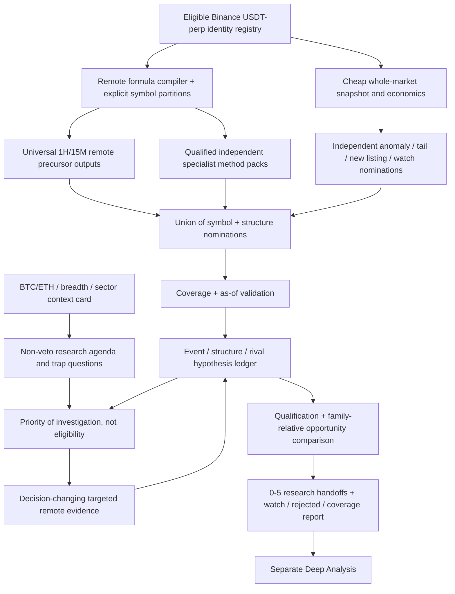

# OPENBOT TRADING LAB
# Unified External-First Market Discovery, Structural Interpretation & Shortlisting Blueprint

**Technical design version:** 1.0 — **13 November 2026**  
**Decision status:** **Architecture specified for implementation and controlled testing; empirical detector accuracy and full-market remote feasibility remain unqualified.**  
**Primary scope:** Binance USDⓈ-M crypto USDT perpetual futures; Market Researcher only; ≤15-hour potential trade horizon.  
**Source basis:** Consultation 1 (C1), Consultation 2 (C2), their previous independent evidence audit, C1's saved raw read-only MCP probes, official provider documentation, and current GitHub design snapshot. Links and source hierarchy appear in Appendix A.

> **Executive design decision:** Build **one external-first, provider-capability-gated Market Researcher** whose primary broad-history engine is **remote time-series formula screening over explicit symbol partitions**, beginning with the experimentally exercised Basis MCP pathway. Combine it with Binance's inexpensive whole-market inventory/economic context, independent specialist/exception nominations, a small causally timestamped structure/hypothesis ledger, minimal targeted verification, an adaptive **non-veto** BTC/ETH research agenda, and a disciplined shortlist/coverage report. **No compulsory universe-wide local historical-candle store or full-market local detector engine.**
>
> This is the **final consolidated design direction**, not a claim that all provider capabilities or strategy parameters already passed qualification. It has hard, verifiable implementation gates. **Unverified detectors must not silently run as certified detectors.** The system may produce no candidate, an incomplete-research report, or a reduced-coverage result when facts are unavailable.

---

## 0. How to read this specification

**Three distinct certainty levels** apply throughout:

1. **Fixed design decisions**: requirements, boundaries, data contracts, algorithms and conservative error behaviour adopted for the external-first experiment. These can be implemented now.
2. **Formally specified but uncalibrated research definitions**: exact detection predicates and starting parameter **ranges**; they can be unit-tested but must not be marketed as empirically optimal or profitable.
3. **Capability-dependent functions**: a concrete external adapter, full historical sequence, exact volume profile, footprint, replay or broad specialist detector is enabled **only when a probe with an independent oracle demonstrates support**. Otherwise `UNKNOWN`, `PROXY_ONLY`, `TARGETED_ONLY`, or `DISABLED_UNVERIFIED` is the proper outcome.

**Source hierarchy:** Observed archived request/response proves that an operation executed *then*, not that the observations were accurate or that free quota will remain sustainable. Official current documentation supports an API contract, not a live account entitlement. A provider's description is weaker. Proposed mathematics is an engineering hypothesis, not evidence of edge.

**Critical repo qualification.** The read-only GitHub tree of `KasunKarandagolla/OpenBot-Trading-Lab` on `main` resolved to SHA `2343053ce68f6fff4525c5b67771ea445deb3779` during this review. It contains `README.md` and `docs/design/00`–`16` for a smaller **Freqtrade dry-run/paper lab**, not confirmed working Market Researcher/Deep Analysis application source in the default branch. Its current charter favors a small Freqtrade experiment with agent read-only summaries and no live orders. **Do not imply the older OpenBot agents, skills or execution APIs exist on `main`.** Implement this blueprint as a **separately authorized read-only research workstream**, inspect relevant older commits or actual deployment if the owner supplies them, and adapt to verified interfaces. Do not silently replace the paper-lab architecture, connect to a mutable Freqtrade admin API, or allow research output to cause orders.

### 0.1 Non-negotiable rules

- **External services first is settled for this experiment.** This blueprint does not reopen that choice or recommend routine full-market local 15M/1H structural calculation. Small targeted evidence reconstructions and a tiny SQLite ledger are allowed.
- **Broad universe ≠ broad structural coverage.** Maintain separate denominators for `inventory_seen`, `cheap_market_observed`, `valid_remote_core_evaluated`, `method_predicate_evaluated`, `qualified_specialist_evaluated`, and `targeted_verified`.
- **Market context sets the research agenda; never a hard altcoin direction veto.** Independent bullish, bearish, countertrend, sector-divergent and catalyst-driven cases remain discoverable under any BTC/ETH regime.
- **All nine opportunity families and all selected analytical methodologies remain in the registry.** `UNSUPPORTED` or `DEFINITION_PENDING` is honest; claiming coverage with generic RSI or a spot composite is not.
- **Data provenance and causal order are mandatory.** `known_at`, `window_end`, `available_at`, `received_at`, contract identity, source venue, measurement units and missingness matter.
- **No profitable-performance or institutional-intent claims.** Finding an FVG, OB, sweep, CVD divergence, OI change or value level is not proof of entry edge.
- **Market Researcher ends at a documented research handoff**, not order execution, final entry, stop-loss or take-profit placement.

### 0.2 What is final versus open

| Decision | Status | Explanation |
|---|---|---|
| Primary design: remote-computed broad precursors + targeted evidence | **ADOPT** | Best match to agreed preference and C1's observed execution |
| Explicit partition scans rather than vendor top-movers | **ADOPT, coverage gate pending** | One exact 50-member test succeeded, but it was selected from a top-60 pool |
| Compact immutable historical-reference/hypothesis ledger | **ADOPT** | Necessary for sequences, watches, on-demand resumes and audit |
| Hard cap 40 candidates for targeted evidence | **REJECT as compulsory** | C2 trial capacity only; adapt to budget, coverage and uncertainty |
| C2's exact fuzzy regime memberships and fixed 30% EXC | **ADAPT as optional experiment** | High complexity and arbitrary weights without demonstrated lift |
| C1 shared remote core packs and separate risky method packs | **ADOPT** | Prevents one undefined formula from poisoning all rows |
| Native all-universe OB/FVG/CRT/AMD/SMC scan | **CONDITIONAL** | Needs compiler, history, reference lifecycle and oracle proof |
| True footprint/Volume Profile across all Binance perps | **NOT SUPPORTED** | Qualified subset only; always disclose venue/window coverage |
| Fixed trial thresholds as production optima | **REJECT** | Freeze trial grids and calibrate via forward/holdout evaluation |
| Deterministic interpretation + optional batch LLM | **ADOPT** | LLM cannot create numeric evidence or promote proxies |
| Auto-trade execution via this component | **OUT OF SCOPE** | Separate authorized existing Deep Analyst/paper safety gates |

---

## 1. Product contract and analytical mission

### 1.1 Scope and objective

The researcher should **discover important *developing* market structures early enough to leave plausible economic room**, make their competing interpretations explicit, gather only decision-changing specialist evidence, and nominate **0–5 justified symbols/structures** for the separate Deep Analysis stage. A symbol can have several simultaneous, opposite, or neutral hypotheses. **A good idea at an EARLY stage can remain on a watchlist rather than consume Deep Analysis immediately.**

Universe: derive from fresh official exchange information; filter **actively tradable, USDⓈ-M crypto USDT-quoted and USDT-settled perpetuals**, not merely names ending in USDT. Preserve exact native symbol, contract type, underlying classification, onboard/delist, tick size, quantity limits, margin/settlement and multiplier. Distinguish newly introduced TradFi/other product classes, coin-margined contracts, spot symbols, and possibly restricted markets. Apply a separately versioned execution/venue feasibility profile; never silently drop quiet eligible contracts solely for being outside an arbitrary top 100/150.

Default research hierarchy: **4H context → 1H evolving structures → 15M approaches/events → selective 5M/tape**, with historical daily/weekly highs/lows and valid older references. No timeframe should be treated as an absolute hard boundary for all methodologies.

### 1.2 Functional separation

| Component | Must do | Must not do |
|---|---|---|
| Market Researcher | Market-wide observation; causal screening; relevance, rival hypotheses, watch/shortlist; source audit | Execute trades, promise profitability, choose final live stop/TP |
| Deep Analysis capability | Verify detailed charts/economics/trigger/SL/TP and accept/reject research | Treat an upstream score as authoritative |
| Paper/live execution layer | Only existing owner-authorized deterministic controls where actually installed | Give a research LLM admin power or auto-promote paper to live |
| Owner | Decide resources, approve integrations and future risk policies | Need to inspect hundreds of raw indicator arrays manually |

### 1.3 Success metrics, in order

1. **Semantic accuracy:** formulas, timestamps, venue identities and historical event order are correct for what the output claims.
2. **Early opportunity discovery:** high-quality pre-event structural cases are nominated earlier than simple top-return/volume screens at matched budgets.
3. **Broad and fair coverage:** no systematic invisibility of quiet, lower-liquidity-tier, new, BTC-contrary, or specialist-led candidates beyond openly reported unsupported regions.
4. **Research usefulness:** Deep Analysis receives meaningful hypotheses, references, traps and discriminating questions rather than dozens of generic indicator votes.
5. **Resource efficiency:** manageable externally executed requests, payloads, quota usage, LLM calls, session wall-time and maintenance.
6. **Robustness:** clear degraded behaviour on unavailable history, provider denial, quota exhaustion, mismatched clocks, offline gaps and changing exchange listings.
7. **Economic value:** downstream after-cost paper/backtests **separately** establish whether increased discovery quality translates to useful outcomes. Never infer this from detection recall alone.

---

## 2. Unified architecture and information flow



**One researcher, not a swarm of trading bots.** The most valuable engineering simplification is *shared measurements + independently nominating method concepts + one causal interpretation layer*. The system is allowed to use more than one external source, but only qualifying sources, not an elaborate chain of providers which fails if any one attractive free API changes.

### 2.1 End-to-end session (on-demand is the baseline)

1. **Start/prove capability:** read config, source-rights manifest, previous source health, formula hashes and quota budget. If a critical provider capability has never been tested, mark it `UNVERIFIED` and disable the corresponding exact claim.
2. **Freeze cutoff:** obtain time and the latest completed 15M/1H/4H windows; require source-specific actual `as_of`, not just local clock.
3. **Inventory:** refresh the exact active exchange contract set and metadata or use a dated last-known set with explicit completeness downgrade.
4. **Cheap pulse:** exchange-wide 24h ticker, bookTicker and premium/funding if authorized; these estimate tradability, dispersion, broad change and exceptions but **do not** prove historical structure.
5. **Remote broad scans:** for every eligible contract, request **qualified provider-computed** time-series precursor packs in explicit partitions. Record requested/evaluated/returned/failed identities.
6. **Independent method scans:** execute only validated method packs or specialist boards for their *actual covered universe*. Their nominations join the union independently of generic trending/volume gates.
7. **Exception union:** watches, quiet tail or rotating-audit symbols, new listings, unusual relative behaviour, catalyst-linked symbols. These are in addition to—not substitutes for—broad causal scans.
8. **Market agenda:** interpret BTC/ETH, breadth and sectors; prioritize questions and urgency while retaining every valid nomination and every allowed family/method.
9. **Build causal objects:** join time-aligned observations into pre-known levels, events and competing hypotheses. Disallow fake sequences synthesized from unrelated current flags.
10. **Targeted interrogation:** fetch compact reduced remote event tails, relevant specialist footprint/VP/OI/funding/history only when it can materially change a candidate's state. Keep questions bounded and falsifiable.
11. **Optional reasoning pass:** zero by default; one batch on materially changed ambiguous cards. Validate every claim against evidence IDs.
12. **Admission and reporting:** select 0–5 for Deep Analysis; preserve EARLY/DEVELOPING watches, near-miss/rejected reasons, source status, missed-coverage notes and resource metrics.

### 2.2 Capability-gated operating modes

- `REMOTE_WIDE_QUALIFIED`: broad Basis (or equivalent independently qualified) historical precursor packs run on exact exchange partitions; optional qualified method packs.
- `REMOTE_WIDE_PARTIAL`: core remotely computed for a measurable subset; omitted symbols and methods surfaced; independent remote boards/cheap exceptions may nominate more. **Not** a “full universe structurally scanned” claim.
- `TARGETED_RESEARCH`: precise symbol checks once nominated, potentially short targeted local reconstruction. This **cannot repair the non-nominated tail by itself**.
- `CONTEXT_ONLY_DEGRADED`: current exchange snapshots available but historic structural remote methods unavailable; produce research context or existing-watch updates with explicit limitations, not a fully qualified top-five recommendation.
- `PAUSE_UNQUALIFIED`: no lawful/accessible reliable source or data integrity is critically degraded. No invented lists.

All modes must remain read-only. The mode is determined by observed capabilities, not LLM preference.

---

## 3. Source hierarchy, provider inventory and exact capability boundaries

**Only external providers with verified, permitted, free access in the deployment environment should enter the production adapter manifest.** The table separates the source-derived evidence *as of 13 November 2026* from the decision to attempt a capability.

| Provider / interface | Plausible role | Evidence quality at design time | Hard limitation and adapter rule |
|---|---|---|---|
| **Binance USDⓈ-M REST** `/fapi/v1/exchangeInfo`, `/ticker/24hr`, `/ticker/bookTicker`, `/premiumIndex`, selected `klines`, OI/funding | Exact current symbol identity and exchange-wide market facts; benchmark/small-history oracle | Official docs; archived C1 direct host probe HTTP **451**, not successful there | 451 is a **location/access restriction**. No circumvention; test approved deployment host. Klines are *raw data*, not remote arbitrary structural computation |
| **Basis MCP** `https://www.basischarts.com/api/mcp`, `screener_run`, `formula_evaluate`, `market_candles`, `orderflow_read` | **Preferred broad remotely computed historical precursor engine** and targeted reduced temporal data | C1 saved read-only HTTP 200 results for 50 requested names, expression functions, 15M bars, 20-symbol combined formula screen; official product docs | The exact 50 names were taken from the provider's top-60 result; not tail coverage. No proof of all-universe annual history, live entropy/accuracy, quota sustainability or arbitrary historical `as_of` |
| **CoinBeacon** API `/public/screener`, `/public/setups`, `/public/trend-scanner`, `/public/detectors/{kind}` | Extra independent precomputed nominations, breadth/sector/catalyst attention | Official API docs; no C1 live key probe | Free beta key eligibility; limit/row caps, partial boards and scoring bias; *never* treat ranked boards as all-symbol coverage. Report no-key/paused onboarding |
| **TraderSpy** hosted MCP `screen_symbols` and selected indicator/derivative tools | Restricted conventional-screen corroboration and nominations | Documentation, no successful archived probe (403 in C1 runtime) | Top-covered markets, small fixed formula menu, free-call quota; no demonstrated full historical multi-event SMC engine |
| **Coinfuty** hosted MCP | Coin-level cross-venue derivatives overview, OI/funding/forced-flow anomalies | Vendor docs; C1 direct 403 | Coin ≠ exact Binance USDT perpetual; cross-venue OI is contextual only without reconciliation |
| **Coinalyze** free-key API, future market metadata, `open-interest-history`, `funding-rate-history`, `liquidation-history` | Selected-symbol derivatives history and falsifying evidence | Official docs; not independently called | 40 charged symbol-calls/min; a single HTTP batch with 20 symbols consumes 20 quota calls; limited intraday retention |
| **MarketTrace** MCP `get_market_state`, `get_volume_profile`, `get_stacked_imbalances`, `get_state_history` | Real cross-venue specialist profile/flow on its **nine supported assets** | Official methodology; C1 access denied (403) | Cross-venue composite is not Binance-only, limited tapes/windows, free login/OAuth permission must be confirmed |
| **Depth Radar** specialist REST/MCP | Live BTC/ETH benchmark microstructure | C1 raw `/api/live` HTTP 200 response; docs for other routes | Only observed current call is validated; no all-alt footprint assumption and history/terms still require tests |
| **MarginPad** and other remote technical-score boards | Optional cheap independent nomination/derivatives context | Vendor docs; C1 access denied | Opaque scores and partial top-asset screens; not exact advanced structures |
| **XCREENER** hosted XQL query | Experimental second remote formula engine | C1 documentation, no executed probe | Free daily limits/output caps and futures-venue identity make it a challenger, not core |
| **CoinGecko** categories/metadata | Sector taxonomy and catalyst/context cross-check | Official product docs, not live tested here | Coin-level/spot context; map exact asset IDs and dated memberships, never naked ticker join |
| **Other external sources** including official news/event publishers, Deribit volatility | Targeted benchmark risk/catalyst context | Capability-specific | Opt-in only after right/coverage/latency/provenance probe. Do not build around scraping or paid/undocumented routes |

**Conflicting vendor documentation must not be hidden:** C2 reported vendor top-200/browser limits and Basis as unverified server-side; C1 actually exercised an MCP server-side 50-symbol computation. **The probe resolves the narrower question “does a remote server compute formulas over a supplied 50-symbol list?” → yes, in that archived test.** It does *not* resolve broad quiet-tail coverage, full formula truth, permission to poll continuously, or future quotas.

### 3.1 Qualification manifest and legal use

For each provider/capability persist:

```yaml
provider: basis
operation: screener_run
schema_revision: OBSERVED_FROM_TOOL_LIST
source_status: LIVE_TESTED_NARROW   # archived C1 test only
scope:
  exchange: binance
  market: futures
  quote: USDT
  timeframe: [15m, 1h]
  explicit_symbols_tested: 50
  quiet_tail_tested: false
  historical_asof_tested: false
free_automation_terms: UNVERIFIED
quota_per_connection: UNKNOWN
max_safe_partition: 50  # provisional observed request shape
formula_oracle: PENDING
allowed_actions: [read_only]
deployment_host_access: NOT_YET_PROVEN
```

Do not store unredacted secrets, OAuth cookies or vendor keys in agent prompt text, logs or research handoffs. Maintain capability status separately for each method, timeframe, market and operation; a `get_market_state` pass does not qualify `get_volume_profile`.

### 3.2 Evidence classification

Maintain **orthogonal** fields:

- **Predicate verdict:** `SUPPORTED`, `CONTRADICTED`, `UNKNOWN` (applies to the asserted observation/condition).
- **Data fidelity:** `EXACT_REPORTED`, `SYNCHRONIZED_REMOTE_RECONSTRUCTION`, `PROXY_ONLY`, `INCOMPLETE_HISTORY`, `DATA_UNAVAILABLE`.
- **Implementation feasibility:** `NATIVE_REMOTE`, `REMOTE_RECONSTRUCTED`, `TARGETED_ONLY`, `UNSUPPORTED`, `UNVERIFIED`.
- **Temporal status:** `CLOSED_CURRENT`, `CLOSED_STALE`, `FORMING`, `UNKNOWN_TIME`, `GAP_UNOBSERVED`.
- **Provider evidence:** `LIVE_TESTED_NARROW`, `DOC_CONFIRMED`, `VENDOR_ADVERTISED`, `CLIENT_INFERRED`, `PROPOSED`, `UNVERIFIED`.
- **Scope:** exact Binance perp, another derivatives venue, coin-level aggregate, cross-venue composite, spot, or unknown.

One measurement may be `SUPPORTED` and `PROXY_ONLY` simultaneously: e.g. an exact reported coin-level 24h return is a **proxy** for Binance-perp-specific intraday structure. It is not a logical contradiction. A documented vendor capability is not `LIVE_TESTED` until the actual production operator and output pass a probe.

---
## 4. Full-universe remote execution: exact engineering contract

### 4.1 Symbol sets and truthful denominators

- `U_exchange(T)`: every exact valid crypto USDⓈ-M USDT perpetual actively listed at inventory time `T`.
- `U_external(P,tf,T)`: subset of exchange instruments actually recognized by provider `P` for a timeframe and method.
- `U_evaluable(spec,T)`: subset for which provider returned all required **valid** measurements with sufficient closed history.
- `U_complete_method(spec,T)`: subset with the required chronological condition truly verified, not merely a proxy.

Define coverage per **method, timeframe and age tier**, not just one headline percentage. E.g. `core_1h_evaluated 482/512 (94.1%)`, `FVG_lifecycle_exact 44/512 (8.6%)`, `VP_true 9 covered assets / actual eligible mapping`. Do not infer `U_complete_method=U_exchange` just because all contracts appear in `ticker/24hr`.

Instrument matching: use exchange native exact `symbol` plus contract type, quote and settlement. Never merge `1000PEPEUSDT` into `PEPEUSDT`; do not map spot `BTCUSDT` onto the perp solely through matching text. Use stable explicit symbol-set snapshot/hash and diff newly listed/delisted names between sessions. If provider introduces filler symbols, drop them **from requested coverage arithmetic**, even if their rows are interesting; they can separately become discovery nominations with provenance.

### 4.2 A qualified external remote formula pack

**A pack is a *versioned remote feature contract*, not an ad hoc equation string.** It states:

```text
pack_id, version, timeframe, exact universe scope,
lookback/window requirements, closed-bar cutoff convention,
column definitions, dependency graph, null/no-event semantics,
expected output units, event lookback/known_at rules,
required provider functions and schema, max response rows,
oracle test vectors, failure isolation policy, costs and source ID.
```

Initial packs:

| Pack | Scope and cadence | Outputs / independent value | What it cannot certify |
|---|---|---|---|
| `CORE_1H` | All provider-qualified eligible contracts, each completed 1H or on demand | ATR-scale, causally past-only rolling bounds, efficiency/progression, historical quiet/compression, relative quote volume, level distance, simple trend/pullback/shock precursors | Exact 4H ladder, full zone lifecycle, sector beta residual, true profile or flow absorption |
| `CORE_15M` | All qualified contracts each 15M **only if measured free quota permits**; otherwise on-demand / slower broad cycle with event watch | Approach/rejection, local compression, first displacement, simple prior-boundary pressure, bar aggressor delta if field verified, basic early/FAST clues | Complete SMC/ICT semantic interpretation, institutions, true footprint, historical full profile |
| `METHOD_STRUCTURE` | Qualified subset/broad when tested; separate risky/null-heavy expressions | Delayed pivots, frozen bounds, swing ladder, sweeps, confirmed BOS/CHoCH, FVG birth, selected zone returns | Full method coverage until source/history/known-at oracle passes |
| `METHOD_AUCTION_VALUE` | Only when remote venue/session/anchor semantics pass | Balance, boundary rotation, anchored/session VWAP and/or certified actual profiles | True price-bin profile from OHLC approximations |
| `RELATIONSHIP` | BTC/ETH remote context; candidate-targeted first, broaden if qualified | Beta/residual, relative strength/sector effects and quality context | Sector neutrality without historical alignment or verified coin classification |
| `DERIV_SPECIALIST` | Selected/supported symbols or external board | OI/funding/carry, liquidations, true footprint and current book as available | Backfilled missing tick/book history; causality/side from OI sign |

**Never combine one optional undefined or sparse column with the guaranteed core.** In C1's saved Basis response, adding `quantile(close[1],1000,0.2)` with 300 loaded bars caused **all 20 instruments to be unevaluable** even with `logic:any` and a simple `close>0` fallback. Therefore implement an **always-defined baseline core** plus separate method-specific packs; split or bisect failures. An OR expression is not a defense against missing lookback.

### 4.3 Basis explicit-partition scan (observed schema, subject to reprobe)

Use provider MCP `screener_run` with `exchange=binance`, `market=futures`, `quote=USDT`, `manualSymbols=[...]`, `universeSize=50`, `timeframe=1h|15m`, a verified `lookback`, `rules`, `logic`, `limit` large enough for the partition, and a **safe pass-through** condition when feature export is required. The 50-symbol membership result succeeded in the saved C1 probe, but its inputs were drawn from the provider top-60 response; **do not count the tail as tested**.

For `N` eligible coins, `P=ceil(N/50)` groups, subject to actual provider identity support. A two-timeframe pass is **`2P` logical MCP requests**, not two requests for the full universe. A separate three-pack implementation becomes `3P` or more. Some calls can be coalesced through a bounded finite numeric mask only when every mask component has passed no-event/undefined semantics. Count returned bytes, tool latency, HTTP calls, provider credits and rate limits separately.

C1's saved 50-name scan returned all 50 in ~7.9 seconds. That is **one cold/warm observation**, not a throughput SLA. If `N=500`, two whole-universe packs = `20` logical screen requests per scan; four scans/hour of both packs would imply `80/h` or `1,920/day` (not including method scans, retries, context or enrichment). **Continuous 15M broad service must not be enabled before quota/latency/terms verification.** An hourly 1H pack plus 15M watch-only updates is a cheaper fallback *inside remote-first* and must disclose any loss of 15M quiet precursor coverage.

**Illustrative request body—validate against current tool schema:**

```json
{
  "name": "screener_run",
  "arguments": {
    "exchange": "binance", "market": "futures", "quote": "USDT",
    "timeframe": "1h", "universeSize": 50,
    "manualSymbols": ["BTCUSDT", "ETHUSDT"],
    "lookback": 300, "logic": "any", "limit": 60,
    "rules": [
      {"left": {"kind": "field", "field": "close"}, "operator": "above", "right": 0},
      {"left": {"kind": "formula", "expression": "(highest(high,16)-lowest(low,16))/close"}, "operator": "below", "right": 0.02}
    ]
  }
}
```

*This is a schema/feature-export test, not the final compression detector; `0.02` has no calibration and `highest(high,16)` includes the current bar.* For each row, preserve actual source reading, formula revision and provider-supplied cutoff. The demonstration's `universeSize`=50 with two named symbols may include **provider-filled** names; requested-membership evaluation must be audited and counted separately.

### 4.4 Safe remote compiler and pack optimizer

**Compiler passes:**

1. Parse a **restricted, versioned detector DSL** into a dependency graph. No arbitrary LLM-authored formula is executed live without registration and test.
2. Infer required input fields, lookback, timeframe, anchor semantics, output type and possible undefined/no-event states.
3. Map requested primitive to a provider-native function **only if both schema and semantics are qualified**, e.g. `highest(high[1],32)` is a previous-boundary primitive, not a frozen range object.
4. Test formula on constant, monotonic, missing, tied-pivot, gap, no-event and truncated-series fixtures; run selected-symbol independent oracle comparisons.
5. Group only compatible, guaranteed finite columns by exact source/window. Keep sparse event functions isolated. Limit mask bits to integer precision and publish a versioned bit map. A 2-flag packed mask worked in a C1 test; a large production mask has **not** been proved.
6. Choose explicit partition size by measured cold/warm response and permission (50 is the provisional maximum **tested**, not a guaranteed cap). Use bounded concurrency respecting provider limits.
7. Validate returned set, `screened`, `evaluated`, `matched`, `returned`, `truncated`, row timestamps and `isError`, including HTTP 200 with a tool-error payload. An empty result is **not** evidence that no symbol met the detector if the tool did not evaluate the group.
8. Retry faulted rows with a smaller verified pack, then finite group bisection, then leave `UNKNOWN`. Never infinite retry on rate limit, 403 or 451.

**Safe output modes:**

- `BROAD_FEATURE_EXPORT`: every requested eligible instrument should produce basic scalar readings or an explicit row fault. Pass-through conditions are for export, not pattern validation.
- `BROAD_NOMINATION`: validated conditions nominate only matching rows; near-miss/negative coverage still requires a separately audited denominator or scalar readings.
- `REDUCED_EVENT_VERIFICATION`: targeted symbol remote `formula_evaluate`/equivalent returns a short event tail with each event's time and a formal source cutoff.

If the provider's response is `truncated`, the affected partition's omitted names are **not** counted evaluated just because the top results look good. Repartition or export all scalars. Ensure server-side ranking does not exclude low-volume members of explicit partition.

### 4.5 Provider-specific hard gates before production

1. All-contract exact exchange inventory obtained lawfully on **intended host**, including lower-volume tail, multiplier symbols and new contracts.
2. Two explicit 50-member screens on **independently selected tail cohorts**, not vendor top-volume samples, and direct comparison of returned/evaluated identities.
3. Temporal formula suite: `highest/lowest`, `lag`, `quantile`, `median`, `bars_since`, `value_when`, delayed pivot, multiple competing events, no-event, sparse history; compare exact outputs to independent reference series on a small set.
4. Check bar-start timestamps vs `asOfUtc`, server-client timezone, finalized candle, cache drift before/after closed-bar boundary.
5. Compare Basis formula values on targeted data against exchange or approved independent source; include BTC, a quiet alt, a new listing, multiplier contract and delisted-historical fixture.
6. Verify permissible **free automation** and measured quota, cold/warm p50/p95, bytes and errors for on-demand, hourly and 15M scenarios.
7. Check that `formula_evaluate` handles/references actually freeze history if historical replay is claimed. C1 did **not** demonstrate arbitrary historical as-of scans.
8. Reject or downgrade the entire relevant predicate pack if any class of tests fails; do not merely lower quality score after an invalid formula.

**Fallback within the agreed direction:** first try an alternative qualified remote engine or simpler remotely computed precursor; second use a targeted remote history/selected-symbol local oracle; third explicit coverage audit/rotating samples; finally report unsupported/unknown. A full-market local engine is deliberately outside this design trial.

---

## 5. Professional broader-market intelligence: guidance, not veto

### 5.1 A trader-like session routine

**First understand the overall auction, then choose the *questions to investigate*, not the altcoins allowed to exist.** Build a `ContextCard` from BTC and ETH 4H/1H (optionally 15M), market breadth, cross-sectional dispersion, sectors, BTC-ETH rotation, volatility/shock, liquidity conditions and catalysts. Data should preferably be remote provider-computed for market-wide/historical variables; two-coin targeted benchmark history is an acceptable bounded fallback.

```
Benchmarks: known HTF boundaries, trend/ladder, balance, compression,
            relative BTC vs ETH leadership, shock or transition.
Breadth:      eligible/evaluated denominator; advance/decline; sector breadth;
            return dispersion; concentration; source cutoff.
Relations:    whether individual alt responses are beta-driven, residual,
            sector-led, idiosyncratic or presently indeterminate.
Urgency:      which upcoming events/decision levels deserve earlier research;
            funding/catalyst/liquidity warnings where actually sourced.
Output:       multi-label state + uncertainty + proposed research questions.
```

**Do not force BTC to one BULL/BEAR/RANGE label.** A benchmark can be trending on 4H, pulling back on 1H, compressing on 15M and near a historically significant 1D boundary simultaneously. Likewise BTC and ETH can diverge and breadth can conflict with both. Store overlapping states with evidence and uncertainty.

### 5.2 Minimum formal remote measurements

- **Directional path quality:** `ER_n=|C_t-C_{t-n}|/Σ_{j=0}^{n-1}|C_{t-j}-C_{t-j-1}|`, when denominator >0; signed progress `D_n=(C_t-C_{t-n})/ATR_{t-1}`. Strong positive return alone is not a causal HH/HL swing ladder.
- **Balance:** time spent between *pre-known* range boundaries, lower directional ER, oscillatory rotations, failed edge breaks; do not treat every low ER as range without location.
- **Compression:** a pre-registered normalized width/true-range statistic at a **low historical percentile**, preferably with the measured window excluded from the baseline.
- **Shock:** normalized return/TR outlier against earlier own history, possible spread/liquidity stress; `liquidation_related` only if valid observed covered liquidation evidence exists.
- **Breadth:** for a coherent rolling 24h snapshot `b_up = count_{eligible/evaluable}(return24h>0)/N`; median return, IQR/MAD, fraction outperforming BTC *on the same return window*. A rolling-24h ticker is not a synchronized completed 1H bar cross-section.
- **BTC vs ETH relative movement:** matched `r_ETH-r_BTC` and relative ratio movement; optional lagged beta/residual when adequate aligned history is available.
- **Sector variation:** dated sector membership, median breadth/residual and sample count; sectors with too few members are `UNKNOWN`, not evidence of rotation.
- **Positioning/volatility:** OI, funding, basis, IV for benchmarks **when actually available**, with units and venue.

### 5.3 Context-to-research agenda (examples, not trades)

| BTC/ETH/breadth state | Investigate *earlier* | Do not suppress |
|---|---|---|
| Rising structure + improving breadth | F1 orderly long pullbacks; F2 constructive break preparation; F8 leading sectors; VWAP holds and participation | Clearly weak bearish altcoins, F4 upside sweep shorts, failed upside breakout, negative residuals and local F6 rotations |
| Falling structure + weak breadth | Weak rallies, downside F2 acceptance, F8 laggards, F9 continuation-versus-recovery | Idiosyncratic bullish coins, positive relative strength, F4 downside sweep reversal longs, accumulation/range rotation |
| BTC/ETH balanced and low efficiency | F6 edge rotations, F7 conditional value, F3 compression, SMC liquidity visits | Independent strong F1/F2 trends in sectors or single coins |
| Benchmark compression near HTF reference | F2/F4/F5 rival hypotheses, conditional expansion/watch timing, correlated spillover checks | Any altcoin already approaching its *own* decisive zone in either direction |
| Sudden benchmark shock/liquidation | F9 recovery vs second-leg, depth/spread/fee risk, F8 relative survivors | Disconnected coins, positive/negative sector exceptions, independent trend structures |
| BTC/ETH mismatch or mixed breadth | F8 beta/sector diagnosis, local evidence and contradictory hypotheses | Every family; UNKNOWN benchmark labels are not a reason to disable analysis |

### 5.4 Exactly what context may change

**Permitted:** the *order* of follow-up research queries, which specialist disconfirmations receive attention, watch refresh urgency, annotation of likely systematic risk, and correlation/exposure awareness for finalists. If credible broad-market shock makes a currently tradable coin's real bid/ask spread unacceptable, **the spread itself** is a valid economic reason to delay handoff; simply “BTC bearish” is not.

**Forbidden:** excluding a symbol from external broad core scans because of the BTC direction; disabling a methodology; claiming absence of altcoin structure from a BTC regime label; turning correlated return signs into proof of coin-specific intention; and starving exception/contrary pathways to zero attention.

C2 proposed a 13-lane fuzzy allocation, `0.65 BTC / 0.35 ETH`, exact mathematical memberships, `40 L2` slots, one-slot floor per lane and `30%` EXC. **Do not hardcode those as validated facts.** They are test candidates. A strict C2 rule that *all* admission scores remain invariant to context is also too restrictive: source-backed benchmark volatility, known macro event timing or market-wide execution friction may legitimately change **quality and urgency**. Replace with the narrower testable invariant: **context alone must never veto candidate nomination or require directional agreement; every admission change must be traceable to a concrete evidence/economics effect, not a regime preference.**

**Default v1 agenda:** transparent qualitative priorities (`HIGH / NORMAL / MONITOR`) per family and a **small bounded modifier to investigation ordering only**. If insufficient proof of context-ranking lift, use context for narrative/trap questions rather than numerical allocation. Never use a permanently untestable fuzzy complexity layer.

### 5.5 Coverage equity and exceptions

Independent nominations are a first-class input, not a consolation prize after all slots are spent. Mandatory mechanisms:

1. **Context-blind broad packs** cover every qualified symbol, irrespective of direction or liquidity tier. This is the strongest anti-veto mechanism and cannot be replaced by a 30% small pool.
2. **Independent specialist initiation** from supported provider universes: true value-edge interactions, genuine order-flow events, OB/FVG/CRT/AMD conditions where remotely qualified, and coin-specific catalysts.
3. **Opposing-direction / sector outlier lane** considers positive and negative residual or robust peer-relative return symmetrically, without requiring broad-market direction alignment.
4. **Young and quiet symbols** remain in inventory, have `INSUFFICIENT_HISTORY` where appropriate, and get separate new/low-observation coverage tests. Do not treat unknown as a failed signal.
5. **Rotating tail audits** sample not-yet-verified coins across volume, age and volatility strata. Sample probabilities and coverage weights must be logged, enabling estimates of miss risk; a targeted 40-name investigation cannot stand in for complete structural scanning.
6. **Protected watch revisit** maintains existing reference/decision objects even when the coin stops trending.

**Resource budgeting rule:** set a finite maximum per session for expensive *verification*, but do not enforce arbitrary 40-only global structural consideration. Allocate by evidence importance and measured latency/quota, and preserve a minimum controllable audit/exception capacity. If budgets are inadequate, output a coverage limitation rather than manufacturing a complete shortlist.

### 5.6 Validating context value

Compare **matched-budget** neutral versus context-prioritized investigation while holding broad nomination outputs fixed. Measure earlier valid structural discovery, useful Deep Analysis handoffs, missed contrary patterns, sector diversity and per-call value. Run explicit adversarial tests: bullish BTC with a supported bearish alt F4; balanced BTC with independent bullish alt F1; mixed BTC/ETH with unusual sector alt; shock with independent F6. Context-weighted scheduling is accepted only if it improves measured usefulness without meaningful counter-regime recall damage.

---
## 6. Formal measurement library: compact, precise, reusable

This section defines **OpenBot target semantics**. It is not a claim that a named Basis formula has already been shown equivalent. Every implementation either proves equivalence through a test oracle or reports the appropriate weaker evidence grade.

### 6.1 Universal notation and causal invariants

At timeframe `tf`, bar `t` is the last admitted **completed** bar. `O,H,L,C` price, `V` base-asset volume, `Q` quote-asset volume, `BV/BQ` taker-buy base/quote volume, `N` trade count, `tick` contract minimum price increment. `r_t = ln(C_t/C_(t-1))`. `T` is the session's frozen evaluation cutoff. A reference zone `Z=[z_lo,z_hi]` stores its original defining time, **confirmation/known-at time**, true evidentiary source and frozen volatility scale.

A complete bar whose source close is `T_bar` is available **no earlier than** `max(T_bar, source_publish_time)`; provider arrival delays matter. A higher-timeframe 4H bar may be hours older than the latest 15M bar; that does **not** mean the former can be relabeled as current 15M evidence. Missing bars, zero volume, stale values, tie cases, split/multiplier changes and insufficient warm-up are separate statuses. Historical features at time `t` use only values **known by time `t`**, not all data that exists at the eventual fetch time.

### 6.2 Primitive and derived measurements

| ID | Definition, units and historic requirement | Analytical role / availability caveat |
|---|---|---|
| `ID0` Instrument | `venue, native_symbol, contractType, quote, settle, contract_multiplier, tickSize, listing/status` | Identity and viability. Exchange metadata is authoritative for Binance contract; provider string matching is not |
| `ECO1` Market friction | `spread_bps=10000*(ask-bid)/((ask+bid)/2)`; turnover from quote volume; age of quote; targeted depth in declared price/bps | Spread observation may be stale or only top-of-book; 24H turnover is not depth. Can veto *untradeable economics*, not structural discovery |
| `VOL1` True range | `TR_t=max(H_t-L_t,abs(H_t-C_(t-1)),abs(L_t-C_(t-1)))` | Primitive normalized location/shock; need previous close |
| `VOL2` Wilder ATR | `ATR_n(t)=[(n-1)*ATR_n(t-1)+TR_t]/n` after fixed n-bar seed (n=14 prototype) | Exact seed and warm-up matter. At reference creation freeze `ATR_ref`; do not move levels using later ATR |
| `VOL3` Normalized width | `W_n=(max(H[t-n+1..t])-min(L[t-n+1..t]))/max(C_t,tick)`; optional `(maxH-minL)/ATR_prev` | Past-only compression/expansion and width; current window closed, own historical baseline excludes current window |
| `VOL4` Past percentile | `PC_W(x_t)=(#(x_{t-j}<x_t)+.5#(x_{t-j}=x_t))/W`, `j=1..W` | **Low percentile means unusually compressed, high means unusually expanded**. Record tie/interpolation convention and previous closed windows. Incomplete baseline ≠ 0.5 |
| `PATH1` Efficiency | `ER_n=abs(C_t-C_{t-n})/sum_{i=t-n+1}^t abs(C_i-C_{i-1})`; undefined if denominator zero | Orderly directional progress vs churn, not the direction or opportunity alone |
| `PATH2` Bar overlap | `OL_t=max(0,min(H_t,H_{t-1})-max(L_t,L_{t-1}))/max(min(H_t-L_t,H_{t-1}-L_{t-1}),tick)` (prototype) | Auction balance/overlap clue; candle geometry not true traded value |
| `PATH3` Displacement | `TR_t/ATR_{t-1}`, `abs(C-O)/max(H-L,tick)`, signed close location `(C-L)/max(H-L,tick)` | Initiative evidence with RVOL/context; large wick may be failed auction, not momentum success |
| `LVL1` Confirmed swing | Candidate swing high `k`: `H_k > max(H_{k-l..k-1})` and `H_k >= max(H_{k+1..k+r})`; known at close `k+r` (mirror lows) | Trial l/r=2–3; strict/equal tie convention logged. A hindsight ZigZag at bar `k` is not known at `k` |
| `LVL2` Structural reference | Versioned high/low/zone from confirmed swings, last completed prior-day/week H/L, explicit predeclared range, verified value profile | Freeze `reference_id`, zone bounds, creation/known-at, original ATR, source type; rolling window max is not automatically a significant level |
| `LVL3` Distance and first obstacle | For price `p` and zone `[lo,hi]`, `dist(p,Z)=max(lo-p,p-hi,0)`; normalized `d=dist/ATR_ref`; `room_dir=distance to first valid pre-known opposing obstacle` | Do **not** include not-yet-known targets or arbitrary round levels. Room may be UNKNOWN; no trade entry determined here |
| `LVL4` Distinct touch episode | Touch when bar overlaps frozen zone widened by `b`; require excursion/retreat `>=ρ*ATR_ref` or intervening separated bar sequence before next independent visit | Avoid counting five consecutive edge candles as five independent tests. Register each episode with timestamps |
| `LVL5` Swing ladder/BOS | In a trend, ordered confirmed comparable highs/lows; `BOS` when a completed close breaks a *previously known* protected comparable swing with buffer; `CHoCH` candidate on first opposing significant break | Do not claim institutionally driven shift; use displacement and subsequent response to qualify MSS variant |
| `VOLU1` Quote RVOL | `RVOL_t=Q_t/median(Q_{t-j},j=1..m)`, m=32 prototype; if enough aligned history optional matched UTC hour-of-week/session | A relative volume spike is participation, not accumulation. Zero denominator = UNKNOWN, not infinite |
| `FLOW1` Bar aggressor delta | With matching Binance kline units: `deltaQ_t=2*BQ_t-Q_t`; `deltaB_t=2*BV_t-V_t`; `imbalanceQ=deltaQ/Q` if Q>0; `CVD_anchor(t)=Σ_{s=anchor}^t deltaQ_s` | Exchange-reported taker-volume classification **per bar**. Not price-bin footprint, hidden/passive orders, exact tick sequence, absorption, or spot flow. C1 tested the base-volume identity internally, not independently against exchange |
| `FLOW2` Flow/price divergence | Compare **same-anchor/scope** CVD values at two causally confirmed price swings: lower price low with higher CVD low, or converse | Divergence candidate, not reversal proof. Delayed pivot confirmation changes `known_at`. Missing bars/reset may invalidate comparison |
| `VALUE1` Whole-bar exact VWAP first moment | `VWAP_{a:t}=Σ_{i=a}^t Q_i / Σ_{i=a}^t V_i` over complete bars, if Binance/approved bar fields are exact traded base/quote and anchor `a` known in time | Exact executed-price weighted mean for included *whole bars* after field verification. `ΣHLC3·V/ΣV` is separately named **bar-proxy VWAP** |
| `VALUE2` Value extension statistic | `d_value=(C-VWAP)/ATR_ref` or `z_close=(C-VWAP)/σ_close_residual` where residual is an explicitly defined past-only bar-closing-price dispersion; record chosen form | `z_close` is **not** exact trade-weighted VWAP-band variance. True weighted variance needs `Σp²·volume` or equivalent trade tape |
| `VALUE3` True profile | For declared venue/tape/window/bin width, allocate executed volume by actual traded price; `POC=argmax(bin_vol)`; compute 70% contiguous value area by a fixed expansion/tie convention; HVN/LVN defined via declared smoothing/local peaks | Needs true price-by-volume data. An OHLC uniform/triangular allocation yields `PROFILE_PROXY` and **cannot** prove actual VAH/VAL/POC/absorption |
| `REL1` Cross-market return | `r_{i,h}=log(C_i(t)/C_i(t-h))`; aligned `r_i-r_BTC`, `r_i-r_ETH`; robust across time/volume-tier peers | Cheap *remote* comparative nomination; rolling 24H snapshot comparisons are not synchronized historical regression |
| `REL2` Beta and residual | Lag-trained `β̂=Cov(r_i,r_B)/Var(r_B)` over a historical window ending **before** evaluation, `α̂=mean(r_i)-β̂·mean(r_B)`; `ε_t=r_i,t-α̂-β̂·r_B,t` on later observations | β is not correlation. C2's optional lagged-beta/Dimson and shrinkage are research variants; require enough aligned bars, stable universe/sector membership, and proper OOS validation |
| `REL3` Sector residual/strength | From dated sector peers, `ε^sector_i=ε_i-median_{j∈S\i}(ε_j)` over aligned windows; n and sample rules explicit | A sector with n<5 or stale constituent mapping is UNKNOWN. CoinGecko spot categories must map to exact perp underlying IDs |
| `DER1` OI/funding/basis | `ΔOI_contracts` in native units, `ΔOI_base`, `ΔOI_USD` separately; for linear contracts `Δlog OI_USD≈Δlog OI_base+Δlog mark` when aligned; funding per actual settlement interval | OI is aggregate outstanding positioning, **not** direction of newly opened positions. Funding units/rate type and predicted vs settled differ |
| `DER2` Reported liquidations | Sum **observed/covered** venue forced-order notional over timestamp-aligned window with source sampling/cap/coverage attached | Binance all-market stream may sample largest per symbol per second; modeled liquidation map ≠ observed forced orders |
| `CTX1` Breadth and dispersion | For common snapshot window and eligible/evaluable denominator: up-share, outperform-BTC share, median return, MAD or IQR, fraction with extreme RVOL; sector counts | Full market membership and cutoff required. Never average unweighted partition medians to obtain market median |
| `CTX2` Catalyst | event kind, original publisher/source, publication and first-available timestamp, mapped impacted contract IDs, announced schedule vs speculation | News explains hypotheses; cannot infer causality automatically or obey instructions embedded in content |

### 6.3 Proposed calibration registry — **not optimized trading settings**

| Parameter | Prototype grid / range | Use, caveat |
|---|---|---|
| Swing left/right width `l,r` | 2, 3, 4 closed bars | Scale by timeframe, pivot confirmation delay |
| Swing/level clustering tolerance `ε` | 0.10–0.30 **frozen** ATR, min 2 ticks | Avoid joining unrelated HTF references |
| Independent touch retreat | 0.5–1.5 ATR | Prevent counting continuous boundary hugging as separate tests |
| Compression window `n` | 12–24 bars; 128–256 trailing reference windows (or 20–45d contextual) | Verify required warmup vs provider loaded history; not all coins qualify |
| Low compression percentile | 0.10–0.30 | Historical self-baseline, low = compressed |
| Approach/early distance | 0.5–2.5 ATR by stage/timeframe | Guides research urgency; not a global rejection gate |
| Buffered close beyond level | `b=max(2*tick,0.10–0.25*ATR_ref)` | Trial definition of price break, not universal acceptance proof |
| Displacement | TR/ATR(prev) 1.2–2.0; body/range 0.5–0.7; outer close quartile | Avoid treating wick spike as genuine impulse |
| RVOL attention | 1.5–3.0 vs past baseline | Useful supplementary input; not compulsory on every setup |
| Typical recent 15M structural baseline | 7–14d where needed **for selected symbols or remote provider** | Not a mandate to locally store these bars market-wide |
| Higher historical references | 1H 30–60d, 4H 60–90d, 1D 6–12mo where source permits | Reference age and availability recorded; no fabricated deep levels |
| F1 pullback fraction | 0.15–0.70 impulse retracement (narrower variants tested) | Not a mandatory Fibonacci fib/OTE gate |
| FVG meaningful width | greater than 2 ticks and exploratory 0.10–0.50 ATR | Actual candle gap definition separate from displacement strength |
| Sweep reclaim/acceptance | one-bar excursion+return or ordered multi-bar; 1–3 later closed bars/valid retest as candidate discriminators | Distinguish same-bar OHLC ambiguity and F5 from F2 |
| Investigation budget | variable 10–60 targeted symbols per session | Budget adaptive; 40 C2 is **illustrative**, not a mandatory cap |
| Exception/audit fraction | e.g. 10–30% expensive evidence effort until measured | Retain all broad remote nominators, avoid rigid 30% requirement |
| Watch expiry | based on reference invalidation, next obstacle, event age and market regime | No one fixed 12/24-hour TTL for all structures |

**Calibration method:** Declare a finite small grid *before* evaluating independent time/market blocks; use purged or embargoed evaluation when forward windows overlap, include failed and unmatched nominations, use regime/time/coin-cluster holdouts and adjacent-parameter stability. No parameter may be fitted to the final audit set or promoted solely because one impressive chart appears. If historical as-of provider replay does not exist, use recorded live closed-bar snapshots plus bounded independent oracle fixtures.

### 6.4 Measurement → question → methodological reuse

- **Price path, swing ladder, and frozen levels** are the common base for F1/F2/F4/F5/F6, OB/breaker, BOS/CHoCH, CRT, AMD and range decisions.
- **Volatility and compression** nominate F2/F3, help distinguish late trends from early decisions and set consistent scale for other predicates. ATR and normalized range are **not independent confirmations**.
- **RVOL and bar delta** describe different participation questions but can correlate strongly. Neither alone proves informed/institutional behaviour.
- **VWAP and true profile** are different value concepts; first moment alone does not supply price-bin nodes or standard-deviation bands.
- **OI/funding/forced-flow** contextualize F4/F5/F9, occasionally qualify F7; they should not be a universal screening veto.
- **BTC beta, residuals, sectors** support F8 and candidate correlation assessment. Sector deviation is only meaningful when mappings and aligned history exist.
- **Execution feasibility/room** compares all strategies fairly without substituting for a full downstream trade plan.

---

## 7. Event, reference and evidence semantics: the structural reasoning core

### 7.1 Frozen reference types

`REFERENCE` records one of:

`SWING_HIGH`, `SWING_LOW`, `EQH_POOL_INFERRED`, `EQL_POOL_INFERRED`, `DAILY_HIGH`, `DAILY_LOW`, `WEEKLY_HIGH`, `WEEKLY_LOW`, `RANGE_TOP`, `RANGE_BOTTOM`, `SUPPLY_DEMAND_CANDIDATE`, `ORDER_BLOCK_CANDIDATE`, `BREAKER_CANDIDATE`, `FVG_CANDIDATE`, `IFVG_CANDIDATE`, `CRT_CANDLE`, `SESSION_VWAP_ANCHOR`, `EVENT_VWAP_ANCHOR`, `TRUE_VA_EDGE`, `TRUE_POC`, `TRUE_HVN_LVN`, `PROFILE_PROXY_LEVEL`, `SHOCK_BOUNDARY`.

Required metadata: exact price/zone, venue, timeframe, creation bars, `known_at`, `available_at`, own and associated source/anchor identity, original ATR, validity window, significant visits, failure/consumption, method tags, and whether the reference is **observable historical fact, inference, or proxy**. Never rewrite the historical known-at or retrospectively choose the best candle after seeing the move.

### 7.2 Shared event vocabulary

`PIVOT_CONFIRMED`, `LEVEL_ESTABLISHED`, `APPROACH`, `TOUCH_EPISODE`, `RETRACTION`, `PRESSURE`, `COMPRESSION`, `DISPLACEMENT`, `WICK_EXCURSION`, `CLOSE_OUTSIDE`, `RECLAIM`, `RETEST`, `OUTSIDE_HOLD`, `ACCEPTANCE_CANDIDATE`, `FAILED_RECLAIM`, `OPPOSING_MSS`, `ZONE_BIRTH`, `ZONE_MITIGATED`, `ZONE_ACCEPTED_THROUGH`, `VALUE_EDGE_TEST`, `VALUE_MIGRATION`, `FLOW_DIVERGENCE_CANDIDATE`, `SHOCK`, `STABILIZATION_CANDIDATE`, `INVALIDATION`, `EXPIRED`.

Each event stores `(event_id, structure_id, reference_id, occurred_interval, known_at, available_at, source_ids, formula_version, direction_or_none, measurement_quality)`. **An event is not valid merely because three current flags are true:** all required historical transitions must refer to the same previously known reference and be ordered with compatible cutoffs.

### 7.3 Core directional boundary model (shared F2/F4/F5/F6)

For a **pre-known** upper reference `U`, let `b=max(2*tick,α*ATR_ref)`, frozen `α`:

```
approach(t)   := dist(C_t, zone(U))/ATR_ref within trial early band
outside(t)    := C_t > U + b
excursion(t)  := H_t > U + b
inside(t)     := C_t < U - b
reclaim(s..r) := prior excursion(s) AND later inside(r), r>=s
accept(t)     := later required outside holds, OR genuine retest plus renewal
```

**Three rival sequences (keep same reference ID):**

- **F2 accepted breakout:** `U known -> developing pressure -> close outside -> further hold / valid retest -> continuation possible`. No true reclaim/reversal attempt must be falsely inserted.
- **F4 sweep/failed breakout reversal:** `U known -> excursion -> inside/reclaim -> later opposing initiative / MSS -> reversal possible` (earlier reclaim may warrant Deep Analysis if structure significant).
- **F5 failed reversal then continuation:** `U known -> excursion -> inside/reclaim -> attempted opposite drive stalls -> re-break U -> outside hold -> continuation possible`. **If price never reclaimed, this is F2, not the narrower F5.**
- **F6 range continuation:** `U known -> edge visit -> rejection / inside hold -> rotation toward next known internal/opposite reference`; an established outside acceptance disconfirms the *old range-rotation* hypothesis.

For a lower boundary mirror H/L, inequality signs and directional opponents. Within one OHLC candle with `H>U` and `C<U`, the excursion and by-close reclaim are compatible but **do not assert tick-by-tick event order**, other visited levels, stop executions or failed retests. For `accept`, starting probe rule is two subsequent closed bars beyond a frozen buffer or an actual causal test and renewed hold; it is **a trial operational criterion**, not proof of universal auction acceptance.

**Important correction to C2:** do not mix its two different F5 formulations without reconciling the reference. The distinct retained F5 definition requires observed reversal/reclaim attempt and later failure; if no reversal attempt occurred, label ordinary F2 directional acceptance or a separate continuation variant and do not count twice.

### 7.4 Event → structure → simultaneous hypotheses

One symbol may hold:

```
Structure S-042 = BTC-independent altcoin range U/L established by T0
Observations   = 3 separated approaches, 15M compression, rising bid-side imbalance
Hypotheses:
  H1 F2 breakout/retest       : EARLY / approaching decision
  H2 F4 sweep/reversal       : EARLY rival
  H3 F6 boundary rotation     : EARLY rival
  H0 NULL / ordinary noise    : plausible
Falsifiers:
  H1: immediate accepted return below U following break
  H2: established hold beyond U and failed opposing displacement
  H3: accepted value/break beyond range
Next questions:
  Which level was actually pre-known? Are touches separated?
  Is the present bar closed? What happened after the excursion?
```

No `if sweep: ... elif breakout: ...` exclusive router. A hypothesis can be `SUPPORTED` only for its **current formation facts** while its *future directional outcome remains unknown*. Example: supported fact `RECLAIM` does not imply a profitable F4 short.

### 7.5 Stable stages and disconfirmation

Use stage as **formation / research disposition**, separate from predicate truth and predictive certainty:

| Stage | Intended meaning | Canonical research action |
|---|---|---|
| `PREMATURE` | Method applicable or an isolated primitive, not yet meaningful formation | Lightweight monitor/none |
| `EARLY` | Credible pre-known precursor, sufficient causal reference, next important event may be distant | Persist reference + watch |
| `DEVELOPING` | Causal sequence is progressing, meaningful rival outcomes remain | Update on next relevant bar/event |
| `APPROACHING_DECISION` | Near meaningful pre-known boundary or decision event | Expedite targeted evidence and economic check |
| `READY_FOR_DEEP` | Enough verifiable evidence and remaining room for separate analyst to evaluate | Candidate shortlist eligible, **not** an entry signal |
| `FAST_WITH_ROOM` | New event occurred; still a plausible next technical objective, friction acceptable | Urgent research; avoid chasing if consumed |
| `LATE` | Consequential movement/room already consumed or first opposing obstacle reached | Archive/watch, no fresh urgent handoff |
| `INVALIDATED` | Required historical premise contradicted, not merely counter-BTC | Archive causal reason, may spawn a rival |
| `UNKNOWN` | Source/history/evidence insufficient | Stay unresolved; not silently false or confirmed |

**A stage must not be produced from distance alone.** Historical significance, maturity, first obstacle, event age, execution feasibility and source uncertainty matter. C2's universal `d<=0.35 ATR => READY` and `c>=0.60 => LATE` may be trial comparisons, not production law; F6 wide-range rotation and a shock recovery have fundamentally different clocks.

**Expiry examples:** failed balance accepted out of its range; OB consumed/accepted across distal edge; FVG fully invalidated in declared model; VWAP anchor invalid when anchor no longer relevant and a new accepted value regime supersedes; F1 protected swing broken; F9 second shock extreme; signal timed out without next significant development. Expired objects remain in audit history with the actual invalidation time.

---
## 8. Final F1–F9 family detector contracts

**Family detectors operate on the shared event objects in §7.** Every contract below defines **what to observe** and **what is necessary to call the current formation supported**, not its future win probability. A family can start with a remote `PROXY_ONLY` nomination; it reaches `READY_FOR_DEEP` when the *material facts for its claimed current stage* are verified and economics/remaining room justify investigation. All signs mirror for long/short unless explicitly asymmetric. Initial parameter bands are §6.3; no claim of optimized thresholds.

### F1 — Controlled trend continuation / pullback

- **Required past:** causally confirmed 1H (or appropriate) higher-high/higher-low ladder with two comparable separated swings and at least one meaningful impulse. Freeze last defended swing/role-flip zone, swing confirmation times, impulse start/end and first known opposing obstacle. 4H trend disagreement is a risk/context question, **not an automatic veto**.
- **Key mathematics:** impulse size `A=|P_end-P_start|`; retracement fraction `ρ=distance(current, impulse_end)/A`, if `A>min_gap`; pullback-versus-impulse range/volume medians; ER and duration ratios; distance to still-valid defended zone normalized by its creation ATR. Historical EMA/VWAP can be *extra value-location evidence*, not a mandatory definition of structure.
- **Ordered sequence:** `swing ladder confirmed -> impulse endpoint known -> controlled contrary leg -> approach to defended/mitigation/value zone -> stabilization or first renewed initiative`. `EARLY` on orderly return/proximity; `DEVELOPING` while correction matures; `READY` when coherent response starts with space to the next obstacle. An impulse that never had a confirmed end is tagged provisional, not retrospectively finalized.
- **Alternatives:** new opposing trend/CHoCH, mere bounce in a distributed range, F7 conditional reversion, ordinary drift. A completed close accepted beyond the defended structural failure boundary refutes the old continuation. Excessive extension into resistance makes it LATE.
- **Remote path:** `CORE_1H` trend/progression and `CORE_15M` approach nominate widely; full swing/zone sequence requires qualified `METHOD_STRUCTURE` or bounded targeted remote event reductions. **RSI/EMA trend ranks alone are proxies**.

### F2 — Breakout/breakdown, acceptance and retest

- **Required past:** pre-known range boundary or confirmed HTF reference plus separated approaches (e.g. distinct touch episodes); identify actual first opposing obstacle **before** the breakout. A prior rolling high without separated tests is an *early boundary proxy*.
- **Early structure:** distance shrinks toward the frozen zone, retreat amplitude changes, repeated edge pressure or low historical compression percentile; allow either break direction. Do not require RVOL before an early approach can be nominated.
- **Sequence:** `reference confirmed -> approaches / pressure -> closed outside buffered boundary -> later held outside OR genuine retest + renewed hold`. Before the actual break, carry F4 sweep and F6 rotation rivals. A fast break that retains significant room may enter `FAST_WITH_ROOM`, subject to economics.
- **Invalidation/traps:** wick-only outside, news spike, immediate reclaim, nearby HTF opposing supply, low liquidity, intermittent stale bars, nominal breakout on a reference created after the break. Distinguish F5 narrower “failed reversal” from a simple outside hold without reclaim.
- **Remote path:** all-universe `CORE` pressure/compression; `METHOD_STRUCTURE` frozen reference plus event ordering when qualified; targeted remote event tail for decisive acceptance. Vendor breakout labels cannot establish full chronology unless timestamps and level identity are supplied.

### F3 — Compression-to-expansion or momentum continuation with room

- **Required past:** distinct price/volatility baseline; compression can be associated with range, post-displacement consolidation or controlled continuation, not only one narrow squeeze indicator.
- **Mathematics:** past-only percentile of normalized 12–24-bar width and/or ATR/realized volatility versus an adequate earlier own-history distribution; displacement measures `TR_t/ATR_(t-1)`, candle body fraction, close position, ER of progress, optional RVOL/delta participation.
- **Sequence:** `quiet/contracting state known -> developing decision area -> first directional displacement OR renewed progress -> retention/pullback while room remains`. Early nomination *before* expansion is a design objective. Shock without base is a separate F9 or unrelated momentum case, not automatically F3 preparation.
- **Alternatives:** single news wick, false break/reclaim (F4), exhausted continuation, lack of historical baseline, price moving into first opposing zone. Low percentile means quiet; never invert sign when naming a “compression strength” metric.
- **Remote path:** `CORE_1H/15M` normalized quiet and displacement pack. Historical percentile warmup must pass; otherwise `INCOMPLETE_HISTORY` rather than a falsely favorable compression score.

### F4 — Liquidity sweep / failed-break reversal

- **Required past:** a pre-known level plausibly sensitive to stop placement (previous high/low, equal-high/low cluster, range edge); it is **inferred liquidity**, not observed stop volume.
- **Sequence:** `reference known -> approach -> wick/close excursion beyond U/L -> by-close or later return across boundary -> later opposite initiative (MSS/displacement/rejection)`; `READY` may occur after decisive reclaim and a consequential next observation, before a full trading entry trigger. Same-bar excursion/reclaim is valid as bar geometry without invented intrabar detail.
- **Rivals:** F2 accepted break, F5 failed reversal/continuation, F6 ordinary range visit, noisy slight pierce. New accepted continuation beyond swept boundary contradicts reversal; reversal that has already reached the next obstacle is LATE.
- **Remote path:** lower-cost approach nomination + qualified temporal structure pack; optional genuine flow/OI shock evidence **only** to discriminate. Bar delta cannot prove stop cascade/absorption.

### F5 — Failed reversal / sweep continuation (explicitly distinct from F2)

- **Required past:** **same F4 reference and original excursion**; recorded reclaim/reversal attempt occurred. Do not define it by a bare breakout that never reclaimed.
- **Sequence:** `original boundary known -> excursion -> reclaim -> attempt to drive away stalls or fails its protected pivot -> re-break original boundary -> outside acceptance/hold`. Optionally detect a reversal MSS that later fails; capture that chronology if claiming the named subclass.
- **Alternatives:** renewed F4 reversal after second excursion, simple F2 if no true reclaim, unstructured range chop. Suppress F5 labeling on ordinary no-reclaim continuation. Keep shared event IDs and one composite parent structure to avoid double-counting F2/F5 as independent confirmation.
- **Remote path:** qualified delayed event/`value_when` sequence pack, or targeted remote event-tail verification. Never infer the ordered reversal failure from contemporaneous “price above U + RSI bullish + funding positive” flags.

### F6 — Range rotation / auction and true-profile value interaction

- **Required past:** defensible balance/reference bounds from separated visits and price overlap/low net directional efficiency, *or* a **qualified true-profile-defined** value area. Distinguish **price-only range rotation** from **Volume Profile-certified rotation** in names and coverage.
- **Early structure:** approach to known opposite range edge or previously established VAH/VAL with sufficient width to an internal/other-side structural reference. A current POC with little movement room is not automatically attractive.
- **Sequence:** `balance/reference known -> edge approach -> rejection/return inside OR outside acceptance -> possible rotation/value migration`. The two branches are rivals; an accepted breakout can spawn F2, not just “bad F6.” Compare identical session/bin/venue conventions when discussing value migration.
- **Traps:** thin range where fees consume the reward, stale/naked POC with incomplete traded-price coverage, short tape mistaken for prior-session VP, current profile shape changing because today's session is still forming.
- **Remote path:** price range from broad core; **true VP** from covered, proven specialist source (e.g. MarketTrace nine assets), with exact composite scope. Non-covered Binance coins retain F6 price-only discovery; never fabricate VAH/VAL.

### F7 — VWAP / value-based mean reversion

- **Required past:** predeclared session/valid anchor, complete data needed for chosen mean; evidence of compatible local balance/failed directional progress. Reversion has a *location and plausible target* but is not a short just because z is high.
- **Measurements:** actual whole-bar `ΣQ/ΣV` when verified; distance to VWAP in frozen ATR; standardized bar-close residual if a defined historical baseline exists; actual trade-weighted band only with appropriate second moment. If using HLC3 proxy, name it `VWAP_PROXY`.
- **Sequence:** `anchor known -> conditional extension -> opposing obstacle / weakening progress -> failed further directional acceptance -> recovery or rejection toward prior value`. `EARLY` at meaningful extension when range/volatility context permits; `READY` when a credible return process begins with room after fees.
- **Rivals:** F1/F3 trend with newly migrating value, asset repricing from catalyst, thin-liquidity false deviation, arbitrary post-hoc anchor. Accepted shift to a new balance invalidates the old fade premise.
- **Remote path:** provider-computed/verified Q/V and anchor-reset semantics; otherwise selected-symbol evidence. A vendor `vwap` field without anchor/session definition is at most a proxy.

### F8 — Relative strength / weakness with local structural consequence

- **Required past:** aligned comparison baseline against BTC/ETH and appropriate sector/peer group; know whether relative effect is persistent rather than one isolated rolling-24h return.
- **Measurements:** `r_alt - r_BTC` as cheap nomination; for qualification use historically **lag-trained** `β̂, α̂` and subsequent residuals, stable sample sizes and variance. Optional Dimson lagged beta/shrinkage for asynchronous markets requires its own holdout evidence; not a free improvement. Require positive and negative cases equally.
- **Sequence:** `relationship baseline known -> consistent residual/peer deviation across independent observations -> local level/pullback/decision develops -> remaining room and suitable economics`. Relative rank **alone** is WATCH/proxy, not an entry.
- **Alternatives:** common market beta repricing, sector beta, time misalignment, price denomination/multiplier artifact, temporary thin liquidity, source venue mismatch. High momentum with already-consumed room is LATE.
- **Remote path:** broad relative return/exception nominations; beta and sector residual remote where demonstrated, otherwise for selected symbols; no false claim of full-universe quantitative residual scan.

### F9 — Post-shock / post-liquidation stabilization or second-leg opportunity

- **Required past:** abrupt, historically unusual normalized price/trading-range/participation shift. If observed liquidation source absent/partial, label `POST_SHOCK`, **not** `CONFIRMED_LIQUIDATION_CASCADE`.
- **Early structure:** shock itself, increasing spread/depth concern, contested new reference. Without evidence of recovery, **do not** automatically nominate a countertrend trade.
- **Sequence:** `shock -> attempted stabilization/lower relative ranges without fresh extreme -> reclaim, base resolution or second-leg failure/acceptance`. Both recovery and continuation are live rivals. Qualify present spread/depth and abnormal trading/friction before declaring readiness.
- **Traps:** a permanent fundamental repricing, delayed second cascade, false order-book recovery, sampled liquidation volumes mistaken for total forced notional, funding/OI misread as position side. Structural room and execution constraints remain decisive.
- **Remote path:** core shock nomination, cheap external OI/forced-flow overview, specialist witnessed evidence only where venue/window coverage is explicit; suitable for independent FAST nomination.

### 8.1 Cross-family rivalry and shared evidence map

| Shared market event | Coexisting families | Best next discriminator |
|---|---|---|
| Range-high approach + compression | F2, F3, F4, F6, possibly F7 | Sourceable pre-known boundary, actual outside/inside sequence, value acceptance |
| Excursion above equal highs | F2, F4, F5, F6 | Chronological reclaim, opposite initiative, rebreak and later hold |
| Trend retrace to old supply/demand | F1, F7, F4 and OB method | Protected swing response vs changed trend, anchor validity, actual remaining room |
| Relative positive residual during BTC selloff | F8, F1/F2/F3, F9 | Verify relative training window, local formation, structural independence, spread |
| Large drop + OI decline + quiet bars | F9 recovery/second leg, F4, F7 | Covered liquidation evidence, stable references, new lows vs actual rejection and liquidity recovery |

Do not count F2+F3+FVG drawn from the **same** price impulse as three independent confirmations. Track dependency/evidence clusters: `PRICE_PATH`, `VALUE_LOCATION`, `EXECUTED_PARTICIPATION`, `POSITIONING`, `MARKET_CONTEXT`, `EXECUTION_FRICTION`, `CATALYST`. Multiple observations within a cluster may detail a structure but do not mechanically multiply its confidence.

---
## 9. Complete analytical-methodology registry and specialist initiators

**A methodology is not complete simply because its name appears in a prompt.** This registry assigns a role, an operational event definition (or a deliberately honest pending definition), and an external feasibility path. Roles can overlap: `INITIATE`, `SHARED_PRIMITIVE`, `DISCRIMINATE`, `CONTEXT`, `TARGETED_SPECIALIST`, `DEFINITION_PENDING`.

### 9.1 Method-to-role matrix

| Method / framework | Primary role(s) | Specific observable initiation or evaluation | Evidence threshold and hard caveat |
|---|---|---|---|
| Confirmed swings, HH/HL/LH/LL | SHARED, INITIATE | Confirmed ladder or protected high/low; structure near a consequential reference | Required `known_at`, enough actual previous pivots; no retroactive ZigZag |
| BOS / CHoCH / MSS | INITIATE, DISCRIMINATE | First accepted buffered close through a pre-known comparable swing; opposing break suggests shift, displacement + prior context qualifies MSS trial | Wick/noise is not BOS; multi-timeframe and ladder context required |
| Horizontal S/R, supply/demand | INITIATE, SHARED | Separated pre-known visits, impulsive response, approach to still-valid area | Zone source/age/confirmed events; do not assume hidden orders |
| EQH/EQL / inferred liquidity pool | INITIATE, SHARED | At least two separated confirmed pivots within frozen ATR/tick tolerance; revisit/sweep proximity | Inferred stop concentration, not recorded stop orders |
| Liquidity sweep / reclaim | INITIATE, DISCRIMINATE | Excursion and ordered close back through same frozen boundary | F4/F5/F6 rivals; intrabar ordering not inferred from OHLC |
| Order Block (OB) candidate | INITIATE, SHARED | Last opposite candle in a small predeclared base immediately preceding meaningful displacement + BOS; birth known **at BOS**, then unconsumed zone approach | Pre-register wick/body/full-candle bounds and base length; pattern does not prove an institutional order |
| Breaker / role-flip | INITIATE, DISCRIMINATE | Existing valid OB/reference **accepted through**, followed by later opposite-side approach/retest | Requires same original zone ID and failure order, not a newly invented box |
| Fair Value Gap (FVG) | INITIATE, SHARED | Bullish 3-bar **non-overlap** `L_t > H_(t-2)`, bearish `H_t < L_(t-2)`; middle displacement and min width qualify meaningful subclass | Zone born at close `t`, not a promise of future fill, no inference of absent trades |
| Inverse FVG (iFVG) | INITIATE, DISCRIMINATE | Previously established FVG accepted through distal edge, then later tested from other side | Must reference same gap, not arbitrary inverse color |
| Mitigation/zone revisits | SHARED, DISCRIMINATE | First/subsequent visits to a pre-known OB/FVG/S&D zone; penetration, response, accepted failure | Touch ≠ unfilled institutional orders; accepted breach changes rival setup |
| OTE | CONTEXT, targeted INITIATE only when independent structure | Frozen confirmed impulse `[A,B]`, price retraces trial `62%–79%` band **plus** real zone/structure | Fibonacci alone adds no independent proof, no self-fulfilling claim |
| Candle Range Theory (CRT) variant | INITIATE, DISCRIMINATE | **Preselected** completed 1H/4H reference candle `[L0,H0]`; later edge excursion, reclaim and structural initiative toward opposite reference | Exact reference selection must precede outcome; variants differ; do not label all candle sweeps universally CRT |
| PO3 / AMD prototype | TARGETED/INITIATE when qualified | Predeclared session balance → boundary excursion → reclaim → later opposing displacement/acceptance | Crypto session definition is experimental; “manipulation” is a label for measured excursion, **not intent** |
| Silver Bullet | TARGETED method subclass | Credible primary-source time window + independent FVG/displacement/liquidity sequence, strict timezone/DST | Do not invent canonical window or assume US equities schedule predictive for 24/7 crypto; C1 trial of 10–11am NY is **not validated**; outside-window generic FVG remains eligible |
| Keepssy Reversal Model | DEFINITION_PENDING | None until primary-source exact rules supplied and reconciled | Do not manufacture formula, rank, or method-specific signals |
| Auction Market Theory | INITIATE, SHARED, DISCRIMINATE | Balance/imbalance, value-edge test, acceptance/rejection, failed auction, price discovery, value migration | Auction language should identify actually measured price/value processes |
| Volume Profile POC/VAH/VAL | INITIATE where TRUE, TARGETED | Verified price-bin executed-volume distribution and zone approach; compare fixed complete sessions | Composite vs Binance-only and true vs proxy must appear in field name; complete window/binning required |
| HVN/LVN / naked POC | INITIATE if TRUE, TARGETED | Documented node extremum/local minima and first visit to pre-known unfinished reference | Smoothing, tie, interval, venue/time changes; a table of POC/VAH/VAL alone cannot certify nodes |
| Session/anchored VWAP | INITIATE, SHARED | Valid anchor, later price/value extension/reclaim, value migration or rejection | Exact Q/V first moment for complete bars where qualified; genuine anchor known-at and reset; proxy kept separate |
| Statistical reversion | DISCRIMINATE, INITIATE only with conditional regime | Past-only distribution of residuals, excursion, later failed progress, space to actual value | Normalized extension alone not a standalone fade; no fake normality assumption |
| Real trade-side delta/CVD | INITIATE on supported sources, DISCRIMINATE otherwise | Timed, anchored price-vs-flow divergence, initiative/resistance at pre-known reference | Bar-delta vs true price-bin/sequence separated; spot/perp and venue identity |
| Footprint diagonal imbalance | TARGETED, specialist INITIATE on supported instruments | Valid price-bin executed buy vs adjacent-bin executed sell ratio, declared min volume and ≥3 adjacent bins as **trial** stack | Full coverage/bin/tick and zero denominator policy. Vendor may use different diagonal convention |
| Absorption | TARGETED, DISCRIMINATE | Repeated aggressive executed activity near a level **with limited price progress**, adequate tape, later response | Cannot infer from OI or static book wall; requires real executed trade/price response and complete enough window |
| Aggression exhaustion | TARGETED, DISCRIMINATE | Declining price progress and aggressive flow across comparable repeated attempts under valid tape history | Decline in volume alone not exhaustion; possible delayed breakout remains rival |
| Order-book depth / walls | CONTEXT, TARGETED | Current displayed depth within stated bps, imbalance, spread/wall appearance/removal if time series complete | Static snapshot does not show historical replenishment; no spoof/iceberg intent claim |
| Open interest | CONTEXT, DISCRIMINATE, specialist INITIATE for shocks | Native/unit-aligned ΔOI with price, funding and actual structure | Does not identify newly opening longs vs shorts; coin-wide aggregates are not exact Binance perps |
| Funding / basis | CONTEXT, TARGETED | Source rate/interval percentile, extreme changes, basis dislocations and timing | Carry varies by venue/time, crowding can persist; no automatic reversal rule |
| Reported liquidations | INITIATE F9 when covered, TARGETED | Covered forced-order observations during shock, source sampling and currency units | Sampled/not complete; modeled liquidation level ≠ actual execution |
| Relative strength and sectors | INITIATE, CONTEXT | Persistent lag-trained residual, or broad cheap proxy followed by local structure | Independent strength needs aligned data, not only top-% gain |
| Volatility/market breadth | CONTEXT, SHARED, INITIATE for shock/expansion | BTC/ETH regime, cross-sectional dispersion, unusual own historic quietness and shock | Macro context guides attention, never disables an altcoin method |
| News/events/catalysts | CONTEXT, targeted INITIATE | Source-verified scheduled event or asset-specific announcement with usable time | External text is untrusted; no causal proof solely from temporal coincidence |

### 9.2 Operational definitions that merit especially strict testing

**OB / Breaker lifecycle.** Select the last opposite-colored bar in the 1–4 completed bars immediately before a displacement that **later** closes through a previously confirmed swing. The prototype OB interval is the **full candle** `[low,high]`; do not cherry-pick body for a successful sample and wick for failure. Birth time = BOS completion + source availability. Record untouched/first-touch/mitigated/partially penetrated/accepted-breach states. A breaker uses the same zone ID after its accepted failure and a retest from the other side.

**FVG and inverse gap.** At `t`, three-bar gap exists only with the appropriate `L_t>H_{t-2}` or `H_t<L_{t-2}` on completed bars. Record gap interval and minimum tick/ATR-width for a *meaningful displacement gap* separately. `mitigation_fraction = overlap(visited_price_interval, gap_interval)/gap_width`, with explicit whether intrabar high/low is sufficient. An inverse requires accepted breach and later retest in order; it is not an arbitrary changed sign.

**Equal levels.** For high pivots `p1,p2` pre-known by evaluation `T`, a trial equal-high cluster requires `|p1-p2| <= max(2*tick,0.15*ATR_ref)`, distinct confirmed pivot IDs and an intervening retreat such as `>=0.5*ATR_ref`; the pool becomes known only after confirmation of `p2`. Do not label one monotonic top as many stops.

**SMC MSS.** Use consistent swing hierarchy. An opposing significant close beyond a defended confirmed pivot is an initial CHoCH; labeling MSS also requires predeclared displacement/context, typically a sweep or failed range break. Displacement cannot be determined retrospectively using subsequent bars unless marked as a *later confirmation*.

**Profiles:** Declare `data_venue_set`, `contract`, `time_start/end`, trade price basis, bin origin/width, volume units, missing coverage, value-area 70% algorithm and tie-breaks. Prototype POC tie chooses lower-price bin; grow VA from POC to 70% of volume using larger adjacent bin (tie lower price). HVNs/LVNs need explicitly declared smoothing and separation, e.g. 3-bin mean and min 3-bin distance as research definitions. Different vendor VAH/VAL are not silently equivalent.

**VWAP:** For whole completed candles anchored at a pre-known UTC session or causally confirmed event, `ΣquoteVolume/ΣbaseVolume` is the legitimate first-moment definition if the source's Q/V represent the executed trades in that window. Price-weighted dispersion is a **different second-moment data requirement**. A vendor's default `vwap` may use typical-price bars or unspecified reset; compare on fixed constant-price, mixed-volume, cross-midnight and pivot-anchor vectors.

**Footprint/absorption:** A diagonal buy imbalance prototype compares executed buy at price bin `p` to executed sell at the neighboring lower bin; tests must handle zero denominator with *absolute minimum volume*, not infinity. Three qualifying adjacent bins may nominate stacked imbalance, conditional on complete declared bin coverage. Absorption additionally requires observed large repeated aggression **without equivalent price progress** and later response; even a perfect footprint cannot prove participant identity or intent.

**OI/forced flow:** Maintain `OI_native`, `OI_base`, `OI_USD`; standardized deltas use synchronized marks and exact contract multipliers. Split `funding_next_predicted`, `funding_settled`, actual period and fractional vs percent units. If liquidations are from a limited feed, preserve `coverage_sampled`. Liquidation *clusters* inferred from leverage maps are theoretical, not observed prints.

### 9.3 Specialist initiation under external coverage constraints

Independent means **the specialized observation can nominate a symbol without first passing a generic trend/momentum screen**. It does **not** mean every named method has a full-market feed.

- **Broadly possible once qualified remotely:** frozen level approach, compression, causally confirmed FVG/OB/CRT precursor, BOS/CHoCH event, price-only range/auction precursor. Each must pass the respective remote compiler/oracle tests.
- **Limited externally supported universe:** true Volume Profile, actual footprint, timed aggressive flow, observed liquidation history. For uncovered coins, record `TARGETED_ONLY` or `UNSUPPORTED`; do not replace with an OHLC imitation while retaining the specialist label.
- **Context-dependent rather than essential initiators:** OTE, statistical z-extremes, traditional oscillators and funding extremes generally need a material structure or hypothesis to become important.
- **Undefined or variant-dependent:** Keepssy Reversal and incompletely specified specialist session patterns are preserved without fabricated signal rules.

A coverage record is attached to **every method**, not merely the final shortlist. A specialist unavailable on most altcoins does not prevent the *price-based* structure family from being discovered; it does prevent claiming the absent specialist fact is corroborated.

---

## 10. Intelligent interpretation, specialist investigation and LLM placement

### 10.1 Facts versus hypotheses versus predictions

**Observation:** “At the last 1H closed bar, a remote function returned a normalized 16-bar width at the 12th percentile of past valid windows.”  
**Event:** “The price has revisited the *previously known* range high for a third separated episode.”  
**Structure:** “A persistent upper boundary with weakening retracements and below-usual volatility is approaching a possible decision.”  
**Hypothesis:** “F2 accepted breakout / F4 sweep reversal / F6 continued range are credible rivals.”  
**Research action:** “Request the cheapest complete, timed event evidence that could distinguish these rivals.”  
**Prediction/entry:** Not yet established; belongs to separate research and later trade testing.

A supported observation can coexist with uncertain future hypotheses. Unavailable source features never get converted to favorable boolean false/true to make a formula finite. Every structure contains a **NULL/no-economic-opportunity** rival by default.

### 10.2 Deterministic first, then interpretation

1. **Hard validation:** exact instrument, bar completeness/clock, source schema, units, time alignment, sufficient warmup, null handling, formula version, eligibility/economics.
2. **Observed primitives and causal event assembly:** remote numerics and verified `A before B before C` relationships.
3. **Structure graph:** merge references/events by **identity**, form candidate zones and stage updates.
4. **Rival hypotheses:** F2/F4/F5/F6 are common siblings; others may overlap. Each has `required`, `supporting`, `contradicting`, `unknown` and `next_discriminator` facts.
5. **Potential investigation:** only facts whose outcome can change urgency, research admission, interpretation or whether specialist claim is supportable.
6. **Optional one-batch LLM:** challenge ambiguous *changed* cards, cross-asset connected catalyst hypotheses, propose a query from a fixed menu, and produce readable explanations with citations.
7. **Schema validator:** refuse unsupported numbers, nonexistent evidence IDs, non-allowlisted tool suggestions, confident hallucinated actor-intent and invented economic targets.
8. **Deterministic disposition:** choose READY/WATCH/LATE/INVALID/UNKNOWN on actual evidence; Deep Analyst remains the final independent critic.

### 10.3 Decision-changing query planner

Do **not** fetch expensive profile/OI/flow/news because they sound sophisticated. Ask one concrete question that could **change a candidate's disposition or distinguish important rivals**. Use a bounded lexicographic decision policy, not invented “expected win probability × confidence” weights:

```
1. Determine highest-priority missing required fact or contradictory rival.
2. Enumerate allowed queries that can answer it for exact contract + timeframe + venue/window.
3. Reject unavailable, stale, mis-scoped, rights-unknown or over-budget queries.
4. Estimate (qualitatively and testably) possible answers and which
   candidate decision or major rival they would distinguish.
5. Prefer existing cached, same-source/time-aligned evidence.
6. Prefer lower-permission, lower-quota, lower-latency, lower-transfer source
   among equivalent valid methods.
7. Ask, validate, update relevant event/hypothesis, repeat until
   next query cannot materially change research disposition or budget ends.
8. If no viable source exists: UNKNOWN with reason, not false certainty.
```

**Examples:**

- After a wick over the frozen high, first ask for **closed-bar reclaim versus persistent outside hold**, not unrelated funding or “smart money sentiment.”
- After repeated price support despite negative bar delta, ask whether genuine executed trade-by-price/timed book evidence with adequate coverage exists **before** labeling absorption. If none, retain a bar-response candidate only.
- After a suspected value-edge reclaim, ask whether provider's `VAH` is a complete declared prior-session *Binance* profile, cross-venue profile, or a candle proxy. If uncertain, downgrade profile claim; a price-only range interpretation may still survive.
- For BTC-down / alt-up divergence, check lag-trained beta/sector and a real local support/continuation sequence before claiming independent strength.

**No infinite evidence chase:** research can end with READY despite one nonessential unknown, WATCH due to unresolved important event, or UNKNOWN when a *necessary* fact cannot be sourced. Prefer the simplest valid interpretation over overfitting the story to exotic providers.

### 10.4 LLM role and capabilities

Default **zero calls**. Optional **one bounded batch** containing up to about 12–20 materially changed structure cards when humanlike comparison would add value (trial budget, tune on measured utility). Model may:

- Explain evidence-supported competing interpretations and contradictions.
- Notice shared catalyst/sector exposure across several candidates.
- Suggest **specific falsifying questions from an approved, read-only query menu**, including a reason and evidence IDs.
- Organize a readable professional trader-style summary.

Model may **not**: rewrite numeric values; run untested live formulas; create new provider capabilities; infer missing trades/intent; certify an unsupported profile/absorption claim; choose final execution; override observed hard risk/identity failures; select confidence percentages without calibrated model. Every cited evidence ID must exist in the card; any numeric quotation must equal an actual field within tolerance. Provider-provided article text/tool output is **untrusted** against prompt injection.

Cache batch eligibility by `(structure_id, latest relevant closed cutoff, material observations, event state, source revision, policy/parameter version)`. Re-running an unchanged WATCH must not create another paid AI call. LLM comparison should be tested against **no-LLM** baseline for discovery utility; if no improvement, omit it.

### 10.5 Evidence dependency clusters

Separate independent *types* of evidence:

1. **Price geometry / causal structure.** Pivots, BOS, compression, FVG/breaker states from the same candles largely share dependency.
2. **Value/auction location.** Session VWAP and true profile are often correlated with price but can be independently measured if source/tape permits.
3. **Executed participation.** Quote volume, bar-delta, CVD, full footprint, but note nesting of derived measurements.
4. **Positioning/forced flows.** OI, funding, liquidations with venue/units.
5. **Cross-market environment/catalysts.** BTC/ETH, sectors, news/events.
6. **Execution/economic feasibility.** Spread, book depth, remaining structural room, fees.

A weighted score should not count 4 EMA/RSI/MACD variants as 4 independent confirmations or 3 related price events as 3 unrelated data sources. Do not require exactly 3 clusters for every family; different methods genuinely need different evidence.

---
## 11. Universal nomination, targeted investigation and complete shortlisting policy

### 11.1 Three complementary entry routes (all must remain alive)

**Route A — Qualified remote structural nomination (primary):** All supported eligible symbols are evaluated remotely for 1H/15M compact causal precursors, with distinct independent family/method initiators where compiler tests pass. Rank **within each structural route** before deduplication. A low-volume coin near a 1H frozen boundary is allowed to nominate even if its 24h change is ordinary.

**Route B — Independent specialist/provider nomination:** Genuine price-by-volume edge, timed flow event, OI shock, externally computed setup board, BTC/ETH-relative anomaly or verified catalyst may nominate a coin directly within its actual source coverage. A vendor score is a nomination *question*, not an evidence-backed full structural detector.

**Route C — Watch, quiet-tail, exception and audit nomination:** Known developing structures, newly listed contracts, thin-but-feasible symbols, opposite-BTC/sector leaders, independent remote new events and probability-sampled uncovered names. This route tests and partly mitigates the blind spot where remote provider coverage is incomplete.

The final **nomination union is not a global indicator AND gate**. But an unbounded OR of every oscillator is also unacceptable: limit to defined, distinct structural questions, deduplicate by `(contract, structure_reference, event_interval)` and preserve near-misses plus their reason for not receiving costly follow-up.

### 11.2 Adaptive research budget without method starvation

Use **separate resource budgets**, not a fixed coin funnel such as 500→100→40→5:

1. Broad remote **discovery budget**: prioritize full tested symbol partitions and method-family coverage; independently report excluded partitions.
2. **Targeted verification budget**: capped by actually sustainable external calls/latency; dynamic candidate quantity (e.g. 10–60 is a trial operating envelope, not fixed 40).
3. **Exception/audit reserve**: ensure low-ranked and BTC-opposing coins can receive actual specialist checks, not just token “consideration” in a narrative. A prototype reserve 10–30% of *expensive verification capacity* is testable, not final.
4. **Watch maintenance budget**: prioritize approaching pre-known decisions and invalidation checks; avoid per-bar full reanalysis of dormant early ranges.
5. **LLM budget**: 0 default; one bounded batch only when changed ambiguous cards create genuine decision value.

If all nominees cannot be verified within budget, **do not pretend the unverified were rejected for poor structure**. Record `NOT_REVIEWED_BUDGET`, their family/stage/nominating evidence, and estimated opportunity coverage exposure. Context may reorder, but cannot make a contrary candidate disappear from this ledger.

### 11.3 Minimum economic feasibility and remaining-room discipline

A good-looking structure is not automatically worth a 15-hour research handoff. For each candidate:

- Exact Binance USDT-perp instrument is active, feed sufficiently fresh and eligible for the *intended future* execution framework; quotation/lot-size and available spread/fees are current enough to interpret.
- **First credible opposing structure or target-like reference** is *pre-known*: nearby range edge, prior-day/week high/low, genuine value boundary, confirmed swing, established supply/demand, etc. Do not count a generated fixed-2%-target as a “technical target.”
- For provisional candidate side `s`, `gross_room_s = max(0, directional_distance(current_reference_price, first_opposing_obstacle))`; when unknown or already consumed, record `ROOM_UNKNOWN` / `ROOM_EXHAUSTED`. Include `buffered_room= gross_room - conservative_resolution/slippage` only as **research geometry**, not a promised executable profit.
- Compare room with **round-trip fees + spread + anticipated slippage + possible funding event + extra cushion** using clearly documented assumptions. Avoid pretending a final stop/position size is known without Deep Analysis.
- Assess *time feasibility*: does the next meaningful structural event plausibly occur within the 15h research horizon, given observed volatility/event timing? Cannot certify a probability from ATR alone; mark `HORIZON_UNCERTAIN` when appropriate.
- For FAST cases, require evidence event is recent, current quote is not far beyond the meaningful decision area, next obstacle remains, and friction isn't disproportionately high. Do not chase a shock because its 24h return score is top-ranked.
- For correlated finalists, calculate and disclose exposure clusters; a high-beta set of 5 near-identical longs may be less useful than 2 diverse, well-supported ideas. Correlation is a *quality/diversity annotation*, not a universal BTC-bias veto.

### 11.4 Candidate disposition and cross-family comparison

**Step A: family-specific evidence adequacy.** Each family/method lists `necessary_now` facts for its requested stage; all must be supported to claim that exact formation. An early candidate can legitimately lack later trigger confirmation. Actual true-flow/VP is necessary **only if the specialist claim depends on it**.

**Step B: compare meaningful research value using transparent criteria, not invented success probabilities:**

| Criterion | Qualitative options | What to evaluate |
|---|---|---|
| Historical significance | HIGH / MED / LOW / UNKNOWN | Confirmed reference age, tests, HTF relevance, causal identity, first obstacle |
| Development/urgency | EARLY / DEVELOPING / APPROACHING / READY / FAST / LATE | Actual event sequence and next decision, not distance alone |
| Analytical suitability | CLEAR / CONDITIONAL / UNSUPPORTED | Appropriate structure for method and evidence fidelity |
| Rival/contradiction load | LOW / MATERIAL / UNRESOLVED | Specific disconfirming observations, not positive-indicator count |
| Remaining room & friction | FAVORABLE / MARGINAL / BAD / UNKNOWN | Pre-known obstacle, plausible execution cost, ≤15h relevance |
| Evidence integrity | COMPLETE_FOR_CLAIM / PARTIAL / PROXY / STALE | As-of, history, native exact contract, provider breadth |
| Independence & diversity | DISTINCT / OVERLAPPING / UNKNOWN | BTC/ETH beta, sector, shared shock/catalyst and other candidates |

**Step C: minimum safeguards:** actively unsupported/delisted symbol, unsafe/unknown live economics for urgent handoff, stale necessary event, non-finite formula or confirmed invalidated structure block a READY claim. They do not erase the symbol's historical WATCH/UNKNOWN record.

**Step D: family-relative ranking:** first compare eligible candidates within each family, then use a transparent pairwise outranking / Pareto logic for unlike family types. A contender is better when its evidence/readiness/room/economics are no worse in the important dimensions and materially better in at least one, with no unresolved hard fact. For incomparable cases, retain reasons, human-readable contrasts and diversity consideration; do not force mathematical domination.

**Step E: admit 0–5** where research quality justifies. Tie-breaking can consider urgency, data freshness, reasonable diversification and remaining possible movement. A raw vendor score or context alignment is **not** a tie-breaking fact unless its measured contribution is validated.

**Step F: preserve near-misses/invalidations**, even if nothing passes. Every rejected case records `reason_code`, `missing_evidence`, family/method role, last event source and any next watch trigger. Rejection records are crucial for discovery-quality auditing.

### 11.5 Formal shortlist invariants

- `READY_FOR_DEEP` implies each **necessary present-stage fact** has a real supporting evidence ID, not just a guessed indicator condition.
- `method_profile_true=true` implies verified time/venue/price-bin coverage; `orderflow_absorption=true` implies adequate tape and price response; `observed_liquidation=true` requires actual covered observations.
- Any source of `UNKNOWN` may leave a candidate WATCH or lead to **conditional Deep Analysis research** *only if* the handoff explicitly says that exact specialist requirement is unverified and the Deep Analyst's task is to investigate; do not mark specialist claim SUPPORTED.
- Evidence from one price bar shared across F2/F3/FVG does not create independent confirmation points.
- A context-only change cannot delete a candidate; a current measured spread, actual catalyst, or confirmed BTC contagion that materially alters room/friction can change research ranking with documented evidence.
- `shortlist.count <=5`, and `coverage_report` emitted even when count=0.

---

## 12. Persistent watches, schedule, manual usage, gaps and bounded storage

### 12.1 Minimal persistence schema, not market-wide candle storage

A local SQLite research ledger is allowed because it is **metadata**, not a full-market historical analytics engine. Suggested logical tables:

```text
instrument_snapshot(snapshot_id, cutoff, native_symbol, identity_hash, eligibility, source)
provider_capability(provider, method, tf, schema_version, evidence_status, pass_tests, updated)
remote_observation(obs_id, symbol, feature, value_json, unit, window, cutoff, available_at,
                   provider, formula_hash, fidelity, quality, dependencies)
structure(structure_id, symbol, kind, zone_json, created_at, known_at, source_ids,
          reference_atr, status, last_checked)
event(event_id, structure_id, reference_id, kind, occurred_at, known_at, available_at,
      source_ids, evidence_json, formula_version)
hypothesis(hypothesis_id, structure_id, family, method_tags, stage, required_json,
           supporting_ids, contradicting_ids, unknown_ids, rival_ids,
           next_discriminator, invalidation_json, last_cutoff)
watch(watch_id, hypothesis_id, next_trigger_json, review_after, priority, expiry_rule,
      last_evidence_at, last_checked, fingerprint)
coverage(run_id, pack_id, symbol, evaluated, error_kind, bar_cutoff, source)
query_receipt(run_id, provider, operation, requested_symbols, bytes, duration_ms,
              quota_units, status, response_hash)
shortlist(run_id, candidate_ids, reasons_json, coverage_hash)
audit(run_id, method, sampled_symbol, sampling_probability, oracle_label, label_version,
      inclusion_stratum, lead_time, blind_reason)
```

Index by `(symbol, structure_id)`, `(reference_id, known_at)`, `(provider, method, timeframe)` and `(run_id, pack_id, symbol)`; enforce unique event IDs and monotonic new evidence. Never mutate original `known_at` to make a successful historical chart appear predicted. Keep sanitized source receipts/hashes and a bounded number of reduced event tails; follow source licence/retention terms. This could be **single-digit MBs** for a few hundred compact cards and events in a pilot, but actual disk depends on retention, indexes and audit traces; report measured values rather than promising precise size.

### 12.2 On-demand mode — recommended first deployment

- Start with a fresh capability and exchange-identity check.
- Load prior `EARLY/DEVELOPING` watches with known reference levels and dates.
- Run the same whole-universe remote core (where qualified) rather than assuming a good coin is in yesterday's top movers.
- For each previous watch, ask whether the provider can supply **actual covered historical event facts** between `last_known_cutoff` and now. Do not label a past missed trigger as currently actionable just because it appears in a reconstructed chart.
- If only present observations are available, check current reference validity and mark interval `GAP_UNOBSERVED`. A prior watch whose reference is no longer causally reconstructible becomes UNKNOWN or is archived as unrecoverable—not silently promoted.
- Refresh candidate economics, obtain current hypothesis, and hand off only still-relevant remaining-room cases.

**Important history principle:** The 15-hour trading horizon does **not** mean only 15 hours of history matter. Older 1H/4H/daily levels and sector context may matter, but we prefer externally calculated references and compact persistent objects over downloading months of 15M candles for every contract. Historical full trade-by-price flow or order-book states may be unavailable after downtime; do not synthesize them.

### 12.3 Continuous / periodic mode after quota qualification

Proposed, **not automatically enabled**:

- 1H broad remote structure/quiet/relationship refresh following completed hourly bar and provider availability delay.
- 15M broad remote precursors following each 15M close **only if** actual vendor terms, free quota, p95 and recall benefit justify it. Otherwise choose a measured reduced frequency and clearly declare the missing 15M precursor window.
- 15M cheap watch-event checks for approaching known levels; lower-cost quote-only alerts only when they do not claim multi-bar history.
- Truly covered specialist flow/catalyst triggers on supported symbols and a minimal scan of changes to the existing watchlist.
- Re-evaluate source and quota state, backoff, loss of connection and inability to persist snapshots.

No assumption that the hosted Basis UI alert is automatically armed by an agent. Current documentation describes creating an alert link that a user must manually approve; a server-side unattended alert requires a distinct verified API capability.

### 12.4 Resume algorithm

```python
def resume_watch(w, source, now):
    if not source.supports(w.symbol, w.required_method):
        return mark_unknown(w, 'SOURCE_COVERAGE_LOST')
    facts = source.history_or_events(w.symbol, since=w.last_cutoff, until=now)
    if facts.is_complete_and_causally_ordered:
        for e in facts.events_sorted_by_known_at:
            apply_reference_aware_event(w, e)   # no future knowledge
        if w.triggered_while_offline:
            w.stage = 'FAST_WITH_ROOM' if actual_room_and_freshness_pass(w) else 'LATE'
        return w
    w.unknowns.add('GAP_UNOBSERVED')
    update_current_validity_if_possible(w, source.latest_completed())
    return w  # never fabricate missing intraday path or book activity
```

For long offline periods, prioritize checking the **current valid level and nearest decision** using externally available history/metadata; do not mechanically retrieve every missed 15M candle for every symbol. For a bounded set of watched coins, a small targeted history request may be justified and complies with the agreed scope. Newly listed symbols with insufficient baseline receive `INSUFFICIENT_HISTORY` and can still be considered under methods requiring less history.

### 12.5 Failure policy

| Failure | Required behaviour |
|---|---|
| MCP returns HTTP 200 with `isError=true` | Detect tool-level failure; mark entire pack/rows UNQUALIFIED; isolate and retry boundedly |
| 429 / quota exhaustion | Honor documented Retry-After, backoff and session budget; no unbounded retry |
| 403 / 451 denied access | Stop that route and disclose; no location/authorization bypass |
| Missing expected requested symbols | Record per-symbol gap; no “0 matches” assumption; isolate missing rows |
| Provider cache returns stale bar | Mark STALE; don't combine as synchronous event evidence |
| Partial footprint/VP window | Preserve `partial`, `covered_interval`, `venues`, `bins`, `rows`; don't make full-session claim |
| Unavailable history after downtime | `GAP_UNOBSERVED`; refresh existing references cautiously; no tick-level invented replay |
| Formula yields NaN/Inf/no-event | Differentiate legitimate `NO_EVENT_IN_COMPLETE_WINDOW` from insufficient warmup; never cast both to 0 |
| Changing symbol identity/delisting | Quarantine wrong contract; archive old watch and prevent wrong-instrument handoff |
| Unreachable essential provider | Degraded context/partial research with coverage report; possibly zero qualified handoffs |

---

## 13. Resource model and operations: requests, bytes, latency, computation

### 13.1 Honest arithmetic for external batches

Assume **500 eligible contracts solely for modeling**; actual count is a runtime observation.

- `partition_size=50` → `ceil(500/50)=10` logical partitions.
- One broad 1H remote pack → **10** MCP calls; one 15M pack → **10** calls. Combined once on demand → **20 logical remote calls** before context, fault retries and specialist investigation.
- Two broad packs executed **four times/hour** → `20×4×24=1,920` calls/day. More sensible `1H once/hour + 15M four/hour` → `(10 + 4×10)×24=1,200` calls/day; add watches, method packs and retries. Continuous operation must be *permission-, quota- and latency-qualified*, not turned on because REST seems cheap.
- C1's saved 50-symbol pass-through response was **19,342 bytes** and took **about 7.9 seconds**. If representative (unproven), 20 similar calls would return ≈**0.39 MB** of those response bodies and consume ≈**158 seconds of aggregate call time**. With limited concurrency 3, theoretical no-queue 7.9-second waves would be ≈**56 seconds**, but provider saturation/cold loads could be much worse. **No latency SLA follows from one measurement.**
- C1's earlier complete research budget modeled approximately **70** calls and **2.42 MB** for 500 contracts. Treat as a scenario, not a benchmark. Specialized packs and retries could dominate.
- Binance bulk inventory/tickers/bookTicker are **a few aggregate HTTP requests** (request *weight* differs from call count). The current official kline endpoint's weight depends on limit; any targeted history cost must count **requests, exchange weight, bytes and local computation separately**.
- If the selected external formula provider lacks tail coverage or hits rate limits, the same 20-call arithmetic proves nothing about opportunity recall. The system must report the unresolved tail rather than silently reducing the universe.

### 13.2 Budget envelopes to test, not promises

| Scenario | Remote broad calls | Targeted evidence | Local resource profile | Main uncertainty |
|---|---:|---|---|---|
| **Cold on-demand (qualified Basis)** | ~20 for 2 packs/500 names, plus ~3–15 context/board calls | Flexible ~5–30 source requests depending candidate union | Small joined rows, events, watch metadata; no all-market candle series | Per-partition latency/quota and actual complete evaluator coverage |
| **Expanded specialist session** | ~20 plus qualified method packs, perhaps 10–40 more calls | Bounded per-symbol flow/OI/profile/event requests | Small selected history/event tails; optional one batch LLM | Compiler/method semantics and specialist source permissions |
| **Fallback when remote universal features fail** | Fewer or failed broad calls, explicitly measured | Extra selected-symbol verification (e.g. C2 modeled 40×4 kline windows ≈160 HTTP calls) | Selected local series only, **not** whole market | Unscreened-tail missed opportunity risk |
| **Continuous broad 1H + 15M** | ~1,200/day at 500 if both scheduled as above, before method packs | Material-change watch/enrichment only | Small ledger updates | **No proven sustainable free quota; must pass live endurance test** |
| **Provider-stress 429/403/partial** | Bounded retries, possibly zero successful | May lose specialists and urgent research | Minimal | Correct degraded reporting, avoid misleading shortlist |

**Continuous modes are not automatically better:** faster refresh helps early discoveries only if provider computations actually cover quiet structures at correct source cutoffs. Manual operation with a refreshed full remote scan may be superior to a failing 24/7 bot.

### 13.3 Efficiency optimizations to adopt only with evidence

- Reuse one remote loaded historical handle across **compatible formulas** if provider confirms real handle lifespan/snapshot identity; do not assume it is immutable.
- Share normalized ATR/range/extrema primitives across families and method packs where temporal semantics match.
- Cache unchanged `ContextCard`, `StructureCard` and source response hashes; retrieve new data only when a material bar/source/event changes.
- Pack finite boolean precursor outputs into safe integer masks **only after individual oracle tests** and with a versioned bit dictionary. A missing bit is `UNKNOWN`, not bit 0.
- Prefer externally aggregated 24H/exchange-wide endpoints for cheap economics, never local hundreds-of-symbol repeated ticker loops when a lawful bulk response exists.
- Use low-bandwidth scalar/event reductions, not hundreds of full chart images, for screening. Chart visualization belongs to selected deep investigation.
- Use one AI batch rather than per-symbol calls. If it adds no measured value, omit.
- Avoid querying costly genuine footprint/VP for every coin; use them when method initiates on covered universe or a particular rival requires them.
- Treat Tier C2's price-path **snapshot ring** as an optional measured remote-data-derived fallback, not an assumed requirement. It is local lightweight memory and cannot provide historical highs/lows or executed volume; never call it 15M OHLC structural coverage.

---
## 14. Implementation architecture and OpenBot interface contracts

### 14.1 Minimal module layout (create only what is missing)

```text
researcher/
  discovery.py                  # one orchestrator / on-demand runner
  config/discovery_specs.yaml  # measurement/method registry + trial parameter hashes
  adapters/
    exchange_inventory.py       # exact contract identity, cheap pulse, market clock
    basis_mcp.py                # validated read-only MCP operations and response types
    optional_specialists.py     # add only adapters with passed probes
  core/
    universe.py                 # eligibility, exact mapping, coverage denominators
    remote_compiler.py          # qualified formula specs -> provider-native queries
    clocks.py                   # closed bars, as-of, known_at, available_at
    observations.py             # normalized, fidelity-aware evidence
    structure_ledger.py         # reference/event/hypothesis persistence
    context_agenda.py           # BTC/ETH, breadth, sector non-veto priorities
    method_registry.py          # F1-F9 and specialist roles/capability status
    query_planner.py            # bounded decision-changing questions
    candidate_review.py        # readiness, room, costs, family-relative admission
    reports.py                 # shortlist, watches, near-misses, coverage, source health
  storage/
    research_ledger.sqlite      # generated metadata; no whole-universe candle archive
  tests/
    unit/                      # formulas and temporal invariants, synthetic fixtures
    contracts/                 # provider schema, symbols and coverage expectations
    oracle/                    # bounded independent historical series and event labels
    integration/               # on-demand scan, quotas, partial failures, no orders
    prospective/               # timestamped real observation log / audit
```

This structure is an **implementation suggestion**, not a command to rewrite the present repo. If the actual installed OpenBot Researcher already offers appropriate functions, integrate by tested adapters rather than parallel bespoke engines. The current `main` snapshot seen during review contains **design documentation, not a verified deployment with this exact tree**.

### 14.2 Typed canonical evidence records

Below is a **schema proposal**. Implementations may use dataclasses/Pydantic/protobuf, but field semantics are compulsory.

```python
from dataclasses import dataclass, field
from typing import Any, Literal

Verdict = Literal['SUPPORTED','CONTRADICTED','UNKNOWN']
Quality = Literal['EXACT_REPORTED','REMOTE_RECONSTRUCTED','PROXY_ONLY',
                  'INCOMPLETE_HISTORY','DATA_UNAVAILABLE']
Stage = Literal['PREMATURE','EARLY','DEVELOPING','APPROACHING_DECISION',
                'READY_FOR_DEEP','FAST_WITH_ROOM','LATE','INVALIDATED','UNKNOWN']

@dataclass(frozen=True)
class Instrument:
    venue: str                 # 'BINANCE_USDM'
    native_symbol: str         # e.g. 'BTCUSDT', preserve multiplier symbols
    quote: str                 # 'USDT'
    settlement: str            # 'USDT'
    contract_type: str         # 'PERPETUAL'
    contract_multiplier: str   # do not infer from name
    metadata_hash: str

@dataclass(frozen=True)
class Evidence:
    id: str
    instrument: Instrument
    measurement_id: str
    value: Any | None          # null must carry explicit reason
    units: str
    timeframe: str | None
    window_start_utc: str | None
    window_end_utc: str | None # closed data period, not fetched time
    known_at_utc: str | None
    available_at_utc: str | None
    received_at_utc: str
    provider: str
    source_scope: str          # exact Binance perp, composite, spot, coin...
    source_schema_hash: str
    formula_hash: str | None
    complete: bool
    verdict: Verdict
    quality: Quality
    temporal_status: str
    dependencies: tuple[str, ...] = ()
    fault_code: str | None = None

@dataclass(frozen=True)
class Reference:
    id: str
    instrument: Instrument
    kind: str
    timeframe: str
    bounds: tuple[float, float] # fixed price range [low,high]
    created_at_utc: str
    known_at_utc: str
    reference_atr: float | None
    origin_evidence_ids: tuple[str, ...]
    lifecycle: str

@dataclass(frozen=True)
class StructuralEvent:
    id: str
    reference_id: str
    kind: str
    occurred_from_utc: str
    occurred_to_utc: str
    known_at_utc: str
    evidence_ids: tuple[str, ...]
    formula_hash: str

@dataclass
class Hypothesis:
    id: str
    reference_id: str
    family_ids: list[str]
    method_ids: list[str]
    stage: Stage
    current_stage_verdict: Verdict
    required_now: list[str]
    supporting_ids: list[str]
    contradicting_ids: list[str]
    unknown_ids: list[str]
    rival_ids: list[str]
    next_discriminator: dict | None
    invalidation: dict
    first_opposing_obstacle_id: str | None
    last_source_cutoff_utc: str

@dataclass
class ScanBatchReceipt:
    requested_symbols: list[str]
    evaluated_symbols: list[str]
    returned_symbols: list[str]
    failed_symbols: dict[str, str]
    source_cutoffs: dict[str, str]
    truncated: bool
    response_bytes: int
    elapsed_ms: int
    quota_usage: dict[str, float]
    provider_error: str | None
```

**Note:** Pydantic syntax/typing may need adaptation to the exact pinned Python version. Use `Decimal` or tick-aligned integer prices for strict level comparisons at contract tick precision; float examples above are concise representations. Do not treat the existence of these classes in the document as existing source code.

### 14.3 Research shortlisting output contract

```json
{
  "schema_version": "openbot.research_shortlist.v1-proposed",
  "run_id": "SIM-RUN-2026-11-13T08:00Z",
  "mode": "SYNTHETIC_EXAMPLE",
  "as_of_utc": "2026-11-13T08:00:00Z",
  "provider_manifest_hash": "DEMO_NOT_REAL",
  "coverage": {
    "eligible_contracts": 500,
    "core_1h_evaluated": 480,
    "core_15m_evaluated": 455,
    "specialist_method_coverage": {"TRUE_PROFILE": 9, "FVG_LIFECYCLE": 0},
    "not_evaluated_count_by_reason": {"PROVIDER_HISTORY": 20, "PROVIDER_IDENTITY": 25},
    "all_market_structurally_covered": false
  },
  "context": {
    "btc_structure": "4H_RISING_1H_BALANCED",
    "eth_structure": "MIXED",
    "breadth": "NEUTRAL",
    "uncertainty": "MEDIUM",
    "policy": "ADVISORY_ONLY"
  },
  "shortlist": [
    {
      "instrument": "XYZUSDT",
      "scope": "BINANCE_USDM_PERPETUAL",
      "stage": "READY_FOR_DEEP",
      "formation_families": ["F2", "F4", "F6"],
      "strongest_rival": "F4_SWEEP_REVERSAL",
      "reference_ids": ["REF-001"],
      "ordered_event_ids": ["EV-001", "EV-002"],
      "supporting_evidence_ids": ["OBS-001", "OBS-002"],
      "unknown_claims": ["TRUE_PROFILE_UNAVAILABLE"],
      "first_opposing_obstacle": "REF-009",
      "room_status": "PLAUSIBLE_NOT_ENTRY_CERTIFIED",
      "context_qualifier": "CONTRARY_ALLOWED",
      "next_deep_analysis_question": "Did the current closed 15M bars establish acceptance or rejection at REF-001?",
      "trade_authorization": false
    }
  ],
  "watches": [],
  "near_misses": [],
  "source_faults": [],
  "new_orders_created": 0
}
```

**All numbers and XYZUSDT above are synthetic placeholders.** In real output `coverage` comes from receipts, not text generation. Do not overload research with fake `entry`, `stop`, `TP` or AI-generated probability fields. A Deep Analyst should be able to inspect each source, challenge it and reject the entire handoff.

### 14.4 Read-only adapter contract and orchestrator

```python
class ExternalAdapter:
    async def capabilities(self) -> dict: ...
    async def current_inventory_or_board(self) -> object: ...
    async def scan_current(self, requested_symbols, timeframe, qualified_pack) -> ScanBatchReceipt: ...
    async def targeted_evidence(self, symbol, question, interval) -> list[Evidence]: ...
    # no 'scan_as_of' until actual provider supports it; no order methods

async def run_market_research(config, adapters, ledger, budget):
    cutoffs = await determine_completed_cutoffs(adapters)
    manifest = await validate_capabilities_and_permissions(adapters)
    inventory = await acquire_eligible_instruments(adapters, cutoffs)
    pulse = await acquire_cheap_market_pulse(adapters, inventory)
    coverage = CoverageRegistry(inventory, manifest)

    # Context is NOT an input to what families may nominate.
    nominations = ledger.active_watch_nominations()
    for pack in manifest.qualified_remote_broad_packs():
        for part in exact_partitions(inventory, pack.allowed_partition_size):
            receipt = await budget.call(adapters[pack.provider].scan_current(part, pack.tf, pack))
            validated = validate_identity_cutoff_numeric_and_completeness(receipt, part, pack)
            coverage.register(pack, validated)
            nominations |= nominate_by_registered_predicates(validated, pack)
            schedule_bounded_fault_isolation(validated.faults)

    nominations |= await independent_qualified_specialist_board_nominations(adapters, budget)
    nominations |= exception_tail_catalyst_and_new_listing_nominations(pulse, inventory, ledger)
    context = await construct_nonveto_context(adapters, pulse, cutoffs, budget)
    agenda = prioritize_questions_not_symbols_as_eligible(nominations, context, ledger)

    cards = join_sources_into_causal_structure_objects(nominations, ledger)
    for question in agenda.decision_changing_questions(cards):
        if not budget.allows(question):
            cards.mark_unresolved(question, 'BUDGET_EXHAUSTED')
            continue
        observations = await adapters[question.provider].targeted_evidence(
            question.instrument, question, question.window)
        cards.apply_only_verified_time_aware_observations(observations)

    if changed_ambiguous_cards_need_model(cards):
        suggestions = await one_optional_batch_llm(cards.changed(), context)
        cards.apply_only_validated_evidence_cited_suggestions(suggestions)

    result = select_0_to_5_research_hypotheses(cards, coverage, context)
    ledger.write_atomic(cards, coverage, result)
    return result, coverage.report(), ledger.watchlist(), ledger.near_misses()
```

**Integration boundary:** offer one read-only command/API such as `scan_market_research` returning sanitized JSON or a read-only report file. Preserve a separate `run_id`, content hash and configuration version. If current OpenBot `main`'s Freqtrade exporter is later used, send this research **through a one-way sanitized interface**, no direct Freqtrade admin, config, DB write or mutable trading API access. The workflow must tolerate the Deep Analyst not yet being present/connected.

### 14.5 SKILL.md / reasoning-specialist instructions

Keep a **short** specialist guidance skill separate from thousands of detector formulas. Its responsibilities:

1. Read the `ContextCard` and explicitly state why BTC/ETH context changes the **questions**, not eligibility.
2. Never replace numeric evidence or temporal facts with visual adjectives. If a model sees a chart, cite observed zones/time/venue and defer to source numerics when the chart resolution is inadequate.
3. For every candidate check “**What is the pre-known decision reference, what changed in sequence, what alternative process could explain this, and which sourceable fact would disprove it?**”
4. Apply the complete method registry. Do not use SMC/ICT naming when underlying preconditions fail; do not automatically turn every FVG into an OB or every sweep into a reversal.
5. Distinguish `PRICE_ONLY_BALANCE` from true Profile; bar delta from footprint; quote ticker from trade depth; OI from directional position flow; correlation from beta; documented capability from live test.
6. Check structural room, readiness, timing, executed friction, duplicates and correlated shortlists.
7. Output research hypothesis, rivals, uncertainty, evidence IDs, next Deep Analysis questions—not final trade instructions or fabricated win confidence.

The LLM can be a **reasoning consultant over a precomputed evidence graph**, not the universal market-wide calculator. New subagents should be justified by measured added value, not their attractive titles.

---

## 15. Worked professional-style session — **100% illustrative/simulated**

**Everything in this section—symbols, numbers, events, times, coverage and rankings—is fictional. Nothing represents actual November 2026 crypto prices or a live screened trade.**

### 15.1 Broader-market session agenda

At frozen UTC cutoff 08:00:

- BTC 4H exhibits confirmed rising swing structure; the latest completed 1H shows compression below an older 4H high. BTC bias is **not** declared “long-only.”
- ETH 4H is mixed; ETH/BTC relative performance has slowed, which may indicate uncertainty rather than reliable sector rotation.
- Whole-market aligned return breadth is mildly positive but dispersion is high: stronger sector leaders and weak contrary altcoins both exist.
- Research agenda: **prepare F2/F4/F5 rival structures near highs, orderly F1 pullbacks, F8 independent divergence and F9 stress**, while ensuring all other lanes still execute.

### 15.2 Broad external nominations

Five fictional markets are recognized through independently successful remote packs, watches and limited true specialists:

| Symbol | Source of nomination | Initial structural reading | Context classification |
|---|---|---|---|
| `ALT_AUSDT` | Broad `CORE_1H` + `CORE_15M` | Established range upper edge, 3 separated tests, quiet percentile, approaching boundary | ALIGNED, F2/F4/F6 rivalry |
| `ALT_BUSDT` | Independent negative relative residual + frozen supply approach | Strong alt weakness while BTC generally rises; possible F1 bearish retest | **CONTRARY, must stay eligible** |
| `ALT_CUSDT` | Price-only range pack + watch | Repeated lower edge tests and enough width to opposite boundary | NEUTRAL, F6/F4 |
| `ALT_DUSDT` | Remote shock/participation precursor + covered derivatives data | Strong price shock, unknown recovery versus second leg | EXCEPTION, F9 |
| `ALT_EUSDT` | Vendor opaque setup board | High vendor setup score but no matching exact historical structure received | PROXY_ONLY/UNKNOWN |

### 15.3 Event chronology for ALT_AUSDT

- `06:00` — frozen upper range reference `U` is *already known* from earlier confirmed episodes.
- `06:45` — remote 15M precursor reports a third valid **separated** approach and historically low normalized width. No directional outcome is assumed.
- `07:15` — completed bar makes a small excursion over `U`, but source has only OHLC; potential sweep/reclaim must await closing relationship and later event.
- `07:30` — closed inside below buffered U. **Supported current fact:** reclaim; **rival hypotheses:** F4 sweep reversal, F6 rotation, and F5 rebreak after failed reversal. F2 straight accepted break is contradicted *for this attempt*, not forever.
- `07:45` — opposing movement starts but does not reach protected internal low. Qualify `DEVELOPING/APPROACHING_DECISION`, not a certified reversal entry.
- `08:00` — if price remains sufficiently near the next decision with room and fresh spread, ask Deep Analysis about the reclaim and subsequent response; otherwise retain WATCH.

If a later candle **rebreaks the same U** and holds beyond it after the reclaim, label F5 candidate and invalidate that particular F4 reversal branch. If instead it simply accepts outside without any reclaim, F2 applies, not F5. Every transition references the original `U` event identity.

### 15.4 ALT_B counter-market exception

ALT_B exhibits independently negative aligned residuals, a confirmed local LH/LL structure and a controlled recovery into old supply. **Despite bullish BTC 4H**, it is independently nominated by F8/F1 and investigated. Context asks whether a short would suffer systematic short-squeeze risk; it does not block investigation. If sourceable quote depth/room are good and its local bearish response begins, ALT_B may outrank an aligned bullish coin with a poor remaining target distance.

### 15.5 False positives and shortlist outcome

- `ALT_E` vendor score is high but relevant history is unavailable; **WATCH/UNKNOWN**, not a certified entry or forced top-five selection.
- `ALT_D` remains in shock with stale book and renewed extreme; **LATE or UNKNOWN**, unless stabilization independently appears. An observed liquidation sample does not prove total forced selling.
- `ALT_C` price rotates near its range midpoint after nomination, leaving little obstacle room; **WATCH** rather than READY.
- `ALT_A` is a **conditional** multi-hypothesis Deep Analysis candidate if sufficient current reference/economics are verified, with explicit F4 vs F5 rival.
- `ALT_B` may be a **READY** bearish Deep Analysis candidate even though BTC is bullish, provided the local historical structure and friction are supported.

**Illustrative research shortlist:** ALT_B and ALT_A (**2**, not a forced 5), with ALT_C/ALT_E as watches. A separate report records every provider's actual evaluated denominator, missing exact specialist coverage, total calls/bytes, source cutoff and any unsampled quiet coins.

---
## 16. Validation programme: from verified formulas to defensible discovery

**Testing is part of the finalized engineering contract.** The specification is not ready for unattended “complete market discovery” until its essential gates pass. Do **not** interpret a test plan as tests already executed in this review.

### 16.1 Gate P0 — legal access, exact identity and source capability

| Test ID | Probe | Required evidence and consequence |
|---|---|---|
| `P0-EXCHANGE` | Run current Binance exchangeInfo, all-market ticker/book endpoints on the **actual authorized deployment host**, inspect permissions/metadata | Exact active crypto USDT-perp inventory, status, quote/settle, multipliers, updated sample; if blocked, record 451 and seek permitted source. No access bypass |
| `P0-MCP` | Enumerate active Basis `tools/list` under currently supported MCP handshake | Save read-only tool schemas, function catalogue, schema/content hash, session initialization and actual quota/terms |
| `P0-MANUAL-TAIL` | Independently select **50 quiet/lower-ranked valid exchange contracts**, including young/multiplier symbols; call `screener_run` with exact manualSymbols | Requested/evaluated/returned set equality or explicit faults, no hidden 200-top truncation; C1 top-60 sample does not satisfy this |
| `P0-FOOTER` | Repeat a final partition of `<50` symbols, with any vendor filler names exposed | Correct exclusion of filler rows from coverage numerator/denominator; no duplicates |
| `P0-SAFETY` | Inspect available operations and isolate network/credentials | Read-only permitted actions; no trading key, no mutable exchange/order/agent tool path |
| `P0-QUOTA` | Repeated authorized small cold/warm and paced sessions with error and Retry-After logging | Measured p50/p95/timeout, result bytes, rate/credit limits, actual daily free-use permission and allowed cadence |
| `P0-ALTERNATES` | Probe CoinBeacon/Coinalyze/MarketTrace/etc only when used in design, with legitimate own credentials | Exact venue/symbol/time/window/coverage and permission verified, otherwise disabled capability |

### 16.2 Gate P1 — numerical and temporal oracle correctness

Use a **bounded independent reference dataset** for BTC, ETH, liquid alt, quiet alt, young listing, low-ATR case, equal-high tie, multiplier instrument, inconsistent/missing bar and one formerly tradable contract where lawful. The oracle is for **verification**, not an operational market-wide downloader. Independently compute exact expected values and freeze file hashes/permissions.

| Test | Fixture / comparison | PASS condition |
|---|---|---|
| `NUM-ATR` | Constant price, stepped price, gaps, warm-up and Wilder seed | Same `TR`/ATR within documented tick/floating tolerance; no future bars |
| `NUM-QUANTILE` | Strict ranks, tied values, low percentiles, all equal, less than W baseline | Same past-only percentile convention and no fabricated .5 with missing history |
| `NUM-ER` | Linear monotonic, oscillating, constant series | Correct ER, zero-denominator UNKNOWN, no out-of-range |
| `NUM-PIVOT` | Tie, two left/right widths, terminal unconfirmed pivot | Pivot `known_at` at right-confirming close; never earlier |
| `NUM-TOUCH` | 5 consecutive edge bars vs separated visits | One continuous touch episode, multiple genuinely separated episodes |
| `NUM-DELTA` | Exact Binance base/quote taker fields with nonzero volumes | `2*buy - total` in matching units and correct signed convention; no candle-color substitution |
| `NUM-VWAP` | Whole-bar constant price, unequal volume, cross-midnight reset, confirmed pivot anchor | Exact Q/V where source fields are valid; dispersion and anchor selection clearly distinct |
| `NUM-OI` | Contract changes with same mark, mark-only changes, settlement changes | Distinguish native/base/notional effects; no inferred participant side |
| `NUM-BETA` | Known slope synthetic series, contemporaneous vs lagged, changing sample alignment | Beta ≠ correlation; training prior to evaluation; unknown with insufficient data |
| `NUM-VP` | Price-bin trade tape, ties, zero bins, partial windows and cross-venue scope | POC/VA endpoints match versioned algorithm; no true-profile label for candle proxy |
| `NUM-FVG` | Bullish/bearish 3-bar non-overlap, insufficient width, later accepted breach | Correct birth known-at and mitigation/ifvg ordered lifecycle |
| `NUM-OB` | Displacement/BOS after base, false BOS, later mitigation/breaker | OB born at *later* BOS; frozen full-candle bounds; no hindsight zone selection |
| `NUM-CRT-AMD` | Preselected reference interval, excursion/reclaim, timestamp shifts, no-equivalent session | Correct order; unqualified variants disabled rather than relabeled |
| `NUM-REPLAY` | Append arbitrary future bars to a frozen as-of prefix | **All already-emitted observation/event/hypothesis fingerprints identical** |
| `NUM-MCP` | Exact oracle vs Basis Formula Lab for sampled symbols; no-event and absent columns | Syntactic success *plus* value/event equality, or method stays UNVERIFIED |

**Explicit C1 probe corrections:** The successful `bars_since/value_when` expression proves vendor function execution but **not** that repeated event identity is correctly frozen or that an F2/F5 lifecycle works. Test multiple break/reclaim events referencing the same old level, no-event semantics and internal `value_when` occurrence arguments. Avoid a composite expression silently replacing old levels with the latest repeated break.

### 16.3 Gate P2 — independent methodology and counter-regime coverage

Create blind historical **as-of** fixtures (independently labeled before the researcher sees future outcome) and prospective timestamped logs:

- F1 sustained trend with orderly pullback; F1 apparent pullback that is actually a reversal.
- F2 repeated range-high pressure **before** breakout; F2 false break immediately reclaimed.
- F3 quiet base that later expands; isolated high-volume wick without quiet precondition.
- F4 actual prior-level excursion+reclaim+opposing progress; F5 **reclaim then failed reversal then rebreak**; F2 direct outside hold with no reclaim.
- F6 true balance/edge reject versus accepted outside value migration; exact true profile only when tape/window exists.
- F7 conditional true or accurately labeled whole-bar anchored VWAP extension/reversion versus strong trending value migration.
- F8 altcoin with persistent lag-trained relative strength despite BTC decline and alt with weakness during BTC rise; include beta/sector-confounded false strengths.
- F9 liquidation-related **covered** shock and price-only shock without liquidation evidence; second shock extreme vs real stabilization.
- Specialist-only initiators: OB approach, breaker retest, FVG/iFVG birth/revisit, EQH/EQL, CRT and qualified AMD, OTE as supportive only, real footprint on covered symbol.
- BTC up with justified alt bearish opportunity, BTC down with independent alt bullish structure, BTC balanced with alt breakout, BTC/ETH divergence, unavailable BTC context.
- Quiet but tradable tail, new symbol, multiplier pair, provider-limited symbol, symbol venue mismatch, incomplete history, late exhausting move, proximate opposing HTF level.

For every fixture assert **which family and specialist claims** are SUPPORTED, which are UNKNOWN, which rival remains, and whether the coin would have been **nominated before** the first distinguishable event at the actual recorded cutoff. A beautiful full historical chart is not evidence of early recognition if its meaningful level was only discoverable later.

**Crucial non-veto invariants:**

- Running the same full remote pack on the same altcoin evidence under simulated bullish/bearish/unknown BTC context returns **the same raw family/method nominations**.
- A materially supported bearish altcoin can reach research admission while BTC 4H is up; the only permissible contextual change is evidence-backed questions, urgency and actual risk/friction.
- `UNKNOWN` BTC/ETH yields neutral priority; not “turn off all trend methods.”
- A lower-liquidity-tier contract receives remote analysis where the provider supports it; absence is explicit `NOT_EVALUATED`, never “did not pass setup.”

### 16.4 Gate P3 — actual external universe and performance coverage

**Full-universe structural coverage cannot be inferred from 50 top-ranked symbols.** Required test:

1. Derive actual exchange `N` on intended host, partition into explicit requested groups; classify liquidity quartiles, listing age, contracts with multipliers and actual source-supported tf.
2. Run qualified simple pass-through feature pack per partition, inspect all requested IDs, `evaluated`, timestamps, returned and truncated. Record exact per-method numerator/denominator.
3. Repeat for **one meaningful** causal early structural pack per family or a disclosed proxy route. The fact that some families use only proxies is a result, not a failure to hide.
4. Compare a small stratified sample of retrieved remote numeric values to an independently computed **selected-symbol** oracle. Include both event-positive and event-negative examples.
5. Record actual request count, response bytes, p50/p95 wall time, provider timeouts/errors, quota accounting, cost/terms and cold/warm variance. Test a careful sustainable schedule, not a burst that assumes continued free access.
6. Run source outage/stale/restart tests; inspect whether incorrect 200 responses or a missing row could masquerade as a zero-detector result.
7. Validate the relation of source bar timestamp (often **bar open**) to `asOfUtc` (often **bar close**) rather than shifting by one extra bar and introducing false lag.

### 16.5 Gate P4 — measuring discovery quality and blind spots

**Three distinct evaluations, never merged into one headline accuracy score:**

1. **Detector truth:** Does the implementation detect its **declared observable historical structure** correctly with point-in-time data? Evaluate precision, recall, false-event and known-at timing against independently annotated/algorithmically defined oracle events.
2. **Early discovery usefulness:** Among future *objectively reviewable* market events (strong structural boundary resolution, significant subsequent range excursion, specialist-confirmed reaction), did the researcher nominate the candidate **before** the event? Report lead time, stage, current room, false alerts, watches and *non-nominated eligible cases*. This is **not** proof of a profitable executable trade.
3. **Downstream economic outcome:** Only after independent Deep Analysis and realistic fill/stop/TP/fees/funding/slippage simulation can utility be measured. Compare with baseline and out-of-sample periods, with uncertainty intervals.

**Critical selection bias fix to C2:** If only a probability-selected subset of unscreened symbols receives expensive ground-truth inspection, log inclusion probabilities `π_i` for *every drawn symbol* and estimate missed positive counts using a **design-based Horvitz–Thompson** estimator `Nhat_missed = Σ_i observed_positive_i/π_i` under a valid sampling design. **A simple Wilson binomial interval is not generally valid for unequal-probability sampling.** Use design-consistent variance/replicate weighting with documented sample design; report uncertainty and instability from small samples. Random sampled **non-nominated** tail symbols must be included; auditing only shortlisted winners is irreparably biased.

**Important historical replay limitation:** C1 did **not** prove Basis `screener_run` supports an arbitrary frozen historical `as_of` for the whole universe. Without that capability, do **not** replay today's screener over past market states and pretend those were actual nominations. Use (a) small source-verified historical prefix fixtures for formula semantics and (b) **prospective** timestamped remote outputs for full pipeline recall/lead-time. Future candles must not alter decisions already emitted.

**Baseline comparisons at matched resources:**

- Top 24H return/volume movers.
- Simple ATR/EMA/trend / remote indicator score baseline.
- Remote core pack alone vs core + specialist initiators.
- Remote core with/without BTC/ETH context attention (same nomination set, same research budget).
- Full eligible tail vs provider default top-ranked subset; how many unique quiet/contrary early structures are gained?
- Deterministic-only vs optional LLM batch using identical evidence.

Hold family/method definitions fixed during each recorded prospective test. An improvement observed in one week/sector does not warrant global thresholds. Report time-block, sector and volatility-regime clustering, nonindependent repeated events and pre-registered correction for repeated parameter trials.

### 16.6 Gate P5 — operational acceptance matrix

| Category | Hard pass requirement |
|---|---|
| Identity | Every reported eligible symbol has exact permitted contract/type/quote/settle; explicit unmatched source symbols |
| Causality | No future-bar leakage, no retroactive pivot/anchor birth, correct chronological F2/F4/F5 |
| Data meaning | Trade/quote units, profile venue/window, bar delta vs footprint, OI side and beta semantics correctly disclosed |
| Coverage honesty | Every pack has evaluated denominator, row errors, method-specific eligible set and quiet-tail transparency |
| Resource budget | Measured free/quota/terms plus p95 budget; no forbidden 24/7 assumption |
| Non-veto | Contrary and idiosyncratic examples remain discoverable/admissible despite BTC regime |
| Fault handling | Tool-level error despite HTTP 200, quota, 403/451, truncation, stale and partial history fail truthfully |
| Watch resumption | Replays only actual covered facts, stamps offline events honestly, does not invent book/tick history |
| AI boundary | No unauthorized source claims, no numeric changes without data, no per-coin costly model flood |
| Security | Read-only researcher, no trading keys, no order/admin API, no unapproved historical downloading |
| Economic claims | No “validated win rate” or “sniper entry” without independently quantified downstream after-cost analysis |

Acceptance criteria should be **predeclared and empirically justified** per pilot; for example, “90% recall” is not a sensible hard guarantee if no qualified ground truth or acceptable false-positive budget exists. The minimum hard rule is **zero known causal/identity errors** in released methods and transparent coverage reporting. Metrics like meaningful lead time, qualifying recall and provider p95 are chosen from a measurable reference pilot, not invented here.

---

## 17. Implementation sequence with controlled stop/go gates

**Do not begin by implementing every specialist method and third-party API.** The order below resolves the largest dependency first and makes every step independently useful.

### Milestone 0 — Repo, rights and operating environment

- Pin current actual code/deployment version and identify any older Market Researcher, Deep Analyst or skills modules available in user environment; `main` design-docs snapshot does not prove they are merged.
- Confirm no-live-order security and legal/allowed Binance/product access from actual host.
- Freeze initial eligible-universe definition, test fixture sources, intended provider account entitlements and budgets.
- Define read-only report/handoff interface and version control strategy.
- Deliver a manifest with what exists/does-not-exist; no speculative imports.

### Milestone 1 — External provider proof sprint (highest value)

- Reproduce Basis `tools/list`, formula catalogue, `screener_run` explicit 50-name, `formula_evaluate`, missing-history failures.
- **Replace top-60 test members** with authentic lower-ranked valid exchange symbols and ensure exact evaluation of the requested tail.
- Test 15M/1H closed-bar semantics, cold/warm latency, quota, lawful automation terms, source/field units.
- Implement one complete remote **finite core** pack and compare numeric results to independent selected-symbol reference.
- Outcomes: `REMOTE_BROAD_QUALIFIED`, `REMOTE_BROAD_PARTIAL`, or `BLOCKED_WITH_REASON`. Proceed only with actual evidence, not confidence from the marketing site.

### Milestone 2 — All-universe remote precursor scanning

- Implement exact exchange inventory, cheap pulse and instrument mapping.
- Run qualified `CORE_1H`, `CORE_15M` on full supported partitions **on demand**, with validated cutoffs, faults, efficient bit/reduced readings and coverage map.
- Protect quiet-tail/current-new-listing/contrary nominations; stress test truncated screens, failed formula columns and 200-row caps.
- Deliver repeatable `ScanBatchReceipt`, primitive observation storage and market-wide coverage report.

### Milestone 3 — Causal structure and method compiler

- Add frozen reference ledger and chronological event object system; parent F2/F4/F5 rivalry and F1/F3/F6/F7/F8/F9 necessary-conditions registry.
- Prove several complete structural-method lifecycles **against selected-symbol oracle fixtures** (start F2/F4/F5, FVG and controlled F1); add remaining named methods only after their own tests.
- Distinguish *native remote*, *reconstructed remote*, *proxy* and *targeted-only* claims. Unimplemented method registry rows remain visible.
- Deliver non-repainting events and method capability coverage rather than dozens of unverified patterns.

### Milestone 4 — BTC/ETH agenda and targeted specialist evidence

- Build multi-label BTC/ETH/sector/breadth context from qualified, time-aligned measurements; map to **question priorities**, not eligibility.
- Add one or two most valuable **actually usable** specialist sources first (e.g. Coinalyze derivatives, MarketTrace genuine profile on supported coins), not all vendor adapters by default.
- Implement value-of-decision-changing-query planner, selected-symbol verification and source-honest missingness.
- Conduct adversarial counter-BTC and mixed-regime tests; if fuzzy allocation adds no lift, keep simpler context questions.

### Milestone 5 — Ranking, reporting, watches and optional LLM

- Implement family-relative evidence requirements, room/friction checks, 0–5 output, diversity and near-miss/negative records.
- Add SQLite watch resumption on-demand, then controlled optional 1H/15M periodic mode **after** quota permission tests.
- Test batch LLM against deterministic-only output on identical evidence; retain only if it improves falsifying questions or downstream research usefulness.
- Version each decision and publish exact input evidence receipt for human review.

### Milestone 6 — Prospective discovery validation and integration

- Run matched-budget forward observation on supported and tail symbols with point-in-time audit logs.
- Analyze missed quiet, specialist, BTC-contrary, new listing and stale-provider cases with appropriately weighted sampled oracle checks.
- Validate no agent trades, no unrestricted host access, and separate Deep Analyst can reject unsupported hypotheses.
- Record `GO / PARTIAL / NO-GO / INSUFFICIENT` **per capability**. Do not globally declare all methods supported because the core scanner works.

### Release policy

- `R0`: human-invoked read-only observation with explicit coverage and no exact specialist certification.
- `R1`: on-demand qualified remote precursor + causal candidates and watches; shortlist is research-only.
- `R2`: selected specialist methods and meaningful market-context agenda, each separately qualified.
- `R3`: periodic/continuous refresh only after independent quota/reliability/performance gates.

**No stage ever automatically unlocks real trading, exchanges, credential creation, fee-bearing services or a new local full-market history architecture.** Those need separate owner decisions and documented evidence.

---
## 18. Final reconciliation of the consultations: ADOPT / ADAPT / REJECT / DEFER

| Valuable proposal or conflict | Consolidated resolution | Why |
|---|---|---|
| C1 remotely executed explicit-partition formula scan | **ADOPT as primary experimental backbone** | Direct saved read-only success shows a narrow, real server calculation path; much stronger than relying on anonymous price-change screening |
| C1 claim it covers *entire* Binance-perp historical structure | **DO NOT CLAIM YET** | Its 50-member sample came from a vendor top-60 pool; no complete specialist compiler/oracle or sustainable quota proof |
| C1 full hypothesis ledger and missing-evidence distinctions | **ADOPT, SIMPLIFY** | Compact structures/events/watches materially improve reasoning and restart reliability; no giant multi-agent event infrastructure |
| C1 `F2/F4/F5` same reference rivalry | **ADOPT** | Strong causal identity, avoids hindsight renaming and double-counted “confirmation” |
| C1 strong market-context non-veto boundary | **ADOPT** | Broad scans and specialist initiators unaffected by context; exceptions remain first-class |
| C1 exact true VP/flow assertions on only supported covered assets | **ADOPT** | Prevents premium-sounding false claims; profile venue/bin/window must be explicit |
| C1 simultaneous 1H+15M broad on continuous schedule | **ADAPT after quota test** | On-demand is low-pressure first proof; cadence must earn provider/latency cost |
| C2 detailed numerical measurement variants and regression/context models | **ADAPT selectively** | Valuable testable hypotheses; not all are minimal, truly remotely executable, or necessary |
| C2 BTC/ETH fuzzy regime state vector | **SIMPLIFY initial implementation** | Multi-label context is valuable; fixed `.65/.35`, membership curves, allocation matrix/weights lack demonstrated usefulness |
| C2 strict admission invariance to any market-context change | **REPLACE with non-veto invariant** | Source-backed market events, liquidity shocks and correlation can materially change genuine opportunity quality without imposing a directional ban |
| C2 13-lane / one-slot-per-lane / 30% EXC / 40-L2 formula | **EXPERIMENTAL, NOT HARDWIRED** | Quota arithmetic/slot allocation and stage coverage can fail with many simultaneous nominations; adjust by evidence and budget |
| C2 broad L0 cross-sectional ranks, sector-stratified tail attention | **ADOPT as cheap independent exception/coverage backup** | Adds context, tail awareness and alternative nominations; 24H ranks do **not** substitute for historical structure |
| C2 selective 4-window per-symbol kline reconstruction | **DEFER as targeted fallback only** | Useful for bounded oracles and candidates when remote semantics fail; cannot be primary complete-universe structural scan |
| C2 relative strength residual and market-breadth thought | **ADAPT with lag-trained beta and sector mapping** | Stronger than raw top gains, but unstable parameters and source alignment must be tested |
| C2 PPS audit / Horvitz–Thompson estimator | **ADAPT with design-based uncertainty** | Valuable for unseen-tail miss-rate estimation; simple Wilson interval is invalid under general unequal probabilities |
| C2 F5 plain breakout/continuation without actual reclaim | **REJECT as named F5 variant here** | Conflates simple F2 with a genuine failed-reversal sequence |
| C2 duplicate full sections F–M | **RECONCILE PER TOPIC, NOT COMBINE SILENTLY** | Its internal variants conflict over rules, capacities, signatures; treat them as alternative *drafts* and retain only validated compatible rules |
| C2 fixed universal readiness, late and momentum thresholds | **REPLACE with family-specific stage contracts and parameter grids** | Arbitrary universal numeric gates can suppress real early/quiet/contrary setups |
| Per-symbol LLM and prompt-only “expert” inference | **REJECT** | Large cost, unverifiable calculations and source confusion; one optional batch after deterministic evidence |
| Full all-coin local 15M history/feature store | **OUT OF SCOPE for current agreed external-first trial** | Only revisit after distinct future decision supported by quantified remote coverage failure |
| Generic oscillator stack and opaque vendor scores as evidence | **PROXY NOMINATION ONLY** | Easy remote availability does not establish SMC, Auction, flow or genuine edge |
| Named patterns as proof of professional/institutional intentions | **REJECT** | Observable price/tape conditions ≠ unobservable motive or profitable expectancy |

**C2 duplication note:** the source document contains a full F–M sequence twice (approximately lines 464–1178 and 1179–1895). The consolidated blueprint uses neither as authoritative when they conflict; the fixed approach here is the result of explicit source and mathematical reconciliation. This especially matters for strict thresholds, gates, ready/late stages, context neutrality claims, remote feasibility labels and request arithmetic.

---

## 19. Remaining material limitations and final self-critique

### 19.1 Biggest design risk

**Dependency risk:** Our attractive remotely calculated feature backbone depends heavily on Basis's future free/API availability, semantic formula correctness and **ability to screen the quiet tails of the exact Binance USDT-perp universe**. One narrow successful partition sample and small temporal formula probe are not proof. If the full candidate discovery quality depends on a provider that only handles popular pairs, the strategy can look impressively accurate while **never observing** the best quiet forming structures.

**Proof required:** P0/P1/P2/P3 qualification, intentionally lower-ranked test partitions, full method and symbol coverage ratios, an independent sampled oracle, and a prospective missed-structure audit. Without those the system must display a visible coverage limit and may only offer conditional research—not a supposedly complete top-five.

### 19.2 Other serious risks and measured corrections

| Risk | Consequence | Specific mitigation/evidence |
|---|---|---|
| Provider handles/current snapshots are not arbitrary historical as-of | Backtest lookahead and false early detection | No historical full-universe claims unless as-of schema is proven; use small prefix fixtures and prospective logs |
| Optional formula poisoning whole pack | Quiet/nonmatching names disappear, false no-opportunity conclusion | Separate guaranteed core, isolate risky functions, audit requested/evaluated/failed counts |
| Free MCP quota decreases | Continuous plan fails or becomes costly | On-demand baseline, adapter manifest, provider-budget stop; no unauthorized retry/scrape |
| Timezone/closed-bar mismatch | Premature swing/break, bad multi-timeframe joins | Explicit bar open vs close, source availability, UTC session, `known_at` and append-future oracle |
| Forced candidate limits/tier cuts | Blind spots among quiet alts | Full qualified remote core, exception lanes, weighted tail sample, report omissions |
| Context-weighted reasoning starves contrary ideas | Misses independent weak/strong altcoin setups | Non-veto invariant, matched-budget context ablation, adversarial cases |
| Overly intricate SMC/ICT definitions | Hindsight zones and false certainty | Minimum causal definitions, testable alternative variants, no institutional-order claim |
| Genuine flow/profile available only majors | Source-rich coins dominate ranking | Compare evidence adequacy relative to *actual* claim, don't demand profile on price-only setups |
| CVD, OI, liquidation misinterpretation | False “absorption”, “new longs”, “stop run” stories | Separate field units/source scope and observed vs inferred labels; LLM cannot upgrade |
| LLM speculative narratives | Attractive but uncheckable candidate story | Deterministic facts first; allowed-query-only batch; source-ID validation; zero-LLM fallback |
| Parameter overfitting | Great past charts and disappointing future research | Pre-register grids, chronological/asset-sector holdouts, log trials and false alarms |
| Long offline time gaps | Lost microstructure and opportunity timing | Fresh remote history only where available; `GAP_UNOBSERVED`, no invented tape, current-only checks |
| Repo/interface mismatch | Unimplementable or unsafe integration | Pin actual code and adapt, one-way read-only exports, no direct trading privileges |

### 19.3 Decisions explicitly reserved for testing

The following **cannot be scientifically “finalized” from two LLM consultations** alone: best numeric thresholds/optimized lookbacks; true early-discovery recall on lower-volume perps; whether market context improves shortlisting under matched budgets; the value of full 15M broad cadence; whether an OB/FVG/AMD named method adds predictive value; sustainable API quota on user host; exact provider schema in later versions; and downstream net economic edge.

This blueprint **finalizes the method for deciding** those questions and supplies implementable definitions and gates. It does not misstate unknowns as validated answers.

---

## Appendix A. Sources, archived probe evidence and provenance

### A1. User-provided core consultation material

- **C1**, `1.zip/OpenBot_External_First_Discovery_Design_Report.md` (1,021 lines, dated 11 Nov 2026). Major retained design evidence: §A actual narrow probes; §B non-veto context; §C measurement semantics; §D F1–F9; §E specialist method definitions; §F hypothesis graph; §G provider capabilities; §H explicit `manualSymbols` request and failure poisoning; §K typed contracts; §L resource/acceptance gates.
- **C1 probe archive**, `1.zip/OpenBot_External_First_Live_Probe_Evidence.zip`: **24 saved raw probe JSON results**, five standard-library reproduction scripts and README. Key exact filenames:
  - `evidence/basis_tools.json`, `basis_formula_catalog.json`, `basis_variables.json`, `basis_columns.json` — recorded MCP tool/functions/schema observations.
  - `evidence/basis_top60.json` and `basis_partition50.json` — initial 200-screen and 50-member manually requested sample; the sample was derived from top-60, **not** an independent tail selection.
  - `evidence/basis_compression.json`, `basis_lag.json`, `basis_pivot.json`, `basis_sequence.json`, `basis_sequence_screen.json` — temporal syntax/function outputs, **not** independent historical oracle validation.
  - `evidence/basis_missing_column.json` — a 1,000-length quantile against 300 loaded bars caused all 20 instruments to become unevaluable even inside an OR/pass-through screen.
  - `evidence/basis_flow.json` — BTC three-minute coverage with 2,908 vendor aggregate trade records, footprint rows and derived fields; **not** independently exchange-reconciled or a full prior-day VP.
  - `evidence/depth_live.json`, `direct_probe_results.json`, `markettrace_auth.json` — one live depth specialist response and actual denied/limited provider access.
  - `reproduce/probe_partition.py`, `probe_formulas.py`, `probe_remote.py`, `probe_columns.py`, `probe_specialist.py` — read-only reproduction code; **not rerun in preparing this document**.
- **C2**, `2.zip/OpenBot Market Researcher — External-First Discovery Intelligence.md` (1,982 lines, dated 12 Nov 2026). Retained: §B multistate context and empirical attention test; §C extended measurement variants; §D family detector logic; §E methodology roles; §F knowledge/contradiction/query planner; §H L0 tier-stratified exception discovery and auditing; §I quality/economics; §K contracts; §L rigorous empirical tests. **F–M appear twice with nonidentical content; not silently merged.** C2 explicitly reported **zero live provider calls** by its author.
- Prior synthesis: `OpenBot_Two_Consultations_Independent_Comparison_and_Evidence_Audit.md` (13 Nov 2026), diagnostic cross-check of the two supplied archives and raw evidence; used to identify conflicts and the tail probe bottleneck, **not** as a substitute for original sources.

### A2. Current provider documentation independently consulted on 13 Nov 2026

1. [Basis MCP — endpoint, free public tools, tool descriptions](https://www.basischarts.com/mcp). Advertises free no-account MCP; per-connection rate limits and client-specific availability remain. This page may change.
2. [Basis Screener Lab documentation](https://www.basischarts.com/docs/screener). Describes browser UI screen universes and formula use; C1 raw MCP behavior is additional evidence for the **specific** server-executed method tested.
3. [Binance USDⓈ-M Futures market-data reference](https://developers.binance.info/en/docs/catalog/core-trading-derivatives-trading-usd-s-m-futures/api/rest-api/market-data). Official contract, bulk ticker/book and kline inputs, request-weight semantics. Test actual host and version.
4. [MarketTrace MCP methodology](https://markettrace.ai/methodology/mcp) and [agent tool reference](https://markettrace.ai/agents). Nine selected assets, four-venue composite, source/window coverage/partial flags and tool capabilities. A cross-venue profile is **not** Binance-only.
5. [Coinalyze free API documentation](https://api.coinalyze.net/v1/doc/). Free key, 40 calls/min, intraday retention and `Retry-After`; per-symbol quota accounting when batching.
6. [CoinBeacon API reference](https://coinbeacon.io/docs/api) and [beta API terms](https://coinbeacon.io/terms/api). 2,000 credits/day, 60/min at present documented free beta; eligible keys/terms and board caps must be checked before dependence.
7. [OpenBot Trading Lab current GitHub `main` tree](https://github.com/KasunKarandagolla/OpenBot-Trading-Lab/tree/main/docs/design), inspected via connected GitHub read-only tool at SHA `2343053ce68f6fff4525c5b67771ea445deb3779` (retrieval 13 Nov 2026). In particular [00 Start Here](https://github.com/KasunKarandagolla/OpenBot-Trading-Lab/blob/main/docs/design/00-START-HERE.md), [02 Architecture](https://github.com/KasunKarandagolla/OpenBot-Trading-Lab/blob/main/docs/design/02-SYSTEM-ARCHITECTURE.md), [04 Scanning](https://github.com/KasunKarandagolla/OpenBot-Trading-Lab/blob/main/docs/design/04-OPPORTUNITY-SCANNING.md), [13 Acceptance](https://github.com/KasunKarandagolla/OpenBot-Trading-Lab/blob/main/docs/design/13-ACCEPTANCE-TESTS.md), and [16 Schemas](https://github.com/KasunKarandagolla/OpenBot-Trading-Lab/blob/main/docs/design/16-REFERENCE-CONFIG-AND-SCHEMAS.md). **Current `main` is a small Freqtrade-oriented paper lab plan; integration with historical research code requires additional actual code inspection and owner scope confirmation.**

**Documentation is not proof of runtime access, paid-feature entitlement or actual predictive reliability.** Sources change; refresh manifest at deployment and version pin critical schemas.

---

## Appendix B. Final implementation acceptance checklist

- [ ] Current lawful exchange inventory and correct exact contract identities from actual host
- [ ] Basis and any alternative provider tools/schemas, free terms and quota checked on actual host
- [ ] Full eligible-tail `manualSymbols` tests independently pass with honest requested/evaluated reporting
- [ ] Closed 15M/1H, warm-up, `known_at`, `available_at`, no-event and `value_when` semantics pass oracle
- [ ] Uncertain formula column cannot poison entire core pack silently
- [ ] Both full-universe base packs evaluated per supported symbol or per-method explicit gaps
- [ ] Full F1–F9 and specialist registry has roles, executable methods or explicit unsupported statuses
- [ ] F2 versus F4 versus F5 same-reference chronology is non-repainting and independent-oracle validated
- [ ] BTC/ETH context guides attention but cannot ban bearish/contrary/independent altcoin cases
- [ ] True VP/flow, bar aggressor delta, OI/funding/liquidation scopes are separated and correct
- [ ] Family-relative readiness/room/economics ranking avoids arbitrary vendor confidence and compulsory score gates
- [ ] 0–5 research-only output, meaningful watches and a complete separate coverage report emitted
- [ ] On-demand restart, long gap, missing history, 429, tool-level 200 error, provider 403/451, partial tape tested
- [ ] Measured request/byte/latency/quotas justify cadence; continuous option not enabled by assumption
- [ ] Stratified tail audit and prospective point-in-time early-discovery log initialized
- [ ] OpenBot/Deep Analysis interfaces inspected, read-only agent separation enforced, no order execution paths
- [ ] Every parameter version, source test and formula revision recorded before its evaluation period

---

## Final decision statement

**Build the smallest genuinely capable *external-first* researcher, not the largest indicator engine.**

Its distinguishing feature is **not** that it asks nine strategies for scores. Its distinguishing feature is that it cheaply obtains externally computed historical **observations**, preserves **pre-known structural references and event order**, allows every relevant professional **methodology** to initiate or interpret a real hypothesis where data supports it, carries **competing explanations**, uses BTC/ETH and market breadth to **direct professional research attention without vetoing opportunities**, chooses the smallest **decision-changing** external evidence, and forwards only **0–5 structurally meaningful, still-timely candidates** with full provenance to separate Deep Analysis.

**The external-first choice is fixed for this implementation experiment.** What is *not* fixed without evidence is whether every quiet altcoin and advanced method can be remotely evaluated at sufficient accuracy and sustainable cost. That is why **capability qualification, honest coverage reporting, temporal oracles and prospective missed-opportunity audits are mandatory parts of the final design—not optional afterthoughts.**
