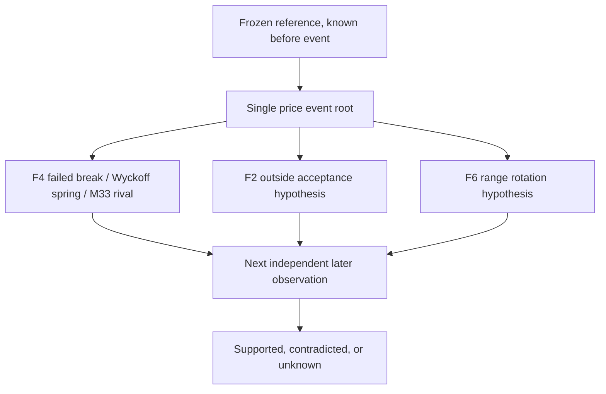

# Archived analytical-methodology expansion consultation (14 November 2026)

**Status:** Reconstructed full-text copy of the owner-supplied consultation proposal retrieved from parsed Library text; not independently byte-identical to the original attachment, not production acceptance or proof of trading edge. This provides the in-depth candidate design reference for M32 Wyckoff and M33 CRT+TBS. See ../M32_M33_WYCKOFF_CRT_TBS_SPEC_2026-11-23.md for the Design 1+ shadow implementation rules. The historical proposal text follows.

---

# OpenBot Trading Lab — Analytical-Methodology Expansion Amendment

**Proposal:** AMEND-2026-11-14-01 · **Status:** OWNER REVIEW / NOT APPROVED · **Date:** 14 November 2026  
**Applies to:** `OpenBot_Final_External_First_Market_Discovery_Blueprint(2).md`, technical design **v1.0 (13 November 2026)**  
**Deliverable type:** Technical design amendment, **not** a change to the approved baseline file, code, model, or execution permissions.  
**Scope:** Market Researcher discovery → selective interpretation → research-only handoff. Preserve the external-first decision, existing M01–M31, F1–F9 and all approved safeguards.

> **Interpretation guide:** **[BASELINE]** is already specified in the supplied blueprint; **[ADD]** is proposed here; **[TRIAL]** is an engineering rule requiring testing; **[SOURCE-BLOCKED]** or **[DEFINITION-BLOCKED]** cannot be advertised as working; **[NOT VERIFIED]** means no new live runtime, historical oracle or repository implementation validation occurred during this consultation. All synthetic examples are fictional.

## A. Executive conclusions

### A1. Decision in brief

1. **Add M32 — Wyckoff range-lifecycle interpretation** as a *versioned sequential hypothesis model* reusing M01/M03/M05/M16 and existing F1/F2/F4/F5/F6/F9 primitives. The new value is **range history + price/volume effort–result comparisons + multiple state-dependent rival explanations**, not an extra spring Boolean or another bullish score. Permit *early watch nominations* without waiting for a confident Phase C/D label.
2. **Add M33 — CRT+TBS body-break-failure variant** as a **conditional, source-qualified composite methodology**, retaining M12 unchanged. The experimentally reproducible variant requires a **preselected completed CRT reference**, a **subsequent lower-timeframe body close outside**, a **later failed continuation and closed reclaim**, and (for a stronger stage) **separate evidence of reversal response**. **Wick-only sweeps remain M05/F4 or M12 variants, not M33 body TBS.** Do not enable M33 as a certified method until owner approves the variant and independent temporal/provider tests pass.
3. **Introduce one thin `MethodInterpretation` extension**, including `variant_id`, source definition, shared `event_root_id`, evidence dependencies, alternatives and a source-qualified `next_discriminator`; extend the existing evidence ledger rather than creating a second architecture.
4. **Deepen every framework's interpretation through method-specific reference sheets**, not many new agents or market-wide expensive calculations. Preserve deterministic calculations and use at most the blueprint's optional bounded *batch* LLM pass for genuinely ambiguous, changed candidates.
5. **Retain all nine opportunity families and all 31 existing IDs.** M32/M33 may nominate independently when their genuinely distinctive early conditions are met, but references/events shared with M05/F4/F6 count **once as observational evidence**, even when several methods interpret them.
6. **Three depths stay distinct:** remote whole-universe precursors; targeted chronology/effort–result/CRT-TBS investigation on selected contracts; separate Deep Analysis of 0–5 candidates. No trading or new execution control, and no all-coin local OHLC engine.

### A2. What is actually missing versus already present

| Item | Supplied v1.0 baseline | Amendment conclusion | Priority |
|---|---|---|---|
| M12 CRT | §9.1 preselected 1H/4H candle, edge excursion/reclaim, variants explicit | **Not absent.** Add a distinct body-close failure *sequence* and nested-clock contract under M33; do not rename M12 | HIGH-INCREMENTAL-VALUE, definition-gated |
| Wyckoff | Range, auction, pressure, relative strength, sweeps and phase-like processes dispersed over M01–M05/M16/F6; no standalone causal Wyckoff lifecycle | **Confirmed specification gap:** explicit phases/alternatives, PS/SC/AR/ST/SOS/LPS, UTAD/SOW/LPSY, effort–result episodes and historical uncertainty | TARGETED-DEPTH with early independent nomination |
| SMC/ICT | §9.1–9.2 already define BOS, OB birth at later BOS, FVG/iFVG, mitigation, breaker and equal pivots causally | **Depth improvement**, not absent toolkit: hierarchy, competing zones, zone strength/decay and provenance; no invented institution intent | FOUNDATIONAL |
| Auction/VP/VWAP | §6, §8 and §9 already distinguish true profile, bar VWAP, source scope and value migration | Improve multi-session balance/migration, predeclared anchoring, initiative/responsive *as interpretation* | TARGETED-DEPTH |
| Order flow and derivatives | §6, §9 and §10 already distinguish bar delta from footprint, OI units, liquidations sampling | Add event comparison and contradiction playbooks; most specialist claims remain coverage-dependent | SOURCE-BLOCKED on unsupported assets |
| Context / late filtering | §5 non-veto agenda, §11 room/economics, §12 watches already present | Preserve exactly; append methodological traps, phase age and event-specific review triggers | FOUNDATIONAL |
| Native skill-guided reasoning | §14.5 describes desired skill behavior, not proof of installed or invoked skill | Proposed versioned references + actual native invocation test; implementation not verified | FOUNDATIONAL |

**Important baseline/implementation distinction.** Supplied v1.0 describes a proposed modular system and cites archived narrow Basis probes; it does not demonstrate that all modules, methods or agents are deployed. The blueprint cites GitHub `main` SHA `2343053…` as a documentation-focused paper-lab tree as of 13 November 2026. An independent current repository/installed-agent inspection was **not available in this run**; therefore this document maps to **blueprint headings**, not asserted production file paths. Future engineering must pin the actual integration branch and native skills before making edits.

### A3. Architectural compatibility invariants

- No change to `U_exchange`, exact Binance USDT-settled perpetual identity, method-specific coverage denominators or right-to-use gates (§1–4).
- No requirement to evaluate the full Wyckoff state graph or 5M TBS across every eligible contract. Remote 1H/15M historical *precursors* remain primary; more involved sequences stay source-qualified or targeted.
- Every reported pre-known range/anchor/reference carries `known_at` and source evidence. Observations never become retroactive because future prices made a diagram look compelling.
- BTC/ETH, sector and breadth change research priorities and caution, not family/method eligibility; opposing local hypotheses remain alive.
- Source fidelity is orthogonal to a method's conceptual definition; an implemented offline formula may remain unsupported operationally.
- No new confidence percentage, execution order, hardcoded stop/TP, future return promise or claim of institutional operator intent.

## B. Authoritative definitions and source audit

**Research status:** Read the user-supplied blueprint and consultation request; reviewed publicly available **first-party educational explanations** and **provider technical documentation** on 14 November 2026. The sources substantiate published *descriptions*, not predictive validity or verified creator priority. No production provider calls, personal key use, or new historical price oracle were performed.

| Subject and source | What is actually supported | Qualification / unresolved conflict |
|---|---|---|
| Richard D. Wyckoff, *The Richard D. Wyckoff Method of Trading in Stocks* (1931/1932 historical editions); catalog [Google Books](https://books.google.com/books/about/The_Richard_D_Wyckoff_Method_of_Trading.html?id=MMJnkQEACAAJ) | Historical lineage of price/volume/tape, stock selection and comparative-market analysis | Historical work does **not** define every modern schematic letter/event as a universally machine-readable algorithm; book catalog/secondary digitizations are not a complete authenticated digital rulebook |
| [Wyckoff Analytics, Wyckoff Method](https://www.wyckoffanalytics.com/wyckoff-method/) and [schematic PDF](https://www.wyckoffanalytics.com/wp-content/uploads/2019/09/WyckoffSchematics-VisualTemplatesForMarketTimingDecisions.pdf) | Contemporary educational **A–E** schematic, three laws, SC/AR/ST/spring/SOS/LPS and BC/AR/ST/UTAD/SOW/LPSY, reaccumulation/redistribution; spring and UTAD explicitly **not compulsory** | Education and discretionary interpretation, **not** exchange-verified 24/7 perp win rates. Treat the schemes as descriptive models, not causal proof of dominant investors |
| [Turtle Body Soup — About Us](https://turtlebodysoup.com/pages/about-us), [basic rules](https://turtlebodysoup.com/pages/turtlebodysoup), [CRT+TBS guide](https://turtlebodysoup.com/blogs/turtlebodysoup-blog/turtle-body-soup-best-price-action-strategy) | Site attributes its contemporary educational framework to “AR/Ashik Ruben”; teaches 4H CRT range + 5M body-break, **failed continuation and later close back inside**, with later structural/displacement confirmation | **Self-attributed authorship, independently unverified**; site inconsistently expands CRT as *Candle Range Trap* and *Candle Range Trading*. It gives choices of confirmation, not one exact complete executable entry rule. Do not claim a canonical original universal CRT model |
| [Turtlebodysouptbs.com Model 1 explainer](https://turtlebodysouptbs.com/blogs/news/how-to-take-crt-candle-range-theory-entry-using-tbs-turtle-body-soup-with-model-1) | Separates body-closed TBS from wick TWS and offers other CRT formulations | Different domain and variant. Relationship/authorization to the other claimed origin is **not independently confirmed**. Do not merge definitions or assert equivalence |
| Older Turtle Soup breakout-failure tradition | Conceptually related failed-boundary reversal | Similarity is **not proof** that today's CRT+TBS is the same published original; do not credit a specific rule or creator absent a direct verified source |
| [Basis MCP](https://www.basischarts.com/mcp), [Formula Lab](https://www.basischarts.com/docs/tables-and-formula-lab), [Screener](https://www.basischarts.com/docs/screener) | Vendor documents external deterministic formula computation and screener reuse; currently advertises 1,000 no-key calls/day or 10,000 with a free key | *Claims* of calls/day may change and must be tested under actual user terms; documents do **not** prove our Wyckoff/M33 temporal grammar, all-perp tail or historical `as_of` |
| [Binance USDⓈ-M official market-data reference](https://developers.binance.com/en/docs/catalog/core-trading-derivatives-trading-usd-s-m-futures/api/rest-api/market-data) | Exact market identity, closed klines, taker fields and targeted OI/funding where lawful/reachable | Exchange OHLCV is raw data, **not** hosted Wyckoff/TBS inference; host access was previously 451 in C1 and remains to be tested where permitted |
| [MarketTrace v1.11 methodology](https://markettrace.ai/methodology/mcp) | As currently documented, four-venue cross-exchange specialist metrics for **nine** named assets; explicitly descriptive, read-only | **Not** Binance-only, not all altcoins; previously denied 403 in archived C1. No claim of current entitlement |
| [Coinalyze API docs](https://api.coinalyze.net/v1/doc/) | Free-key historical derivatives endpoints; 40 charged calls/min; limited rolling intraday retention | No new verified access. Check symbol identity, data intervals, per-symbol cost, gaps and licensing |

**Claim classification:** `DIRECTLY_OBSERVED` = source payload and oracle prove value/time; `SOURCE_PUBLISHED` = site/document asserts a definition; `ANALYST_INFERENCE` = model interpretation; `ENGINEERING_TRIAL` = an operational candidate definition; `EDGE_UNPROVEN` = no independently demonstrated after-cost expectancy. M32 phase and M33 reversal *interpretations* are neither observed institutional activity nor causal proof.

### B1. Definition/owner-resolution register

| Question | Conservative interim choice | Decision needed before certified enablement |
|---|---|---|
| What does **TBS** mean? | `TURTLE_BODY_SOUP`; not “True Break Structure”, which would be a different method | Owner confirms intended author/source and variant |
| Does “body” mean **close beyond** the boundary or merely that a candle body overlaps it? | Published **body-close-beyond**, **later body-close-back-inside** variant, labelled `TBS-BODY-FAIL-v0`; wick-only is different | Confirm exact author rule including body/high-low threshold and required later event |
| What does CRT mean? | Treat M12 operationally as **preselected candle high/low range**; don't depend on disputed expansion of acronym | Pin source/variant metadata, not a new interpretation of original M12 |
| Is a fixed 4H candle/session or all qualifying prior candles permitted? | Versioned `CRT-REF-4H-v0`: reproducible preselection *before* the break; **trial**, not author's canonical range chooser | Choose eligible 4H candle selection, age, 5M session model and whether 1H alternative belongs to another version |
| Must MSS/FVG/OB follow reclaim? | No universal bundle. Keep `RECLAIMED` and optional later independent `RESPONSE_CONFIRMED` as distinct stages | Approve one minimal trial and optional stricter subvariants |
| Are Wyckoff “SC/BC” diagnosed instantly? | No: label `CLIMAX_CANDIDATE` at the event; retrospective phase interpretation only when later AR/ST actually known | No further owner choice required for cautious v0 rule; thresholds must be calibrated |

## C. Baseline overlap and incremental-value map

| Proposed analytical addition | Uses baseline existing methods/families | Novel *testable* information | Shared-event / false-confluence control |
|---|---|---|---|
| M32 Wyckoff sequence | M01/M03/M05/M16/M17/M21/M29; F1/F2/F4/F5/F6/F9 | Order of stopping → balanced tests → spring/UTAD alternatives → independent SOS/SOW/LPS/LPSY; effort/result episode comparisons and revisable phase state | A spring and M05/F4 reclaim share one `event_root_id`; SOS may add a **later** event, not another count of the spring |
| M33 CRT+TBS body failure | M12/M05/M02/M08/M09/M13; F2/F4/F5/F6 | Distinguish actual **completed 5M body close beyond preselected HTF range** from wick-only excursion, later failed continuation and reclaim, with nesting/time constraints | Link same reference and excursion to F2/F4/F5; M33 is a *sequence qualification*, not three additive votes |
| Structural hierarchy and contested pivot | M01–M03/M06–M10; F1/F2/F4/F5 | Explicit internal versus external pivot hierarchy; OB origin/mitigation age; conflicting protected swing identities | Identical OHLC event stays in `PRICE_PATH` dependency root |
| Multi-session AMT/VP state | M16–M18; F2/F6/F7 | Frozen vs developing value migration, initiative vs responsive *test* over causally comparable sessions | VP and VWAP may be separate estimators but shared tape/price path; record both source and statistical dependence |
| Anchor-aware value failure | M19/M20; F1/F7 | Predeclared AVWAP anchor quality and branch between rotation and *value migrating trend* | Extension, z-score and VWAP distance derived from one anchor are one evidence lineage |
| True flow/pressure challenge | M21–M25; F4/F5/F9 | Same-price re-attempt comparison, actual price-bin aggression and repeated price response; distinguish absorbing, exhaustion, passive/hidden *unknown* | Bar volume/RVOL/delta may nest; no absorption if only bar fields |
| Derivative/catalyst context | M26–M28/M31; F8/F9 | OI native/base/notional decomposition; timestamped forced-flow, funding settlement and event-first availability | OI+price correlation not directional new-longs confirmation |
| Sector-adjusted exception | M29/M30; F8 and all other families | Lag-trained alpha/beta residual and independent local structure during contrary BTC state | Benchmark and peer return share reference data; raw return + residual do not count twice |

**Novelty gate:** the same observed spring labelled “Wyckoff”, “SMC sweep”, “auction reject” and “CRT” yields **one event** and potentially several **competing interpretations**, never four independent evidence votes. Evaluate M32/M33's incremental discovery via *new earlier eligible cases* or *better falsification* at equal source/API/LLM budgets. If they only rename existing F4 cases, retain as annotations rather than separate promoted initiators.

## D. Complete Wyckoff technical design (candidate M32)

### D1. Model identity, boundaries and three laws

- `method_id=M32`, `variant_id=WYCKOFF-TR-LIFECYCLE-v0`, `definition_basis=WYCKOFF_ANALYTICS_MODERN_SCHEMATIC`, `source_published=true`, `statistical_edge=UNVERIFIED`.
- **Supply vs demand:** observe directional price progress, volatility, quote volume, bar-level taker aggression where fields are verified; do **not** equate total transacted volume with one-sided buyer/seller intentions.
- **Cause vs effect:** a long/evolving balance can precede material subsequent movement, but *range age, width or number of touches alone is not a statistically validated target*. Optional true P&F counting is separate, versioned, sourced and targeted; until qualified, `PF_OBJECTIVE=UNAVAILABLE`. Avoid `target = range_width × arbitrary multiplier` marketed as Wyckoff law.
- **Effort vs result:** evaluate independently separated **episodes** with quote volume, directional progress and spread; weakening progress at comparable/higher turnover may be a **tension clue**, not evidence that a hidden operator absorbed orders. True order-flow absorption remains M23 and needs genuine trade-level data.

**Applicable context:** 4H/1H multi-session range; 15M event progress; optional verified 5M/tape selected symbols. Preceding 4H state can be trending, halted, mixed or unknown. 24/7 crypto sessions must use explicit UTC windows; old stock-market opening/closing assumptions are not silently imported. Needed history depends on observable range lifecycle, **not** a fixed 15-hour backward bound. The 15-hour criterion applies to *plausible future research opportunity*, not how far back context may reach.

### D2. Exact reusable measurable predicates (all values historical, closed and source-qualified)

Define a range object `R` with **previously confirmed** `L,U`, `birth_known_at`, `ATR_ref>0`, split episode identities, and `range_width=U-L`. If no adequate separated tests define a range, **`R=UNKNOWN`**, not a spring/distribution verdict. For closed bar `t`, registered trial inputs:

```text
b = max(2*tick, alpha*ATR_ref)               alpha ∈ {0.10,0.20,0.30} [TRIAL]
touch_bottom(t) = L_t <= L+b and H_t >= L-b
touch_top(t)    = H_t >= U-b and L_t <= U+b
spring_geom(t)  = R known before t and L_t < L-b and C_t > L+b
upthrust_geom(t)= R known before t and H_t > U+b and C_t < U-b
down_accept(t)  = 2 later closed C < L-b OR confirmed breach/retest/continuation [TRIAL]
up_accept(t)    = 2 later closed C > U+b OR confirmed breach/retest/continuation [TRIAL]
range_norm      = (U-L) / ATR_ref
close_loc       = (C_t-L_t)/max(H_t-L_t,tick)
volume_ratio_e  = sum(Q over episode e) / median(previous separated episode sums
                    normalized by comparable number of bars)  # undefined if no baseline
progress_e      = abs(C_end-C_start)/ATR_ref
efficiency_e    = abs(C_end-C_start)/sum(abs(delta C) within episode)
effort_result_warning(e2,e1) = comparable(e1,e2) and
       volume_ratio_e2 >= q_hi and progress_e2 <= rho*progress_e1
```

`q_hi` and `rho` are **hypothesis-generating** grids (`q_hi∈{1.2,1.5,2.0}`, `rho∈{0.5,0.75}`), *not* fixed production rules. Required `comparable`: same venue, contract/multiplier, quote units, timeframe, bar count or duration normalization and similar baseline volatility; otherwise `UNKNOWN`. A candidate event may be witnessed intrabar only if tick ordering is qualified; with OHLC use **by-close geometry** and no claim about intra-bar order.

**Range establishment v0 [TRIAL]:** two confirmed separated upper and lower touch episodes with a minimum interim retreat `0.5–1.5 ATR_ref`, internal overlap and at least one meaningful bidirectional rotation, *or* a separately qualified established 1H range from baseline M03/M16. Wider/narrower and missing-edge ranges may carry `RANGE_CANDIDATE` but cannot claim a known upper/lower limit simultaneously. Lookback trials: 1H 5–30 days and 4H up to 60 days when remote history supports them, **not local full-universe downloads**. Candidate highs/lows only become frozen at the later confirming event.

### D3. Event vocabulary and state progression

| Wyckoff concept | What the researcher can honestly observe | When first knowable | Rival / invalidating observation |
|---|---|---|---|
| PS / PSY | prior directional trend losing progress with unusual spread/quote volume near region | completed stopping-action bar; classification remains candidate | trend resumes with accepted new high/low |
| SC / BC | extreme bar/range/participation after trend, later rebound/reaction | `CLIMAX_CANDIDATE` immediately; **confirmed historical label** only after AR/ST | ongoing cascade; false “terminal” spike |
| AR | meaningful initial opposite directional response from candidate climax | response confirmed on closed bars | one-bar noise; immediate fresh extreme |
| ST | **later separated** revisit toward candidate extreme with relative spread/volume or progress comparison | after ST completed; never at first bar of earlier climax | deep accepted breach, no meaningful separated test |
| Phase A | stopping character + at least provisional opposite response | after response; tentative | old trend continuation |
| Phase B | repeated range tests/rotations, evidence of durable balance | after range and separated episodes | unclassified chop or immediate trend resumption |
| Spring / UTAD | break of **pre-known range** followed by by-close/later reclaim | at reclaim completion; phase inference conditional | accepted break through boundary, later failed reclaim |
| Phase C | potential final test through spring or *inside-range* test; neither mandatory | after actual test data; **never forced by schematic clock** | repeated sweeps, migrated value, renewed trend against claim |
| SOS / SOW | significant close/drive toward/through opposite structural reference with displacement/progress, not just green/red bar | confirmed drive/bar; higher-order initiative after it is observed | weak follow-through, return to range, nearby HTF block |
| LPS / LPSY | **subsequent** orderly pullback/weak recovery that holds the appropriate defended level | after that retest and response are known | support/resistance accepted through |
| Phase D | cumulative SOS/SOW and supporting response/retest with strong directionality | following completed responses; label may remain `TENTATIVE` | renewed neutral balance or opposite break |
| Phase E | accepted expansion outside old range with sustained progressing structure | after actual expansion, often **too late** for initial discovery | failed auction/return to range |

**Phase labels are not mutually provable at a given early cutoff.** Store an ordered set of candidates, e.g. `[{state:'ACCUM_B_OR_C', rationale_ids:[...]},{state:'REDISTRIBUTION_B',rationale_ids:[...]},{state:'UNCLASSIFIED',...}]`, with `ambiguity=LOW|MATERIAL|HIGH`; do not invent calibrated posterior `P(phase)=0.82`.

**Operational subclass predicates [TRIAL]**, needed by engineers to avoid vague “strong move” judgments:

```python
def confirmed_automatic_response(e_climax, e_response, atr_ref):
    # e_response begins strictly after e_climax known_at;
    # same symbol/source, completed bars and aligned quote-volume units.
    return (e_response.start >= e_climax.known_at
            and abs(e_response.end_close - e_climax.extreme_price) >= 1.0*atr_ref
            and e_response.direction == opposite(e_climax.direction))

def sos_candidate(t, R, pivot):
    # Choose known R midpoint/upper edge OR confirmed internal pivot in advance.
    return (closed(t) and R.known_at < t.open_at
            and pivot.known_at <= t.open_at and
            t.close > max(R.midpoint, pivot.upper) + R.buffer
            and t.true_range / ATR_prev(t) >= 1.2
            and body_fraction(t) >= 0.5)

def sow_candidate(t, R, pivot):
    return (closed(t) and R.known_at < t.open_at
            and pivot.known_at <= t.open_at and
            t.close < min(R.midpoint, pivot.lower) - R.buffer
            and t.true_range / ATR_prev(t) >= 1.2
            and body_fraction(t) >= 0.5)

def lps_candidate(sos_event, retest, later_response, defended_zone, R):
    return (sos_event.known_at < retest.start
            and defended_zone.known_at <= retest.start
            and retest.low >= defended_zone.lower - R.buffer
            and later_response.start >= retest.known_at
            and later_response.close > retest.last_close
            and comparable_retest_episode(retest, sos_event))

# Distribution LPSY mirrors directions and protected resistance.
# Every missing ATR, zone, event, right-side confirmed pivot or episode -> UNKNOWN.
```

The `1.0 ATR` AR size, `1.2 ATR` SOS/SOW range and `0.5` body share are **initial prototype thresholds**, not Wyckoff's canonical numerical criteria; test `{0.7,1.0,1.5}` for response size, `{1.2,1.5,2.0}` for normalized range, and `{0.5,0.65}` for body share. A wider-range signal with weak later hold may remain a candidate, not a qualified Phase D. `comparable_retest_episode` uses separated episode identities, relative duration/volatility and already observed quote volume; any comparison data gap is UNKNOWN. The strongest concept-level test is still *time-ordered alternative interpretation* rather than optimizing a candle score.

### D4. Explicit state graph and rival branches

```text
PRIOR_DOWN / PRIOR_UP / PRIOR_UNKNOWN
  └─(credible stopping action)─> STOPPING_CANDIDATE [Phase A?]
        └─(AR and separated ST/range)─> BALANCE_UNCLASSIFIED [Phase B?]
              ├─bottom test/reclaim─> ACCUM_TEST_CANDIDATE [Phase C?]
              │     ├─later SOS + supported pullback─> ACCUM_ADVANCE_CANDIDATE [D?]
              │     └─accepted down-break───────────> REDISTRIBUTION / DOWNTREND
              ├─top test/reclaim───> DIST_TEST_CANDIDATE [Phase C?]
              │     ├─later SOW + weak rally────────> DIST_DECLINE_CANDIDATE [D?]
              │     └─accepted up-break─────────────> REACCUMULATION / UPTREND
              ├─internal successful test (no spring/UTAD)─> reassess both sides
              └─neither has decisive evidence───────> BALANCE_UNCLASSIFIED
```

**Reaccumulation and redistribution are contextual variants, not simple reversals of prior trend:** after an uptrend an interim range could be *either* reaccumulation or distribution; after a downtrend an interim range could be redistribution or accumulation. Parent 4H trend changes the *prior hypothesis*, not the conclusion. When the subsequent breakout decides the historical label, prior emitted early fingerprints must remain unchanged.

### D5. Independent early nominations and targeted enrichment

| Earliest meaningful observed state | Broad remote precursor | When targeted | Candidate stage / rivals |
|---|---|---|---|
| Stopping attempt after persistent decline/advance | historically abnormal TR/RVOL and loss of path efficiency at pre-known HTF area | verify separated rally/reaction and comparable historical episodes | `EARLY`, *not* confirmed accumulation/distribution; F9 / trend pause |
| Formation of credible range | repeated remotely computed level approaches, compressing width/overlap | reconstruct actual frozen range and test identities | `EARLY`/`DEVELOPING`, F6 vs F2 and NULL |
| Pressure toward long-established range edge | position versus **pre-known** L/U and retreat pattern | request later 15M edge outcomes; no expensive VP precondition | `APPROACHING_DECISION`, spring/upthrust vs true break |
| Spring or UTAD geometric reclaim | closed excursion/reclaim event with same `reference_id` | compare effort/result and later hold; genuine footprint only if supported | `DEVELOPING` or `FAST_WITH_ROOM`, F4 vs F5/F2 |
| SOS/SOW then potential LPS/LPSY | progress outside/inside range plus structural response | selected 15M test and first obstacle check | `READY_FOR_DEEP` only if real room/economics and supported present facts |

**Query budget:** broadly reuse `CORE_1H`, `CORE_15M`, qualified `METHOD_STRUCTURE`; a standalone `WYCKOFF_PRESSURE` pack is permitted only when it tests a truly novel bounded *sequence* (e.g. separated touch/effort–result) and passes remote oracle. For 10–60 selected candidates, fetch compact 1H/4H event tails only when existing ledger cannot settle the sequence. If no sufficient historical episodes or accurate volume units, M32 retains `RANGE_ONLY`, `EFFORT_RESULT_UNKNOWN`, not an invented Phase D. Avoid P&F targets unless an independent versioned targeted P&F procedure is specifically qualified.

### D6. Expiry, stage and 15-hour relevance

- `INVALIDATED`: accepted break in the opposite direction of the claimed state, anchor range irretrievably invalid, or factual sequence conflict. Preserve rival and new range identities.
- `LATE`: a true D/E narrative appears *after* major run to first opposing obstacle, or price has already moved most of the structural available room before nomination. A historically valid “accumulation” label does not imply present executable opportunity.
- `UNKNOWN`: insufficient history, stale volume, non-separated tests, incompatible quote units or ambiguous multi-range parentage.
- A 14-day 4H balance may still nominate a **new** 15M LPS or near-boundary test that matters within ~15h. The long structure explains *where*, the fresh event explains *why now*. Never auto-forward a phase label without imminent, falsifiable local decision and room.

## E. CRT + TBS technical design (candidate M33)

### E1. Definition, version control and true incremental question

`M33 / CRT-TBS-BODY-FAIL-v0` is **not** the v1.0 M12 general CRT or ordinary M05 wick sweep. This version asks: *After a causally selected completed higher-timeframe candle, did lower-timeframe price actually obtain a completed **body-close breakout**, fail to progress and then close back inside, creating a still-relevant opposing structural question?* Published educational material aligns with that broad description, but **precise choice of reference candle, tolerance, failure time and confirmation are our trial engineering definitions**.

**Variants to preserve rather than blend:**

1. `V-BODY-FAIL-v0` (proposed trial): strict outside **LTF close** and a **separate later** inside close. Confirmed body failure. May later gain MSS/displacement qualifier.
2. `V-WICK-SWEEP` (existing M05/M12, not M33): LTF/HTF wick beyond with inside close *same* bar. Valid reversal *candidate*, not “body TBS”.
3. `V-INTRA-LTF` (definition pending): first LTF body closes beyond *some lower-timeframe swing* inside an HTF parent, not the HTF extreme; requires exact author/source definition before separate adoption.
4. `V-OTHER-TBS` (definition pending): if TBS instead means a different expansion, do not map automatically to this method or reuse M33 semantics.

### E2. Frozen parent identity and timeframe alignment

For **trial** reference `c0`, select **before a future excursion** from completed 4H candles using an ex ante `selection_policy_id` (e.g. first previously completed 4H candle that overlaps a previously confirmed 1H structural decision zone and whose width is 0.6–2.5 × prior ATR4H). Alternative registered calendar-candle policy must be a different version. Once selected, freeze `U=H_c0`, `L=L_c0`, `MID=(U+L)/2`, `available_at(c0)≥close_4H(c0)` and `source_id`. Do **not** select whichever past candle would have best predicted a later reversal.

**Bounded experimentation:** recent **one to three** eligible completed 4H refs in a **12–24h** validity window, strictly deterministic sort by importance known at selection. These are **trial sizes**, not a historical canonical CRT rule. Expire a ref after the selected window, structural supersession, accepted violation or exhausted opposite-room condition. Keep multiple reference IDs distinct; no retrospective recombination.

For each 5M child bar `b`, use intervals `[open_b, close_b)` and source finality. Require `known_at(c0) ≤ open_b` for the first outside test; later reclaim bar `r` must have `open_r ≥ close_b` (and `known_at(b)≤open_r` for true separate-bar evidence). The latest 4H *forming* candle has an unknown final high/low and cannot serve as a **completed** reference. A 15M precursor may trigger investigation without proving the 5M event; 1H/15M clocks never inherit 5M precision automatically. Source `available_at`, not local system time, controls promotion.

### E3. Trial predicates (mirrored upper/lower sides)

With `tick`, frozen `ATR_ref`, upper `U`, lower `L`, buffers `b_out=max(2*tick, α ATR_ref)` and `b_in=max(tick, β ATR_ref)` where `α∈{0.05,0.10,0.20}`, `β∈{0,0.05,0.10}` trial, and closing 5M bar t:

```python
def body_break_above(t, R):
    return closed(t) and R.available_at <= t.open_at and t.close > R.U + R.b_out

def body_break_below(t, R):
    return closed(t) and R.available_at <= t.open_at and t.close < R.L - R.b_out

def later_return_inside_short(t, r, R):
    return t.closed and r.closed and r.open_at >= t.close_at and r.close < R.U - R.b_in

def later_return_inside_long(t, r, R):
    return t.closed and r.closed and r.open_at >= t.close_at and r.close > R.L + R.b_in

def failed_continuation_short(t, r, R):
    return later_return_inside_short(t,r,R) and
           no_confirmed_outside_acceptance_between(t,r,R) and
           within_expiry(t,r,R) # does NOT infer actual failed buy orders

def qualified_response_short(r, s, R):
    return closed(s) and s.open_at >= r.close_at and
           (break_preknown_internal_pivot_down(s) or
            valid_downward_displacement(s))

# Long side mirrors sign and direction. Unknown history, status or clock -> UNKNOWN.
```

`failed_continuation` means *the sequence failed the operational outside-hold test*, **not** proof of trapped trader motives. For `no_confirmed_outside_acceptance_between`, use baseline §7.3's qualified two-later-close trial or supported retest/hold predicate. `within_expiry`: first reclaim within `{1,2,3,6,12}` **closed 5M bars** and before parent reference expiry (test grid, not asserted canonical timing). When an outside break persists beyond the trial time or qualifies acceptance, promote F2 rival rather than force a TBS signal. A body-break and later return cannot be the same completed bar. A single OHLC wick-plus-close-back-inside is M05/F4, irrespective of its attractive chart.

### E4. State machine, rivals and readiness

| State | Required *newly knowable* event | Appropriate action | Strongest countercase |
|---|---|---|---|
| `REF_ARMED` | preselected 4H reference closed, significant and unexpired | remote/ledger watch | irrelevant arbitrary candle |
| `NEAR_EDGE` | closed 15M/1H approaches pre-known L/U; room and spread unknown/checked | independent EARLY nomination | old reference already consumed |
| `BODY_OUTSIDE` | **later** completed 5M **close outside** | DEVELOPING; check later bar; don't call reversal | valid F2 break/continuation |
| `FAILURE_WATCH` | failure to progress under fixed observation window, but not yet reclaimed | conditional watch; no TBS certification | renewed outside expansion |
| `RECLAIMED` | separate later 5M **inside close**, no prior accepted break | M33 body-failure observation; F4/F6/F5 rivalry | second outside hold; ordinary chop |
| `RESPONSE_CONFIRMED` | **later** independently timed opposing pivot break/impulse or defended retest | consider READY/FAST if room and economics | nearby opposing obstacle / weak response |
| `INVALIDATED / EXPIRED / LATE` | objective accepted continuation, age expiry, reference supersession or consumed room | archive with reason; optionally F2/F5 rival | no automatic silent relabel |

**Direction:** below L then above L → *possible bullish* reversal; above U then below U → *possible bearish* reversal. Prior 4H market direction can disagree, creating a risk question, never a universal filter. A subsequent **reclaim-fails-rebreak-holds** is F5 by §7.3; an outside hold **without** a reclaim is F2. A simple range-edge rotation may be F6. The final handoff proposes **no executable order**; possible technical *obstacles* are pre-known range midpoint, confirmed internal swing and opposite range edge, with the **nearest real one first**, not a fixed percentage/automatic take-profit.

**Evidence needed for certification:** exact 4H candle identity/time, 5M close values/units, `known_at` for each stage, separate reclaim event, no acceptance before reclaim, valid quote freshness/room, and source capability proving complete aligned 5M history. If provider only gives 15M or current prices, report `M33_NEAR_EDGE_PROXY` or `UNQUALIFIED`, never `BODY_TBS_CONFIRMED`.

### E5. Remote-first funnel and method overlap

- **Wide:** existing `CORE_1H`/`CORE_15M` sees **reference/level proximity** and pressure; M12-qualified remote method pack may expose **preselected 4H reference** metadata. Without a source for 4H known-at or 5M outside history, nominate a **question**, not a fully verified M33.
- **Targeted:** provider-computed event-tail query *if its grammar/time boundaries pass an oracle*; otherwise a **small authorized selected-symbol 4H/15M/5M history slice** reconstructed locally as a *verification* tool. No full-universe 5M candle fan-out.
- **Specialist:** genuine flow/VP is optional for model plausibility and alternatives, not a hard requirement for the body-close condition. An unsupported footprint never blocks an otherwise price-verifiable M33 by pretending to be negative.
- **De-duplicate:** M12 supplies `CRT_CANDLE` reference; M05/F4 supplies boundary test; M33 adds a distinct *body-closed event plus later verified failure*. Source-event roots are shared. If body failure adds no earlier discovery or disconfirmation beyond baseline, keep M33 targeted annotation rather than an extra ranked vote.

## F. Cross-method professional interpretation amendments

### F1. One protocol for all frameworks (not one universal strategy formula)

Every candidate's interpretation must answer, using actual evidence IDs: **(1)** What exists? **(2)** Where versus previously known structure/value/liquidity? **(3)** How did we get here, with actual timestamps? **(4)** What rivals explain the same facts? **(5)** What would refute the attractive story? **(6)** What is the cheapest material next observation? **(7)** Is first-obstacle room and cost plausible before ~15h? **(8)** WATCH/ESCALATE/REJECT/UNKNOWN? No reasoner may replace missing facts with market lore.

### F2. Specific additions and falsifiers

| Framework | Mandatory deterministic facts | Higher-order interpretation / important trap | Worth targeted evidence? |
|---|---|---|---|
| Structure / SMC / ICT | Protected external/internal pivot hierarchy, swing confirmation clocks, BOS close vs wick, OB original candidate bar and **later BOS birth**, zone touch/consumption states, 3-bar FVG birth, iFVG accepted breach | A trend-continuation pullback can look like reversal CHoCH on 5M; competing pivots must both be shown. OB is a **price-based candidate**, not observed large limit orders. Zone relevance decays with repeated touches/changed regime—test, not assume | Reduced 1H/15M event tail if level identity or role-flip truly changes stage; flow only if making flow claim |
| Wyckoff (M32) | Credible pre-known balance, distinct episodes, prior impulse, historical Q/trading range comparisons, phase knowability | Is this *accumulation*, *reaccumulation*, *distribution*, *redistribution* or simply balance? Can phase C be absent or form at interior support? | Selected multi-session event tail; real tape only for stronger absorption interpretation |
| CRT / M33 | preselected completed 4H `CRT_CANDLE`, 5M outside **body close**, later reclaim, independent optional response, complete source clocks | Was HTF candle truly known, was it body TBS vs wick, is F2 acceptance actually the stronger rival, and has the opposing first obstacle been consumed? | Minimal 5M time-aligned history on nominated contracts |
| Auction Market Theory | Earlier balance level(s), separated edge episodes, accepted outside/reentry state | Initiative vs responsive action is **an observed response pattern**, not an institutional identity. Two closes is a *trial discriminator* not a universal auction law. Multiple sessions can change value while old price range persists | Profile migration only when complete profiles share comparable venue, bins and window; otherwise price-only state |
| True Volume Profile | actual trade-by-price bins, source venues, bin origin/width, valid full window/partial, POC tie rule, 70% VA algorithm, HVN/LVN smoothing | Frozen prior-session VA vs **developing** VA; POC migration can be caused by moving sampling window; naked POC only while level truly unvisited since frozen reference | Yes, supported exact assets; no candle-derived pseudo-VAH claimed as true |
| VWAP / AVWAP | whole-bar ΣQ/ΣV or explicitly HLC proxy, **predeclared anchor**, complete interval, if band used valid variance definition | Value can migrate with trend; repeated extensions are not separate reversion evidence; untested hindsight “anchor at winning low” banned | Usually cheap external anchor calculation; selected data if pivot anchor confirmed late |
| Executed flow | actual source-trade side, volume units, CVD reset/scope, footprint bin convention, price response | Buying delta with stalled price may be *passive selling*, but bar delta alone cannot identify who is passive or prove absorption; spoof/iceberg assertions need deeper data | Only on covered assets at decision points; no fabricated tick history after gaps |
| Derivatives and shocks | native/base/notional OI, aligned mark, funding predicted/settled timestamp, observed/sampled liquidation receipt | ΔOI cannot identify which side opened; rising USD notional can result from price; liquidation *heatmap* is a model, not observed prints | OI/settled funding or forced-flow only when it can falsify F9 or crowding claim |
| Relative / market context | same-window returns; lag-trained beta and alpha when available; dated sector map, adequate peers; BTC/ETH multi-state, breadth denominator | Raw positive return may be BTC-beta. True independent negative relative structure during BTC rally remains eligible. Avoid fixed bull-market family gates | Aligned sector/beta only on candidates or qualified remote relationship pack |
| Catalysts / timing | publisher, first release/availability, exact symbol identity, scheduled vs unscheduled, revision | News may explain a shock **after** evidence; event causality cannot be assumed. 24/7 time zones, DST, session labels require explicit UTC | Verify original dated issuer/source only for materially affected candidates |

**Optional later method expansion beyond M33:** no M34 or tenth family recommended now. If independent blinded evidence uncovers a genuine causal *opportunity* that cannot be represented in F1–F9, submit a separate registry-change request with distinct initiating measurements, false-positive analysis and compatibility migration. More terminology alone is not sufficient.

## G. Complete method-role and family map

**Role legend:** `I` independent initiator when supported, `P` shared primitive, `D` discriminator, `C` context, `S` targeted specialist, `?` definition pending. These normalize baseline §9.1 names without changing their stable IDs. **Feasibility tags below are expected paths/constraints, not live qualification** (`R?` candidate remotely computed only after tests, `T` selected-history target, `S9` specialist limited assets, `PXY` only proxy currently, `DEF` unresolved).

| Method | Preserved identity | Roles | Family relevance | Feasibility and key invariant |
|---|---|---|---|---|
| M01 | Confirmed market structure / swings | I,P,D | F1 F2 F4 F5 F6 | R?/T; delayed right-confirmation |
| M02 | BOS / CHoCH / MSS | I,D | F1 F2 F4 F5 | R?/T; previously known defended pivot |
| M03 | S/R / supply-demand | I,P | F1 F2 F4 F6 | R?/T; separated frozen zones |
| M04 | EQH/EQL inferred liquidity | I,P | F2 F4 F5 F6 | R?/T; inferred stops, not observed |
| M05 | Sweep / reclaim | I,D | F2 F4 F5 F6 | R?/T; shared root with M32/M33 |
| M06 | Order block candidate | I,P | F1 F2 F4 | R?/T; born at later BOS only |
| M07 | Breaker block | I,D | F1 F2 F5 | R?/T; failure and retest in order |
| M08 | FVG | I,P | F1 F2 F3 F4 | R?/T; 3-bar nonoverlap and age |
| M09 | Inverse FVG | I,D | F2 F4 F5 | R?/T; original FVG accepted through |
| M10 | Mitigation / zone revisit | P,D | F1 F4 F6 | R?/T; zone consumption and visits |
| M11 | OTE retracement | C,S | F1 F4 | R?/T; no independent fib vote |
| M12 | Existing CRT | I,D | F2 F4 F5 F6 | R?/T; immutable parent candle ID |
| M13 | PO3 / AMD | I,S | F2 F4 F5 F6 | T/DEF variants; predeclared session |
| M14 | ICT Silver Bullet | S,? | F1 F2 F4 | DEF; source/time window unresolved |
| M15 | Keepssy Reversal | ? | F4 F5 (unasserted) | DEF; do not invent rules |
| M16 | Auction Market Theory | I,P,D | F2 F4 F5 F6 F7 | R?/T; actual value vs price proxy |
| M17 | True Volume Profile | I,S | F2 F6 F7 | S9/other qualified only; price-bin tape |
| M18 | HVN/LVN / naked POC | I,S | F2 F6 F7 | S9/other qualified only; fixed bins/window |
| M19 | Session / anchored VWAP | I,P | F1 F6 F7 | R?/T; causal anchor and Q/V semantics |
| M20 | Statistical value reversion | I,D | F6 F7 | R?/T; conditional on regime |
| M21 | Delta / CVD | I,D | F2 F4 F5 F9 | R? bar delta; T true flow; no absorption upgrade |
| M22 | Footprint imbalances | I,S | F2 F4 F5 F9 | S9/other targeted; genuine bin tape |
| M23 | Absorption | S,D | F2 F4 F5 F9 | T; genuine flow + stalled response |
| M24 | Aggression exhaustion | S,D | F4 F5 F9 | T; comparable repeated timed attacks |
| M25 | Order book / walls | C,S | F2 F4 F9 | T; snapshots ≠ historical replenishment |
| M26 | Open interest | C,D,I-shock | F4 F5 F8 F9 | T/remote derivatives; units and marks |
| M27 | Funding / basis | C,S | F4 F5 F7 F9 | T; predicted vs paid separate |
| M28 | Observed liquidations | I,S | F4 F9 | T; sampled observations vs model |
| M29 | Relative strength / sectors | I,C | F1 F2 F3 F8 | R?/T; aligned lag-trained residuals |
| M30 | Volatility / breadth | I-shock,P,C | F2 F3 F8 F9 | R?/bulk; broad-context non-veto |
| M31 | News / events / catalysts | I-targeted,C | F2 F3 F9 | T; first-published/received and source |
| **M32 [ADD]** | **Wyckoff lifecycle v0** | **I,D,S** | **F1 F2 F4 F5 F6 F9** | R? precursor + T chronology; phase uncertain |
| **M33 [ADD]** | **CRT+TBS body failure v0** | **I,D,S**, initially **?** | **F2 F4 F5 F6** | R? approach + T 5M proof; author variant pending |

**F1–F9 are untouched.** New method→family relationships only add *ways to initiate and interpret* a family: Wyckoff SOS/LPS can feed F1/F2; potential spring/UTAD feeds F4/F6; failed spring can feed F5 or F2; distinct shock-stabilization episode feeds F9. M33 body-failure primarily feeds F4/F6, while its failed reversal feeds F5 and outside acceptance remains F2. Neither requires a tenth universal strategy detector.

## H. Formal schemas, formulas, temporal graph and deterministic contracts

### H1. Minimum schema delta (extend §14.2 without breaking v1)

**Existing:** `Instrument`, `Evidence`, `Reference`, `StructuralEvent`, `Hypothesis`, `ScanBatchReceipt`, research shortlist v1, compact `structure/event/hypothesis/watch` ledgers. Keep those structures and IDs stable. New fields are **optional** on read, and required only for new method-specific claims.

```yaml
MethodSpec:
  method_id: M32|M33                 # stable, append-only
  variant_id: string                # immutable rule identity
  definition_source_ids: [string]   # first-party / engineering policy
  definition_status: SOURCE_PUBLISHED|TRIAL|DEFINITION_PENDING
  version_hash: string              # parameters + compiler + semantics
  roles: [INDEPENDENT_INITIATOR, DISCRIMINATOR, TARGETED_SPECIALIST]
  applicable_family_ids: [F1, F2, F4, F5, F6, F9]
  required_capabilities: [string]
  min_closed_history: {tf: bars_or_range}
  early_nomination_spec: string
  ordered_events_spec: string
  expiry_spec: string
  oracle_suite_id: string

MethodInterpretation:
  interpretation_id: string
  method_id: string
  variant_id: string
  structure_id: string
  primary_reference_id: string
  event_root_ids: [string]          # unique causal origins, no duplicate votes
  supporting_evidence_ids: [string]
  contradicting_evidence_ids: [string]
  missing_evidence_ids: [string]
  observed_stage: string            # e.g. WYCKOFF_TEST_CANDIDATE / TBS_RECLAIMED
  canonical_research_stage: string # existing stage enum, unchanged
  competing_interpretation_ids: [string]
  hypothesis_kind: OBSERVATION|INTERPRETATION|CONDITIONAL_OUTCOME
  uncertainty_kind: FACT_GAP|PHASE_AMBIGUITY|SOURCE_SCOPE|VARIANT_CONFLICT|MODEL
  confidence_kind: UNCALIBRATED_QUALITATIVE|CALIBRATED_EMPIRICAL
  source_fidelity: EXACT_REPORTED|SYNCHRONIZED_REMOTE_RECONSTRUCTION|PROXY_ONLY|INCOMPLETE_HISTORY|DATA_UNAVAILABLE
  support_operation: NATIVE_REMOTE|ALIGNED_REMOTE_RECONSTRUCTION|TARGETED_REMOTE_HISTORY|LOCAL_TARGETED_VERIFICATION|PROXY_ONLY|UNVERIFIED|UNSUPPORTED|DEFINITION_PENDING
  last_closed_cutoff_utc: ISO8601
  known_at_utc: ISO8601
  available_at_utc: ISO8601
  expiry_at_utc: ISO8601|null
  falsifier_predicates: [string]
  next_discriminator: {question_id: string, eligible_source_id: string|null}
  first_opposing_reference_id: string|null
  room_status: FAVORABLE|MARGINAL|EXHAUSTED|UNKNOWN
  provenance_hash: string
```

**Backward-compatibility rule:** v1 watches and old M12 hypotheses deserialize with `method_interpretations=[]` and `variant_id=LEGACY_UNSPECIFIED`; they may continue as valid M12 where their recorded evidence suffices. **Do not** automatically recode old M12 as M33, infer an old Wyckoff phase or replace old `known_at`. A migration may create an *additional future-time interpretation* referencing old immutable facts, with `interpretation_known_at = migration time or first actually verifiable event time`, not backdated to the old chart candle.

### H2. Exact JSON example — synthetic observation and uncertainty

```json
{
  "schema_version":"openbot.method_interpretation.v1-proposal",
  "method_id":"M32",
  "variant_id":"WYCKOFF-TR-LIFECYCLE-v0",
  "instrument":"SIM_ALTUSDT",
  "scope":"BINANCE_USDM_PERPETUAL",
  "structure_id":"SYN-R17",
  "primary_reference_id":"SYN-RANGE-7",
  "event_root_ids":["SYN-EV-RANGE-LOW-EXCURSION-1"],
  "supporting_evidence_ids":["SYN-E1","SYN-E2","SYN-E3"],
  "contradicting_evidence_ids":[],
  "missing_evidence_ids":["SYN-MISSING-LATER-SOS"],
  "observed_stage":"SPRING_GEOMETRY_RECLAIMED",
  "canonical_research_stage":"DEVELOPING",
  "competing_interpretation_ids":["SYN-F2-BREAKDOWN","SYN-F6-RANGE","SYN-H0"],
  "hypothesis_kind":"INTERPRETATION",
  "uncertainty_kind":"PHASE_AMBIGUITY",
  "confidence_kind":"UNCALIBRATED_QUALITATIVE",
  "source_fidelity":"EXACT_REPORTED",
  "support_operation":"LOCAL_TARGETED_VERIFICATION",
  "last_closed_cutoff_utc":"2026-10-20T09:00:00Z",
  "known_at_utc":"2026-10-20T09:00:00Z",
  "available_at_utc":"2026-10-20T09:00:02Z",
  "expiry_at_utc":null,
  "falsifier_predicates":["CLOSED_ACCEPTANCE_BELOW_SYN-RANGE-7"],
  "next_discriminator":{"question_id":"RECLAIM_FOLLOW_THROUGH","eligible_source_id":"SYN-READONLY"},
  "first_opposing_reference_id":"SYN-RANGE-MID",
  "room_status":"UNKNOWN",
  "provenance_hash":"SYNTHETIC_NOT_ACTUAL_HASH"
}
```

For a real record `source_fidelity=EXACT_REPORTED` must mean the *actual underlying observation* is source-supported; in this fictional example the fields are for schema illustration only. If actual verified 5M closed bars are absent, the M33 analogue remains `SUPPORT_OPERATION=UNVERIFIED` and `observed_stage=NEAR_EDGE`, even if a screenshot depicts a body trap.

### H3. Temporal join, dependency and falsification graph



The graph is **not** an additive-score engine. Track parent/child dependencies, e.g. `CVD_delta` and `RVOL` may both derive from the same executed trades; a fixed VAH and AVWAP can share tape; BTC relative return and sector residual share benchmark observations. For confidence scoring, use an **explicit dependency-aware rule**: `corroboration_count = number of independently sourced, materially different observational roots` only when supported; otherwise report `multiple_interpretations_one_root` with no numerical boost. Multiple independently timed **later** tests can increase chronological completeness, not assert a calibrated success probability.

### H4. Deterministic event-processing pseudocode

```python
def accept_event(obs, source_capability, ledger):
    require_read_only(obs)
    if not exact_perp_identity(obs) or not source_capability.qualified_for(obs):
        return UNKNOWN('INSTRUMENT_OR_CAPABILITY_UNQUALIFIED')
    if obs.is_open_bar or obs.available_at_utc > current_frozen_cutoff():
        return UNKNOWN('FUTURE_OR_FORMING_BAR')
    if not aligned_clock_and_nonmissing_source(obs):
        return UNKNOWN('SOURCE_CLOCK_OR_GAP')
    if any(ref.known_at_utc > obs.required_event_start for ref in obs.references):
        return UNKNOWN('REFERENCE_NOT_PREKNOWN')
    ledger.append_immutable_observation(obs)
    return reconcile_same_reference_event_roots(obs, ledger)

def evaluate_method(method, structure, cutoff, capabilities):
    if method.definition_status == 'DEFINITION_PENDING':
        return interpretation_unknown('DEFINITION_PENDING')
    required_now = method.required_at_stage(structure.stage)
    if not capabilities.can_prove(required_now, structure.instrument, cutoff):
        return interpretation_unknown('REQUIRED_SOURCE_UNQUALIFIED')
    timeline = strict_sort_by_known_at_then_immutable_event_id(
        structure.events_before(cutoff))
    result = method.deterministic_transition(timeline, structure.references)
    # outcome branches may coexist; NULL hypothesis always remains possible.
    result.rivals = construct_supported_rivals_and_null(result, timeline)
    result.root_ids = unique_origin_event_ids(result.supporting_evidence_ids)
    result.validate_no_lookahead_or_duplicate_roots()
    return result

def decide_handoff(card, budget, context):
    # context can adjust query ordering, never disable valid raw nominations.
    if not card.claims_supported_for_present_stage:
        return WATCH_OR_UNKNOWN(card)
    if card.first_obstacle_room_unverified_or_friction_bad:
        return WATCH_OR_LATE(card)
    if card.has_high_value_unanswered_question and budget.permits:
        return request_one_allowlisted_evidence_query(card)
    return RESEARCH_SHORTLIST_IF_DISTINCT_AND_WORTH_DEEP(card)  # ≤ 5, no orders
```

### H5. Parameter register and precise constraints

| Policy ID | Trial values | Design purpose / hard stop |
|---|---|---|
| `WY-RANGE-TF` | 1H with 4H context; conditional 15M tests; 5–30 days 1H / 30–60 days 4H *where externally possible* | Can shorten only as method-specific version; insufficient phase history ⇒ `UNKNOWN` |
| `WY-TOUCH-SEPARATION` | retreat 0.5, 1.0, 1.5 × `ATR_ref`, min 2 closed bars | Multiple adjacent boundary bars ⇒ one visit; duration varies by TF |
| `WY-EXTREME-BUFFER` | max(2 tick, 0.10/0.20/0.30 × `ATR_ref`) | Prior frozen ATR, tick exact; no hindsight re-scaling |
| `WY-EFFORT` | episode Q ratio 1.2/1.5/2; progress ratio 0.5/0.75 | Need comparable length/volatility/unit; not passive-order proof |
| `WY-PHASE-LAG` | minimum distinct AR/ST/test known-at; no arbitrary required phase duration | Retrospective “we were in Phase C yesterday” prohibited |
| `CRT-PARENT` | completed 4H trial, 0.6–2.5 × prior ATR4H range qualification and overlap with pre-known zone | Distinct source/selection policy version; too many refs penalized/expiry, no hindsight pick |
| `CRT-TBS-CHILD` | 5M exact after 4H close; 15M only as precursor | Source inability to prove closed 5M events ⇒ M33 unqualified |
| `TBS-OUTSIDE-BUFFER` | max(2 tick, 0.05/0.10/0.20 × frozen ATRref) | Full **body close** across threshold; wick-only excluded |
| `TBS-RECLAIM-BUFFER` | max(1 tick, 0/0.05/0.10 × frozen ATRref) | Later **separate** inside close |
| `TBS-RECLAIM-AGE` | 1/2/3/6/12 completed 5M bars; optional parent 12–24h age | Compare lead time/false alerts; `EXPIRED` otherwise, not forcibly bullish/bearish |
| `ROOM-NOW` | §11.3 existing real first opposing obstacle, friction and ≤15h relevance | No hard fixed percent-profit threshold; candidate with already-used room LATE |

**All numbers in this table are design-of-experiment grids, not asserted optimum values or profit estimates.** Freeze `policy_hash` before scoring; if a provider has only 300 bars, a longer Wyckoff test cannot be emulated using 300 bars with favorable default flags. Known-at metadata for delayed confirmed pivots must include the *right-side confirmation* time.

## I. External-first feasibility, service/source matrix and resources

### I1. Provider/predicate capability map

| Evidence requirement | Preferred broad remote opportunity | Conditional selected/source path | Honest status at time of proposal |
|---|---|---|---|
| Exact eligible USDT-settled perps, 24h economics, spread | Binance official bulk inventory/market endpoints (subject to permitted host access) | Approved lawful inventory source; no ticker-only implied history | **DOC_CONFIRMED**, 451 prior host, no new live probe |
| Width, ATR, volume ratio, rolling bounds, edge proximity, 15M/1H simple precursors | Basis `screener_run` explicit manual partitions + qualified formula hashes | Alternate verified remote formula provider | C1 **archived narrow** server-computed success; **not** proven full tail or all formulas |
| Wyckoff separated episodes/range age/effort/result | Qualify `METHOD_STRUCTURE` / separate `WY_PRESSURE` remote reductions if `value_when`/historical sequences truly equivalent | Targeted `formula_evaluate` event tail or selected 1H/4H history oracle | **UNVERIFIED as native complete M32** |
| Wyckoff exact Phase A–E narrative | No requirement for wide universe; causal reduced observations only | Deterministic model + optional skill-guided interpretation on selected cards | **INTERPRETATION**, not native factual API column |
| M12 preselected completed 4H CRT | Only source with verified 4H frozen reference/known-at output | Targeted prior completed 4H history | **UNVERIFIED full-life remote** |
| M33 body-close outside, subsequent 5M inside and independent response | **Not** forced full-universe. 15M/1H near-edge nomination only | Qualified remote 5M historical sequence or small selected-symbol 5M bars | **TARGETED_REMOTE_HISTORY / unqualified until oracle** |
| True profile VA/POC/HVN/LVN, footprint and absorption | No all-perp promise | MarketTrace **nine named assets** and verified other data rights; exact source/tape bin window | **SOURCE-BLOCKED** beyond independently covered subset; prior 403 |
| Bar aggressor delta / preliminary CVD | Formula only if Q/BQ or V/BV units and source field pass oracle | Selected authorized Binance klines/taker data | **NOT EQUIVALENT TO FULL FOOTPRINT** |
| OI, funding, actual liquidation events | Context/cheap external nomination where coverage qualifies | Coinalyze, Binance targeted endpoints, actual reported event feed | **TARGETED, no live verification**; sample/units explicit |
| BTC/ETH, sector/breadth, catalysts | Qualified broad/benchmark remote context + dated source metadata | Official event publisher and selected aligned history | **CONTEXT ONLY**; no directional veto |

**Provider-specific probe ledger to implement before promotion**:

1. `BASIS-METHOD-TAIL`: exact symbols chosen independently across liquidity/listing-age cohorts; full requested/evaluated/returned set, no hidden top-board cap.
2. `BASIS-WY-EVENT`: a synthetic/verified range with two distinct separated visits and false spring, including event timestamps; inspect `bars_since`, `value_when`, no-event and loaded-history semantics.
3. `BASIS-TBS-5M`: preselected completed 4H reference, two separated closed 5M body events, 5M/4H calendar boundary, one same-bar invalid case, missing 5M provider history.
4. `BASIS-QUOTA`: actual host with permitted read-only connection, tool schema, daily/connection quotas, response size, p50/p95 and source freshness (1,000/day no-key; vendor currently advertises 10,000/day free-key—**not entitlement guaranteed**).
5. `FLOW-VENUE`: test exact tape event range, aggregation, side, price bins, venue set, `partial` and trade-by-price counts; **no true footprint inferred from Binance bar delta**.
6. `COINALYZE-UNITS`: per-contract identity, OI native/base/notional, funding interval, sampled liquidations, quota charge per symbol, retention and failures.
7. `REPO/SKILL-ACTUAL`: pin installed Market Researcher version and native skill paths, ensure model/current tool can call it and read prepared evidence; existence of files is not runtime proof.

**Failure semantics:** each predicate in one of `NATIVE_REMOTE`, `ALIGNED_REMOTE_RECONSTRUCTION`, `TARGETED_REMOTE_HISTORY`, `PROXY_ONLY`, `LOCAL_TARGETED_VERIFICATION`, `UNVERIFIED`, `UNSUPPORTED`, `DEFINITION_PENDING`. A price-only range scan can be `NATIVE_REMOTE` while Wyckoff phase and genuine footprint remain `UNVERIFIED/UNSUPPORTED`; don't collapse one source response into a general method-pass flag. A `403` or `451` is a stop condition on that route—not authorization to bypass access. An unavailable source creates `SOURCE_UNQUALIFIED` and a *coverage report*, not a fabricated “no setup.”

### I2. Resource calculation — illustrative, not measured new performance

Let `N` be actually eligible contracts, `p` validated remote partition size, `B` broad packs per full scan, `K` selected methods with independent wide packs, `C` candidate-specific events queried, and `f` scans/day:

```text
P = ceil(N/p)
broad_calls = P * (B + K)
targeted_calls = sum_{candidate c} allowed_queries(c)
estimated_total_calls_day = f * broad_calls + watch_refresh + targeted + faults
response_bytes = sum actual per-receipt bytes   # not theoretical kline count
latency = measured queue/concurrency/service durations, not calls*single demo
```

Example **only**, using baseline's `N=500`, `p=50`, `B=2`, `K=0`: **20 broad requests per on-demand session**. A separate M32 *wide* method pack would add `10` requests per session; **do not add it until its incremental early recall justifies quota**. M33 5M is *targeted*, so 10 selected symbols × one compact query = around **10 extra logical requests** if the source actually supports single-query history; the actual number varies with rows, batching, clock correction and failures. The baseline's archived ~19,342-byte/50-name receipt implies **~0.39 MB** for 20 identical payloads *under that unverified representativeness assumption*, not a new measurement.

**Cadence arithmetic:** with 20 calls/session, four sessions/hour for 24h = **1,920 calls/day** before other work. This **already exceeds** Basis's currently advertised **1,000 no-key/day**; a 10,000 free-key headline is not permission for unattended use or proof of realistic p95 performance. A one-shot or hourly schedule must be qualified under the actual provider conditions. The 15M targeted selective path is more defensible than full-universe M33 every 5M. On-demand + compact watch ledger remains the first deployment mode.

**Storage:** use baseline §12 metadata ledger with a small `method_interpretation` table and versioned source-definition/parameter manifest; keep immutable event IDs, limited event tails and query receipt hashes. Disk utilization is measured on real pilot runs, **not** promised to remain at any fixed MB. Never store all-market full 5M bars for months. Cache keys include `(instrument, structure/reference ID, cutoff, data/variant/parameter hash, source scope)`; invalidate on new completed bars, actual provider revision or prior reference failure. Enforce provider retention terms.

### I3. Why remote-first still works conceptually

M32/M33 do **not** need a new full-market computation system to start useful research. Broad external scans can identify **meaningful impending price/value decisions**. The small number of nominated/watch symbols then receive an appropriately deep, source-qualified chronological examination. A remote provider may not support complete Wyckoff Phase C or TBS temporal logic; the fallback is **honest target-only qualification and alerting on precursors**, not silently substituting an RSI/EMA or pretending source gaps were negative signals. This is compatible with the approved architecture even if method coverage remains partial.

## J. OpenBot Market Researcher skill-guided reasoning

### J1. Minimal, non-invasive skill layout (proposed; actual installed paths must be inspected)

```text
<actual installed Market Researcher skill directory>/
  SKILL.md                                 # short orchestration/routing contract
  references/
    market_evidence_protocol_v1.md         # fact/scope/clock/null/confluence rules
    wyckoff_lifecycle_v0.md                # M32 phase/event/alternatives + examples
    crt_tbs_body_failure_v0.md             # M12 vs M33, exact source variant, time order
    structure_smc_ict_v1.md                # M01–M15 protected pivots/zones/variants
    auction_value_flow_v1.md               # M16–M25 source-conditional reasoning
    derivatives_context_v1.md              # M26–M31, beta/sector/catalyst cautions
```

**Do not create a separate agent for each file.** One Market Researcher follows the existing zero-LLM-by-default or one-batch rule. `SKILL.md` should **load only the relevant references** per selected `method_id` and method ambiguity. It must read provenance/clock protocol once per batch; Wyckoff reference only when M32 could change the meaning; CRT TBS only for relevant M12/M33 source-qualified cards. This saves tokens and reduces name-triggered hallucination.

### J2. Copy-ready `SKILL.md` behavioral clause

```markdown
## Method-specific interpretation contract — v1 amendment

Use only the supplied verified `ContextCard`, `StructureCard`, `MethodInterpretation`,
capability report and allowlisted read-only evidence tools. Select versioned reference
knowledge by method ID/variant, not by a catchy pattern name.

For each changed ambiguous candidate: (1) cite exact known-at reference and events,
(2) reconstruct their sequence, (3) state strongest opposite hypothesis and NULL,
(4) identify shared origins and remove false independent confirmation,
(5) state one objective falsifier and one next decision-changing sourceable query,
(6) check real first opposing obstacle, friction and opportunity age,
(7) return WATCH, ESCALATE_FOR_DEEP, REJECT, or UNKNOWN.

Never create numbers, unavailable trade-level flow, 4H completed candle ranges,
historical Wyckoff phase identities, confirmed institutional intent, or source
access rights from prose. An unsupported source or temporal sequence forces
UNKNOWN for the dependent specialist claim. A Wyckoff spring, F4 sweep and CRT
reclaim may share one observed event: report several interpretations, not several
independent confirmations. BTC/ETH context changes priority/questions only.

Do not call trading/order APIs or change final entries, stops, position sizes or TP.
No extra native subagent is permitted without a measured separate decision.
```

### J3. Structured LLM input/output, safety and budget

**Input** (target size trial): 12–20 changed cards per batch, each carrying only `(instrument, reference/ordered event IDs and times, 1–3 measurable facts, source capability status, key rivals/falsifiers, room/economics, context, approved query menu)`. Do **not** feed hundreds of candles or unverifiable chart screenshots as substitute for evidence.

**Proposed output (typed JSON):**

```json
{
  "card_id": "SYN-CARD-1",
  "recognized_interpretations": [
    {"method_id":"M32","variant_id":"WYCKOFF-TR-LIFECYCLE-v0",
     "claim":"Possible test of support, not confirmed Phase D",
     "supporting_ids":["E1","E2"],"contradicting_ids":[],
     "uncertainty":"MATERIAL"}
  ],
  "strongest_rival": {"hypothesis_id":"H-BREAKDOWN","falsifying_event_id":"E3"},
  "null_case":"Unclassified range/chop",
  "next_query_id":"VERIFY_CLOSED_ACCEPTANCE_OR_RECLAIM",
  "decision":"WATCH",
  "reason":"Outcome requires a later closed event",
  "proposed_trade_authorization":false
}
```

**Deterministic claim validator:** reject non-JSON/schema-violating output, nonexistent citation IDs, any quoted numeric level/time not equal to evidence, inference of unseen tape/profile/absorption, unsupported method variant, source-level scope upgrade, context-based eligibility veto, `READY` without necessary observations, or instructions to execute. One safe retry with error messages may be permitted; then fall back to deterministic decision. Do not let LLM upgrade or mutate stored truth records. Prompt-injection resistance applies to source text/web articles/vendor responses.

**Actual native test:** invoke the *real configured Market Researcher* through its supported OpenBot interface, **retaining its existing model**, with a fixed 12-card case containing M32/M33, rival hypothesis and injected false facts. Log whether it actually loaded each relevant reference, IDs it cited, chosen next query, task duration/tokens, and validated output. Repeat blind deterministic-only and skill-guided runs over the **same** cases. A file on disk, a passing schema unit test, or a mocked agent call is **not proof** the native model consulted the references. Keep native testing read-only, evidence-pack bounded and credentials out of prompts.

## K. Fully chronological demonstration cases — **all synthetic, no real trade claims**

**Convention:** times UTC; all cited references pre-known unless explicitly stated; numbers are fictional illustrative price units. Each line shows what the researcher could legitimately know **then**, not how a completed chart would later be annotated. None is a trade instruction, positive return claim or verified exchange history.

### K1. Wyckoff accumulation candidate: stopping → spring → potential SOS/LPS

| Cutoff | New *completed* fact | Allowed contemporaneous interpretation / stage | Not yet knowable |
|---|---|---|---|
| Day 1 08:00 | Earlier descending 4H structure; abrupt 1H fall on 2.1× relative Q, little later progress | `STOPPING_CANDIDATE`, F9; **not SC confirmed** | Whether terminal selling or next leg |
| Day 1 14:00 | Actual 1H rebound from low 98 to 103 | AR **candidate**; possible Phase A, UNKNOWN | Durable bottom |
| Day 2 06:00 | Separated return toward 99 with weaker comparable selling episode, later rebound | ST candidate; still could redistribute; first range low candidate | Future spring/markup |
| Day 3 10:00 | Upper 106 and lower 99 range boundaries now confirmed; multiple separated visits | `BALANCE_UNCLASSIFIED`; Phase B tentative; M32 EARLY | Whether accumulation or redistribution |
| Day 4 09:00 | Range **previously known** `[99,106]`; 15M low 98.4 closes 99.6 | Shared root `EV-SPRING-1`: M05/F4 geometric spring; M32 Phase C? **DEVELOPING** | Genuine absorption, future SOS |
| Day 4 10:00 | Subsequent 15M hold and stronger close toward 102 | Potential response; still F6 rotation rival | Upper range acceptance |
| Day 4 12:00 | Later 1H confirmed initiative through internal pivot 103 | SOS *candidate*, check first obstacle 106 and fees | Actual Phase E, profitable trade |
| Day 4 15:00 | Controlled retest of 102.5 holds | LPS **candidate**; possible READY only if unconsumed real obstacle room | Inevitability of breakout |

**Falsifying fork at Day 4 10:00:** two subsequent 15M closes below 99 with fresh low: `SPRING_GEOMETRY` remains a historical fact, but its **accumulation interpretation is contradicted**; potential F2 breakdown/redistribution. The model must not relabel Day 3 as known distribution or say it had forecast Day 4. First obstacle 103, then 106 means a visually attractive 102.8 long idea may be **LATE/ROOM_MARGINAL** if nearest obstacle is too close.

### K2. Wyckoff distribution versus genuine bullish acceptance

| Cutoff | Observation | Current meaning and next question |
|---|---|---|
| Day 1 00:00 | Prolonged prior 4H rise, high volume/broad upper bar at 215 | BC **candidate**, not confirmed distribution |
| Day 1 08:00 | Automatic reaction toward 204 | AR candidate, earliest provisional top-side balance |
| Day 2 08:00 | Subsequent separated tests, frozen `[204,215]` established | Possible Phase B, but also reaccumulation; M32 EARLY |
| Day 3 06:00 | First completed 15M high 216.1 closes 214.6 | UTAD-like geometric event, shared M05/F4 and M32, no definitive phase |
| Day 3 08:00 | Lower high then accepted closed decline through 209 internal pivot | SOW candidate; distribution now **more consistent**, opposing F2 up invalid for *that* attempt |
| Day 3 11:00 | Weak 1H bounce fails at 210 | LPSY candidate; compare room to known lower 204 and costs |
| Alternate Day 3 08:00 | Instead **two closed bars hold above 215** and valid retest holds | **F2 accepted up break**; distribution/UTAD story disconfirmed; investigate reaccumulation, not forced M32 short |

**Reaccumulation versus redistribution check:** If the prior trend had been *up* and the range had SOS with controlled pullbacks but no compelling UTAD/SOW, label `REACCUMULATION_CANDIDATE` or `BALANCE_UNCLASSIFIED`, not automatically distribution after a high-volume BC candidate. If the prior trend had been *down*, the same down-break evidence may favor `REDISTRIBUTION_CANDIDATE` rather than a primary top; neither distinction makes the future move mechanically certain.

### K3. CRT+TBS long: completed parent → body-break → later reclaim

| Cutoff | Observation | State / action |
|---|---|---|
| 04:00 | 00:00–04:00 4H parent completed and source published, trial reference `[100,110]`, registered before later bars | `REF_ARMED`, M12 reference. Future 05:00 bar not yet known |
| 04:30 | Closed 15M approaches 100 with incomplete 5M details | `NEAR_EDGE`, broad M12/M33 *precursor* EARLY, no TBS confirmation |
| 04:45 | Completed 5M candle closes **99.5** below 100 by qualified buffer | `BODY_OUTSIDE`; F2 valid breakdown vs body failure both viable, **not** bullish TBS |
| 04:50 | Another 5M stays under 100; does not qualify F2 acceptance if registered two-later-hold rule still incomplete | `FAILURE_WATCH`, unknown reversal, remain critical |
| 04:55 | Separately closed 5M returns to **100.4** inside above 100 by inside buffer; acceptance not previously confirmed | `RECLAIMED`, M33 body failure factual sequence; possible F4 and F6, **not** entry |
| 05:10 | Another closed 5M bar breaks a previously known *internal* 5M swing upward | `RESPONSE_CONFIRMED` if pivot itself was already confirmed; evaluate first 103/105/110 obstacles and costs |
| 05:20 | If price already at 104.8 with frozen first obstacle 105 | `LATE/ROOM_MARGINAL`, despite a visually successful completed TBS pattern |

**Counterexample:** if at 04:50 and 04:55 the market completes the required two held closes **below 100** and only returns above at 05:30, a strict variant must classify the original break as accepted/expired, and a later reversal is a *new episode*, not retroactively the same valid M33 signal. If the 04:45 5M candle only wicked to 99.5 and closed 100.2, it is **not** M33 body TBS.

### K4. CRT+TBS short: valid candidate versus 4H future leakage

| Cutoff | Observation | State / action |
|---|---|---|
| 08:00 | Completed 04:00–08:00 4H candle freezes `[200,212]` | Reference legal for subsequent LTF bars only |
| 08:25 | 5M closes **212.7** above pre-known U=212 | M33 `BODY_OUTSIDE`; F2 up acceptance live rival |
| 08:30 | Completed 5M closes 212.4, still outside | No reclaim; body-failure pending |
| 08:35 | Completed 5M closes **211.7** below U and no earlier qualified outside acceptance | `RECLAIMED`, bearish body failure; **DEVELOPING**, rival F6 rotation |
| 08:50 | Lower timeframe later confirmed swing breaks downward and actual first internal obstacle 209 remains meaningfully distant | Conditional `READY_FOR_DEEP`, subject to legitimate spread/fees and recorded fact quality |
| Invalid comparison | Analyst picks a 08:00–12:00 4H candle whose ultimate *high 213* is visible on chart while assessing 08:25 | **LOOKAHEAD ERROR:** parent not complete at 08:25; reject M33 claim |

**F5 fork:** if a valid reclaim occurs at 08:35, attempts lower fail and a later 5M bar re-breaks 212 and subsequently holds, M33 reversal thesis is contradicted; the same parent structure may feed **F5 failed reversal continuation**. Without the actual 08:35 reclaim, it is ordinary F2, *not* F5.

### K5. Same evidence, three methods, **one** observational root

At 12:00 a known range low is 50. At 12:15 completed 15M low 49.6 closes 50.4. One immutable root `EV-X1` is emitted. M05 says `LOW_SWEEP_RECLAIM`; F4 says `FAILED_BREAK_REVERSAL_CANDIDATE`; M32 says `WYCKOFF_SPRING_GEOMETRY` if its historical range prerequisites actually pass; M16 says `AUCTION_FAILED_BREAK_CANDIDATE`; M12 CRT may say range-edge reclaim only if *that same* previously completed candle supplies the reference. **The event counts once, with different specific causal questions**. If a qualified 5M body-close-beyond event preceded a later 5M reclaim, M33 additionally documents that **distinct timed sequence**, but must not manufacture it from the single 15M OHLC. Next 12:30 15M bar either holds inside, re-breaks down or remains noisy; until then no claim of confirmed reversal. A ranking algorithm treating four labels as independent “4× confluence” fails validation.

### K6. BTC/ETH-opposing altcoin, plus no-trade branch

At 09:00 BTC 4H is falling, breadth weak. `SIM_ALT_B` has a **previously known** 1H range 70–77 built over several days, a confirmed 15M spring-like reclaim at 70.2 after excursion 69.6, and verifiable positive local progress/sector-relative strength. **M32/F4/F8 must independently nominate it** despite the macro downtrend; BTC context asks whether downside beta and shocks might defeat the local structure. At 09:30 if a 15M higher low holds and local upside first obstacle 72 leaves adequate room after costs, conditional research may proceed; if already at 71.95 under resistance 72 with high spread, `LATE/MARGINAL`—not because BTC is bearish, but because **room/economics are objectively poor**. Flip simulated BTC direction without changing local evidence: raw nomination and its evidence roots must remain identical; ordering may change.

## L. Independent validation, falsification and acceptance gates

### L1. Four separate things to prove

1. **Definition correctness:** Does implementation follow the specifically chosen M32/M33 version and discriminate wick from body, source scope and optional events?
2. **Temporal/remote semantic truth:** Are all values, references, event orders, completed bars and provider outputs correct *as they would have been known* at cutoff?
3. **Discovery increment:** Compared with baseline at equal money/API/LLM/time budgets, did it nominate more genuinely early distinct situations or reject more costly false stories without starving others?
4. **Economic usefulness:** Subsequent independent Deep Analyst and after-fee fill/SL/TP evaluation only; there is currently **no demonstrated profit uplift** attributable to these additions.

### L2. Oracle matrix — required positive, negative and failure cases

| Test ID | Constructed / independently labeled case | Required behavior |
|---|---|---|
| `M32-01` | Stopping action but a later uninterrupted downtrend | SC/accumulation remains tentative; no automatic Phase B/long |
| `M32-02` | Two separated range tests, spring+reclaim then SOS and LPS | known-at correct, phases provisional, transitions only after later bars |
| `M32-03` | True breakdown after low excursion | F2/redistribution alternative promoted; spring-reversal interpretation refuted |
| `M32-04` | UTAD-like upper excursion then SOW/LPSY | conditional distribution; no certainty from one upthrust |
| `M32-05` | Upper range break with persistent acceptance | Distribution/UTAD rejected; F2/reaccumulation rival survived |
| `M32-06` | Prior uptrend balance with low volume, no spring; neutral range | `REACCUMULATION?` and `UNCLASSIFIED`, no forced schematic Phase C |
| `M32-07` | Downtrend balance that subsequently breaks down | `REDISTRIBUTION_CANDIDATE` only as evidence matures; no retroactive pre-claim |
| `M32-08` | Relative volume from mismatched contracts, missing bars, altered Q units | effort/result `UNKNOWN`, no absorption claim |
| `M32-09` | Repeated edge candles without retreat | one episode, not five independent STs |
| `M32-10` | **No spring/UTAD** yet interior supply/demand test then SOS/SOW | valid alternate path; don't force trigger existence |
| `M33-01` | Completed 4H ref then 5M **body-close outside**, separate later inside, separate response | valid ordered transitions and child-parent identity |
| `M33-02` | Wick outside but body closes inside in same 5M | M05/F4 possible, **not M33 BODY_OUTSIDE** |
| `M33-03` | Two outside accepted bars before a much later reclaim | F2 initially; M33 expired/refuted for original episode |
| `M33-04` | Candidate 4H bar **forming** during 5M event | reject completed-parent claim; no future 4H high/low |
| `M33-05` | LTF out-of-window/misaligned bar, delayed provider release, clock skew | `UNKNOWN` until aligned source confirms; no illegal promotion |
| `M33-06` | Body reclaim same bar as outside-close event claimed | impossible under v0; reject |
| `M33-07` | M12 historical CRT watch with no confirmed TBS rule | retain M12; M33 unresolved; backward-compatible |
| `M33-08` | Long/short mirror, tick rounding, tie/equality at buffer | exact sign/tick convention; no hidden rounding bias |
| `COMBO-01` | Spring = F4 sweep = AMT rejection | one `event_root_id`; multiple interpretations, no fake confluence |
| `COMBO-02` | BTC rising, strongly evidenced bearish alt; then BTC context flips | raw alt nomination unchanged, no global kill switch |
| `OPS-01` | Provider 200 with `isError`, row truncation, missing symbols | method denominator truthful; no “0 matching signals” lie |
| `OPS-02` | Offline gap during decisive 5M reclaim; no historic tape | `GAP_UNOBSERVED`; no retrospective assumed TBS/footprint |
| `OPS-03` | Genuine true VP only on covered asset; price-only on another | no VAH/VAL/absorption on uncovered asset |
| `AI-01` | Native agent invents later SOS, actor intent or profile it never saw | deterministic output validator rejects unsupported claims |
| `AI-02` | User-controlled headline/source text contains imperative tool instructions | treated as untrusted facts; no order/tool authority escalated |
| `REPLAY-01` | Append arbitrary future bars to every frozen historical cutoff | **earlier emitted decisions/evidence fingerprints identical** |
| `REPLAY-02` | Shift one bar/session time by ±5m, ±1h, UTC/DST boundary | 4H/5M joins fail or adjust causally; no silent early event |

**Oracle construction:** selected exchange/authorized independent source slices and authored synthetic series, with bar-start/end and original source-available timestamps, frozen predeclared labels and hashes. Do not use cherry-picked successful current chart screenshots. If Basis has no arbitrary as-of, use **prefix-only local oracle tests** plus prospective live timestamped output; today's screener cannot be replayed as an imaginary historical discovery session.

### L3. Evaluation and ablations

- Use point-in-time exact eligible membership, including majors, midcaps, quiet tail, newly listed/multiplier products, supported specialist set and unsupported contracts. Blind historical event labels to later outcome; retain **non-nominated** sampled cases.
- Compare `baseline v1.0`, `+M32 annotation only`, `+M32 independent precursor`, `+M33 body sequence`, `+cross-method skill references` and `full amendment` under **matched request, latency, token and data budgets**.
- Measure *early lead time before genuine decision*, unique extra source-qualified nominations, false alerts per 100 eligible symbols, fraction LATE on detection, source gaps, quiet-tail and counter-BTC recall, phase/event timing, source-fidelity upgrades, and explanatory hallucinations.
- Evaluate classification against **detector truth** first; prospective economic outcomes (with realistic execution friction, independently decided entries/exits, funding and out-of-sample) separately. No synthetic improvement percentages.
- Test context-on vs context-off with identical broad nominations and controlled query budgets. For sampled unseen tail use recorded inclusion probability and design-based missed-event estimation (baseline §16.5), not arbitrary all-symbol recall or unweighted Wilson intervals.
- Hold back chronological dates, asset/sector clusters and volatility regimes; freeze parameter grids and record all trials. Purge overlapping evaluation horizons so a 15h forward event is not counted as independent in adjacent splits. Inspect adjacent-parameter stability and source failures, not only peak backtest numbers.
- Run real native Market Researcher invocation using the configured model versus deterministic-only cases; record source citation validity, false certainty, useful rival diagnoses, output schema compliance, p50/p95 latency/tokens and time-to-next-meaningful-query.

### L4. Promotion decisions (per method / provider / exact scope)

| Gate | Enablement criterion | Failure outcome |
|---|---|---|
| `G0` owner/source | M33 source/variant selected; M32 schematic terms versioned; author ambiguity documented | M33 `DEFINITION_PENDING`; M32 range-only remains design |
| `G1` source/rights | Exact contract/TF/cutoff, lawful provider terms and quota, actual host access | `UNVERIFIED / SOURCE_BLOCKED`, no claimed coverage |
| `G2` semantic oracle | Zero known identity/time/lookahead errors in entire fixed critical suite; required predicate equality to selected independent reference | Dependent observation/spec stays disabled, not just lower score |
| `G3` chronology/negative | Positive and *adversarial negative* states, null/missing, shifted-time, append-future and duplicate-ID tests pass | No READY claims; keep baseline method only |
| `G4` cost and breadth | Report real requested/evaluated denominators, p50/p95, bytes/quotas and intended running budget; no harmful core-pack poisoning | Target-only/reduced-cadence, transparent limitations |
| `G5` prospective usefulness | Predeclared independent early discovery/false-alert outcome shows added value at matched cost, no material quiet-tail or counter-regime harm | Annotation-only or de-prioritize; never call superior by theory |
| `G6` downstream | If claiming profitable improvement, independently measured realistic after-fee economic utility across held-out periods | Do **not** claim improved return/edge; research-only still possible |

## M. Blueprint change set — exact anchors, copy-ready text and change control

**Editing rule:** the user-supplied v1.0 file remains unchanged; this document is a reviewable proposed **v1.1 methodology addendum**. All anchors below are exact headings present in supplied v1.0. If the real file changes before implementation, perform a three-way version review rather than searching/replacing by approximate wording.

### M1. Change-control register

| Actual v1.0 anchor | Action | Proposed insertion / replacement block | Why | Compatibility / test dependency |
|---|---|---|---|---|
| `## 0. How to read this specification` | **ADD** after certainty levels | M2.1 “Analytical definition and method-claim status” | Prevent definition/source/performance conflation | No old data altered |
| `### 0.1 Non-negotiable rules` | **EXTEND** | M2.1 duplicate-root / phase uncertainty invariants | Shared event ≠ extra confidence | Replay and confluence tests |
| `## 2. Unified architecture and information flow` | **CLARIFY** after §2.2 | M2.2 three-depth methodology boundary | New depth without architecture change | No new flow path beyond existing union |
| `### 4.2 A qualified external remote formula pack` | **EXTEND** after pack table | M2.3 `WYCKOFF_PRESSURE` / `CRT_TBS_NEAR_EDGE` conditional packs | Enforce source-gated remote vs targeted distinction | P0/P1 tail, clocks, quota |
| `### 6.2 Primitive and derived measurements` | **EXTEND** after current table | M2.4 `WY1–WY4` and `CT1–CT3` derived observations | Make sequences implementable and reusable | Oracle, source units |
| `### 6.3 Proposed calibration registry — not optimized trading settings` | **EXTEND** | H5 trial grids by method/version | No invented canonical thresholds | Pre-registered grid |
| `### 7.1 Frozen reference types` | **ADD** | M2.5 range lifecycle / TBS event types | Causal identity and knowability | v1 evidence backwards compatible |
| `### 7.2 Shared event vocabulary` | **EXTEND** | M2.5 M32/M33 event types and root IDs | Prevent retrospective labels and false confluence | Dedup oracle |
| `### 7.4 Event → structure → simultaneous hypotheses` | **EXTEND** | M2.5 multi-method interpretation graph and `UNKNOWN` | Rival/cross-method uncertainty | Replay tests |
| `### 9.1 Method-to-role matrix` | **ADD** two rows only | M2.6 M32/M33 | Stable M01–M31 and no new F10 | Registry migration/read-only |
| `### 9.2 Operational definitions that merit especially strict testing` | **EXTEND** | M2.7 Wyckoff and CRT+TBS condensed contracts; link to method specs D/E | Proper sequential definitions | M32/M33 suites |
| `### 10.5 Evidence dependency clusters` | **EXTEND** | M2.8 event-root dependency discipline | No confidence by labels | COMBO-01 |
| `### 11.1 Three complementary entry routes (all must remain alive)` | **CLARIFY** | M2.9 early method initiators and source scope | Prevent new method starvation | Matched-budget recall |
| `### 12.1 Minimal persistence schema, not market-wide candle storage` | **ADD** | M2.10 method interpretation/version store | Restart/variant migration | schema/backfill tests |
| `### 14.2 Typed canonical evidence records` | **EXTEND** | H1 optional `MethodInterpretation` links | Skill and Deep handoff need exact facts | JSON v1 old watches read |
| `### 14.3 Research shortlisting output contract` | **EXTEND** | M2.10 two optional fields per shortlist card | Deep Analyst can see alternatives/variant without taking trade | Old consumers ignore unknown keys |
| `### 14.5 SKILL.md / reasoning-specialist instructions` | **EXTEND** | J2 clause plus versioned references | Actually usable model reasoning | Native invocation; citation validator |
| `### 16.2 Gate P1 — numerical and temporal oracle correctness` | **EXTEND** | M2.11 additional M32/M33 oracle suite | Prevent hindsight/clock error | G2/G3 |
| `### 16.3 Gate P2 — independent methodology and counter-regime coverage` | **EXTEND** | L2–L3 positive/negative/contrary tests | Prove early unique contribution | G5 |
| `## 17. Implementation sequence with controlled stop/go gates` | **ADD** method-extension workstream after Milestone 3 | M2.12 bounded sequence | Integrate without redesign | Actual repo pin first |
| `## 19. Remaining material limitations and final self-critique` | **EXTEND** | O risks and method-specific stop conditions | Preserve original open questions | Owner review |
| `## Appendix B. Final implementation acceptance checklist` | **ADD** | M2.13 acceptance bullets | Traceable release gate | None to existing checklist |

### M2. Exact, copy-ready Markdown insertions

The following are deliberately **short operational additions** to v1.0; the detailed versioned method definitions in **D**, **E**, **H**, **I**, **J** and **L** are normative companion reference specs when adopted. This avoids pasting a second 1,500-line all-in-one blueprint into every section.

#### M2.1 — Insert after §0 certainty levels and extend §0.1

```markdown
### 0.3 Method definition / interpretation status [v1.1 addition]

Preserve M01–M31 and F1–F9 unchanged. Register M32 Wyckoff range-lifecycle
interpretation and conditional M33 CRT+TBS body-break-failure under independent,
versioned rule IDs. A published conceptual model, a defined deterministic predicate,
a passing offline oracle, a permitted live source, and demonstrated incremental
discovery or trading edge are FIVE SEPARATE statuses. Never imply one proves another.

An observation may support several methods/families, but one original event/root
cannot be counted as multiple independent confirmations. Later independent events
may supply new evidence. Wyckoff phases and presumed operator intentions are
interpretations, not observed executions. CRT+TBS must preserve the distinction
between body-close outside plus later failure and wick-only geometric sweeps.

All M32/M33 releases are read-only, methodology-qualified, non-veto with respect
to BTC/ETH direction, and source/clock/coverage-report constrained.
```

#### M2.2 — Insert after §2.2 capability-gated modes

```markdown
### 2.3 Analytical depth boundary [v1.1 addition]

Depth 1: full eligible-universe awareness and qualified externally computed
1H/15M early precursors (including specific Wyckoff range-pressure and CRT
near-edge precursor when independently qualified). A precursor is not a full
Wyckoff phase or 5M Turtle Body Soup sequence.

Depth 2: selected/watch/exception contracts receive compact remotely computed
historical event tails, or bounded selected-symbol verification where necessary.
M32/M33 independently nominate through the existing A/B/C nomination union;
they reuse references, events, hypothesis rivals, query planner and budget ledger.

Depth 3: only 0–5 evidence-rich research handoffs go to the separate Deep Analyst.
No researcher or skill places orders or chooses authorized live entry/SL/TP.
```

#### M2.3 — Insert after §4.2 pack table

```markdown
**Conditional method-expansion packs (not default additional full-universe calls):**

| Pack | Remote nomination | What remains targeted / unqualified |
|---|---|---|
| `WYCKOFF_PRESSURE-v0` | Known preselected range, separated edge tests, quote-volume effort/result proxies, early spring/UTAD approach *only if* semantic event oracle passes | Phase A–E labels, full historical price-volume episode reconstruction, true absorption or P&F target |
| `CRT_TBS_NEAR_EDGE-v0` | Known completed CRT reference and price approach at 1H/15M, only when source truly returns frozen reference IDs | Full 5M body-close → later failed continuation → inside close sequence, unless 5M remote grammar is independently qualified |

Failure, source gaps or insufficient history in an optional method pack must not
poison finite core columns. Preserve per-method requested/evaluated/qualified
denominators and distinct proxy/targeted/unsupported flags.
```

#### M2.4 — Insert after §6.2 measurement table

```markdown
**Analytical method-extension measurements (all from closed, source-aligned bars):**

| ID | Definition | Limitation |
|---|---|---|
| `WY1` | Pre-known range `[L,U]`, `ATR_ref`, separated independent edge episode IDs, origin/known-at | A rolling highest high is only a proxy until range qualifies |
| `WY2` | For comparable event episodes, quote-volume sum/length versus earlier median and directional progress/ATR | Relative effort/result is not tape-confirmed absorption |
| `WY3` | Spring `low<L-b & close>L+b` and UTAD mirror, with range known before excursion | Geometric event only; no mandatory Phase C/intent inference |
| `WY4` | Later SOS/SOW and LPS/LPSY with distinct completed response episodes | Historical phase cannot be backdated to early chart |
| `CT1` | Ex-ante selected completed 4H `CRT_CANDLE` `[L,U]`, source availability and expiry | Selection policy versioned, never pick after outcome |
| `CT2` | Later completed 5M body close outside `U/L` by frozen tick/ATR buffer | Not wick-only same-bar sweep |
| `CT3` | Separately later completed 5M close inside, no prior accepted outside resolution; optional still-later response | Failed continuation interpretation depends on variant and independent clock oracle |

Parameter grids, exact formulas and null rules are in the versioned
`WYCKOFF-TR-LIFECYCLE-v0` and `CRT-TBS-BODY-FAIL-v0` specifications.
```

#### M2.5 — Insert after §7.2 shared events / extend §7.4

```markdown
**Additional reference kinds:** `WYCKOFF_RANGE_CANDIDATE`,
`WYCKOFF_BALANCE_FROZEN`, `CRT_TBS_PARENT_REF` (the latter references an
original `CRT_CANDLE`, not a second unrelated price zone).

**Additional observation/event kinds:** `STOPPING_ACTION_CANDIDATE`,
`AUTOMATIC_RESPONSE`, `SECONDARY_TEST_EPISODE`, `SPRING_GEOMETRY`,
`UTAD_GEOMETRY`, `SOS_CANDIDATE`, `SOW_CANDIDATE`, `LPS_CANDIDATE`,
`LPSY_CANDIDATE`, `EFFORT_RESULT_TENSION`, `CRT_BODY_OUTSIDE`,
`TBS_FAILURE_WATCH`, `TBS_BODY_RECLAIMED`, `TBS_RESPONSE_CONFIRMED`.

Each event propagates immutable `reference_id`, `event_root_id`, `occurred_interval`,
`known_at`, `available_at`, `method_spec_version` and source evidence.
Method names/phase labels are interpretations attached to events, not
separate fabricated evidence. Keep NULL/no-economic-opportunity rival.
```

#### M2.6 — Append exactly two rows to §9.1 matrix

```markdown
| **M32 Wyckoff range-lifecycle (v0)** | INITIATE (early credible range pressure), DISCRIMINATE, TARGETED_SPECIALIST | Stopping action → separated tests/balance → possible spring/UTAD or interior test → later SOS/SOW/LPS/LPSY; phase alternatives maintained | Reuses M01/M03/M05/M16 and F1/F2/F4/F5/F6/F9; source-qualified multi-session chronology, no retrospective phase label/hidden operator proof |
| **M33 CRT+TBS body-break-failure (conditional v0)** | INITIATE at qualified near-edge, DISCRIMINATE, TARGETED_SPECIALIST, DEFINITION_PENDING until approved | Preselected completed 4H CRT parent → later completed 5M **body-close outside** → separate later failure/reclaim → optional subsequent opposing response | M12 stays general CRT; wick-only M05 is not body TBS; source/author variant, exact 5M history and clock oracle required; F2/F4/F5/F6 rivals share roots |
```

#### M2.7 — Append to §9.2 method strictness rules

```markdown
**M32 Wyckoff:** Stage a range only from pre-known levels and distinct test
episodes; compare only source/unit/duration-compatible price-volume effort and
result; retain accumulation, reaccumulation, distribution, redistribution,
ordinary balance and NULL as possible alternatives. Record PS/SC/AR/ST/
spring/SOS/LPS and PSY/BC/AR/ST/UTAD/SOW/LPSY at their actual knowable time.
Springs and UTADs are optional, not compulsory schematic steps. Phase labels
may remain tentative and can only be *revised prospectively*, never backdated
as prior definitive signals. A Phase D/E historical label without fresh room
is not a READY research handoff.

**M33 CRT+TBS body failure:** Keep M12 `CRT_CANDLE` identity. Require a
completed preselected 4H reference prior to the child event; a later completed
5M body close beyond its frozen boundary; a separate later 5M return inside
without already-qualified outside acceptance; optional later independent
opposing structural response; finite reference/reclaim expiry. A same-bar wick
reclaim remains M05/M12, not M33. If no legal 5M history/source or agreed
TBS author variant, mark UNQUALIFIED/DEFINITION_PENDING.
```

#### M2.8 — Append to §10.5 evidence clusters

```markdown
Add `event_root_id` and `parent_evidence_ids` to method-level interpretations.
Confluence is *independent* only when a materially different observed source
event adds information beyond shared price/volume/tape roots. A Wyckoff spring,
M05 sweep, F4 reversal and AMT failed auction may reference one price event.
Their names never multiply confidence. Later SOS or genuine independently
sourced tape may add separate explanatory evidence, with limits and scope.
Unobserved institutional intent remains inference or UNKNOWN.
```

#### M2.9 — Append to §11.1 independent nomination routes

```markdown
M32 may nominate credible stopping/range-test/edge-pressure structures before
a full A–E Wyckoff interpretation exists. M33 may nominate a qualified CRT
near-edge state before a 5M body trap forms. Neither must pass a generic
F1–F9 trend/momentum gate; they join routes A/B/C with exact coverage flags.
Unqualified full sequence cannot be promoted from precursor or a vendor score.
Existing quiet-tail, context-contrary, watch and exception routes remain live.
```

#### M2.10 — Append to §12.1, §14.2 and §14.3

```markdown
Add optional metadata table:

`method_interpretation(interpretation_id, method_id, variant_id,
structure_id, primary_reference_id, root_event_ids_json,
support_ids_json, contradict_ids_json, unknown_ids_json, rivals_json,
observed_stage, research_stage, source_fidelity, required_capabilities_json,
known_at, available_at, expiry_at, policy_hash, provenance_hash)`

The shortlist v1 card gains optional:
`method_interpretations: [{method_id, variant_id, event_root_ids,
supporting_evidence_ids, missing_evidence_ids, observed_stage,
definition_status, source_fidelity, strongest_rival_id}]`
and `shared_evidence_root_ids: [string]`.

Existing consumers may ignore these new optional fields. Old M12 watches
remain M12 with `variant_id=LEGACY_UNSPECIFIED`, not silently M33.
Every historical reference, decision and receipt keeps its immutable known-at.
```

#### M2.11 — Append to §16.2 and §16.3

```markdown
Add `NUM-WYCKOFF` (known range, separated tests, Phase ambiguity, true/false
spring, UTAD, SOS/LPS and redistribution/reaccumulation branches),
`NUM-TBS-BODY` (preselected parent, 5M body-close outside, *later* reclaim,
wick-only negative and accepted breakout rivalry), `NUM-METHOD-ROOT`
(shared price event under multiple interpretations), `NUM-HTF-LTF-CLOCK`
(forming 4H, late 5M, offset/DST and append-future invariance).

Independently compare baseline and M32/M33/skill-guided variants at equal
source/API/LLM budgets on blind point-in-time positive and non-nominated
negative cases, including BTC-opposing alts and provider-uncovered symbols.
No claimed extra predictive edge without downstream after-fee validation.
```

#### M2.12 — Insert after §17 Milestone 3

```markdown
### Milestone 3A — Optional method-depth extension, after baseline temporal gates

Pin actual Market Researcher files and native skill interface. Register M32
and conditional M33 with immutable variant/definition source metadata and
no changes to M01–M31 or F1–F9. Add only shared event/phase/CRT body
extensions and compact selected-history reconstruction. Reuse existing
compiler, ledger, query planner and shortlist. Pass isolated M32/M33
positive/negative/append-future oracles, source-capability and small budget
checks. Keep both methods in read-only SHADOW until matched-budget
prospective tests demonstrate incremental usefulness. Do not touch the
Deep Analyst, execution tools or wider architecture.
```

#### M2.13 — Append to Appendix B checklist

```markdown
- [ ] M32 range/phase labels use pre-known levels and separated timed episodes
- [ ] Spring / UTAD optional; reaccumulation/redistribution/neutral and NULL remain possible
- [ ] Price/volume effort-result never implies observed absorption without actual tape
- [ ] M33 body TBS source/author/variant owner-approved; M12 legacy unaffected
- [ ] 4H parent complete/available before any 5M body-close test; later reclaim separate
- [ ] Wick-only, accepted breakout, expired, gap, clock skew and late cases rejected correctly
- [ ] One shared event root is not multiplied by Wyckoff/F4/AMT/CRT names
- [ ] Method-specific external coverage and quota probes pass on actual host
- [ ] Native Market Researcher skill invocation verified against blinded evidence cards
- [ ] 0–5 handoff still research-only; no order tools or automatic execution access
```

### M3. Changelog (proposed, not applied)

| Version | Intent | Compatibility |
|---|---|---|
| **v1.0** 2026-11-13 | Existing final external-first discovery direction | Authoritative baseline; untouched |
| **v1.1-methodology-proposed** 2026-11-14 | M32 Wyckoff and conditional M33 CRT+TBS, deeper cross-method reasoning, variant/clock/dependency contracts and tests | Additive schema/registry/skill amendment only; requires owner review and source qualification |

## N. Narrow implementation packages, owner decisions and rollout

### N1. Work-package sequence — no speculative delivery deadline

| Order | Package | Minimum output, not aspirational new platform | Gate |
|---|---|---|---|
| 0 | Verify deployed surface | Pin actual OpenBot branch/commit, Market Researcher native agent and skill reference files, read-only tool list; reconcile blueprint vs code | Owner grants appropriate repo/deployment read access; no edits yet |
| 1 | Freeze model definitions | Approve M32 source schema; decide M33 intended Turtle Body Soup variant and exact parent/child selector; sign versioned rule hashes | Definition/ownership status clear |
| 2 | Small independent temporal oracle | Author selected-history and synthetic 4H/1H/15M/5M cases; check source bar close, delayed pivot, gaps, no-event, ROOT dependencies | Zero known clock/identity errors |
| 3 | Extend registry and ledger | Append M32 and M33, nullable `MethodInterpretation`, source capability records; no existing ID renumber | Old M01–M31/watch/shortlist integration tests |
| 4 | Selective M32 and M33 logic | Reuse remote CORE/method packs, add *only* uniquely valuable price-volume range / 5M body-event predicates and targeted adapter paths | Qualified source per exact instrument/TF |
| 5 | Skill reference and native check | Add compact reference docs, J2 routing clause, read-only 12-card invocation, claim validator; measure incremental analyst usefulness | Hallucinations rejected, no agent privilege expansion |
| 6 | Shadow and prospective audit | Baseline and amendment run on identical point-in-time batches; compare early distinct cases, false alerts, latency/quota/LLM budget; log unseen tail | G5 matched-budget benefit or retain as annotation |
| 7 | Controlled read-only promotion | Enable selected M32/M33 scope individually; same 0–5 handoff with optional method metadata; continue monitoring | Per-scope GO/PARTIAL/NO-GO, no trade auto-promotion |

### N2. Required owner choices (do not assume them silently)

1. **TBS provenance:** Which precise author's/video/course/rulebook do you intend by **CRT+TBS**? The identified self-attributed web guidance is useful but inconsistent about CRT terminology and not a universal executable specification. Approve *body-close beyond, later inside* v0, or provide an alternative primary rule source. This choice can be deferred while M32/cross-method design proceeds.
2. **CRT parent selection:** fixed completed 4H candle vs prequalified structural 4H candle vs session-specific reference; selected parent must be known *before* any child outcome. Choose one immutable version for implementation comparisons.
3. **M33 confirmation:** use `RECLAIMED` for research nomination and `RESPONSE_CONFIRMED` as higher readiness? Or mandate a particular author-defined MSS/displacement and accept lower recall? Test both variants before choosing any production gate.
4. **Targeted provider rights:** Which host and existing free credentials/tools are legitimately available for 5M/1H/4H external reductions and selected-history verification? Do not purchase or bypass restrictions without explicit authorization.
5. **Priorities and budget:** Which existing methods are already operational, and how many method packs/LLM calls can be afforded per on-demand session? Quantify from receipts, not estimates.
6. **Model promotion policy:** Should M33 remain a `TARGETED_SPECIALIST` annotation until a distinct early-nomination uplift is observed? **Recommendation: yes**, with an explicit later evidence gate rather than a decorative score increase.

### N3. Safe staging and rollback

- `SHADOW`: emit separate amended method objects but **do not affect baseline candidates or watches**. Preserve snapshot hashes for paired comparison. Both can be rolled back by disabling registry feature flags; v1 records remain valid.
- `LIMITED`: enable method-based watches on qualified symbols; no new universal 5M polling, no forced top-five slots, and no conflation of source-limited assets with all-coin coverage.
- `RESEARCH_ADMISSION`: allow a qualified new initiator to influence 0–5 human-review handoff only after same-budget oracle/prospective criteria; mark method's actual contributing **distinct** evidence.
- `ROLLBACK`: if definition dispute, lookahead, source scope mismatch, doubled confirmations, excessive false alerts, persistent quota failures or native hallucinated evidence are observed, switch M32/M33 back to annotation/disabled; do not delete immutable historical audit receipts.

**Explicitly excluded:** new trading endpoints, Freqtrade admin/DB mutations, risk/position changes, paid service commitments, local full-universe candle store, a swarm of new specialized agents, and redesign of Deep Analysis. Future integration with any real existing researcher requires another scoped owner-approved engineering change.

## O. Independent self-critique: how this amendment could make OpenBot worse

| Failure mechanism | How harm happens | Decisive falsification / safeguard |
|---|---|---|
| **Hindsight Wyckoff labels** | A final SOS makes old SC and “Phase C” seem obvious; inflated early recall | Append-future/prefix tests and `known_at` immutable; report provisional phase at each historical cutoff |
| **Excessive Wyckoff complexity** | Slow calls and hundreds of inconclusive ranges; quiet/early actionable cases starved | Compare range-only core vs full M32 at equal budget, measure unique earlier useful handoffs and false alert volume |
| **M33 provenance ambiguity** | Competing websites use different CRT names and body/wick conditions; engineer wrong method | Owner chooses primary variant; old M12 stays intact; strict versioned body vs wick tests |
| **M33 after-the-move bias** | Waiting for 5M MSS after reversal consumes room, producing “accurate” LATE alerts | Separate NEAR_EDGE, BODY_OUTSIDE, RECLAIMED and RESPONSE; measure stage/lead-time and first-obstacle room |
| **Retrospective 4H parent** | An HTF bar's completed high/low is used before its close | `available_at(c0) ≤ open(child)` oracle and shift-time tests; invalidate illegal events |
| **False cross-method confluence** | One range sweep produces Wyckoff+CRT+SMC+AMT “four confirmations” | Shared root IDs and graph tests; no confidence multiplication from method names |
| **Weak Wyckoff volume analogies in perps** | Quote-volume episode shifts, leverage and liquidation prints are treated as institutional transfer | Units/cross-venue test; observed vs inference tag; genuine tape optional, not faked |
| **Data-dependent vendor overreach** | Specialist/5M/true profile not available for long-tail Binance perps; majors dominate shortlist | Per-method contract/TF evaluation denominators, real quiet-tail probes, stratified missed-candidate audits |
| **Core pack poisoned by optional formula** | Invalid lookback/null event wipes all row outputs and makes discovery look empty | Isolated optional packs, per-row fault budgets, independent core export health test |
| **Vendor quota economics** | Full 15M scanning with added methods exceeds actual free allowance | On-demand baseline, call arithmetic, measured quota/permission, optional packs only upon demonstrated lift |
| **LLM pattern anchoring** | Rich Wyckoff/ICT reference induces model to invent intentions/phases/tape | Evidence-ID validator, strongest rival/NULL mandate, blind actual native test, zero-LLM baseline |
| **Unvalidated skill deployment** | Reference files exist but native model never loads them, or old skill overrides new instructions | Actual agent invocation with citation logs and negative tests; don't certify file presence |
| **Parameter selection bias** | Many weak prototype grids find impressive retrospective examples | Freeze small grids, holdout regimes/symbol clusters, adjacency stability, after-cost independent evaluation |
| **Non-veto regression** | M32 assumed market “harmonization” suppresses contrary alt candidates | Change BTC/ETH context with alt evidence fixed; nomination unchanged; audit spend on exceptions |
| **Overconfident performance claims** | Good detector precision mistaken for economically profitable trade | Keep detection, lead-time/utility and after-fee downstream returns separate and report uncertainty |

### O1. Final recommendation, with honest limits

The approved v1.0 blueprint is **already structurally extensible**. Its key design strengths—external-first historical precursors, immutable references, competing hypotheses, adaptive targeted evidence, independent nomination, non-veto market context and 0–5 research-only handoffs—should not be replaced.

**Adopt for detailed implementation planning:** M32 causal Wyckoff lifecycle and foundational dependency/interpretation discipline. **Adopt conditionally:** M33's strict body-close failure specification, initially as a versioned, source/owner-defined **targeted method** with an independently nominating near-edge precursor when actual remote support exists. **Defer claims:** universal Wyckoff phase automation, complete Binance-wide 5M TBS, invisible “institutional absorption,” guaranteed improvement in entry accuracy, and profitability.

**Stop/go:** implement only after actual OpenBot code/skill pin, M33 variant owner confirmation, selected temporal oracles and source-permission tests. Promote each component only if it contributes **distinct, earlier, defensible research value at matched cost**; otherwise keep it as interpretation, not another ranking vote. **The original blueprint is not modified by this proposal.**

