# Source-candle trade casebook

All ten approved plans are included: nine fills and one unfilled plan. Every entry chart uses only fully closed 15m/1h candles at the decision cutoff. Subsequent paths are separate hindsight charts. Prices are sourced Gate OHLCV, not executable bid/ask. The four rejected examples are illustrative first chronological members of reason × parent-outcome groups, not unbiased performance estimates.

## trade-01: ETH/USDT:USDT | 2026-08-20T08:15:00+00:00 UTC | long vwap | NATIVE_FILLED

VWAP long agrees with hourly structure. Prior-day high lies before 2R, but this trade wins and exits at the eight-hour cap. The obstacle is a warning, not proof of a hard ceiling.

Entry reference 2283.75; stop 2246.165; target 2358.92; hourly ADX 69.28, structure UP. Router net +0.320846; matched parent net +0.320846 USDT; router exit max_hold_8h.

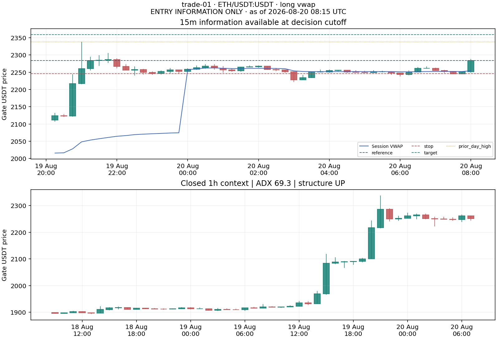

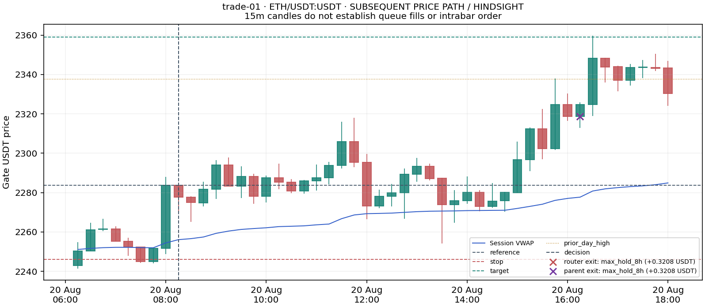

## trade-02: DOGE/USDT:USDT | 2026-08-22T17:45:00+00:00 UTC | long vwap | NATIVE_FILLED

Meaningful losing continuation: price passed the known prior-day high, failed to reach distant 2R, and stopped. Target/management hypotheses are justified; selling at the hindsight high is not.

Entry reference 0.09349; stop 0.091702091; target 0.097065817; hourly ADX 25.72, structure UP. Router net -0.491691; matched parent net -0.491691 USDT; router exit stop_loss.

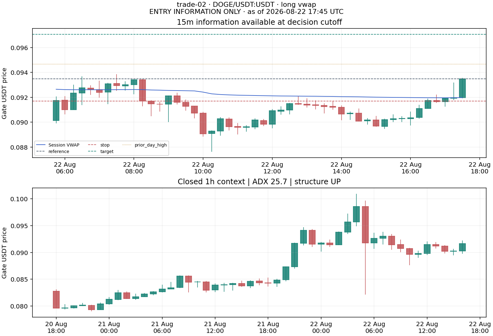

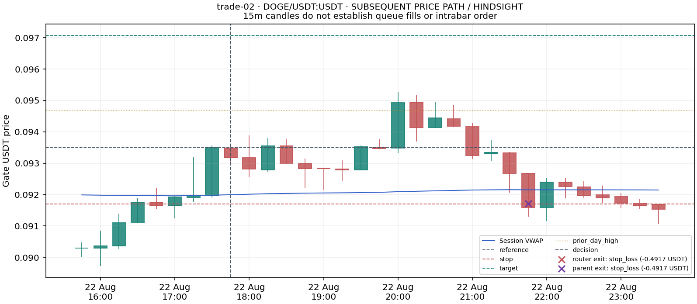

## trade-03: DOGE/USDT:USDT | 2026-08-22T18:15:00+00:00 UTC | short sweep | PLAN_UNFILLED_NO_PNL

Opposite sweep plan appears 30 minutes after the DOGE long while it is open. It did not fill. This is setup churn to investigate, not an actual opposing position or a missed profit.

Entry reference 0.09281; stop 0.094086095; target 0.09025781; hourly ADX 24.31, structure UP. Router net —; matched parent net — USDT; router exit none.

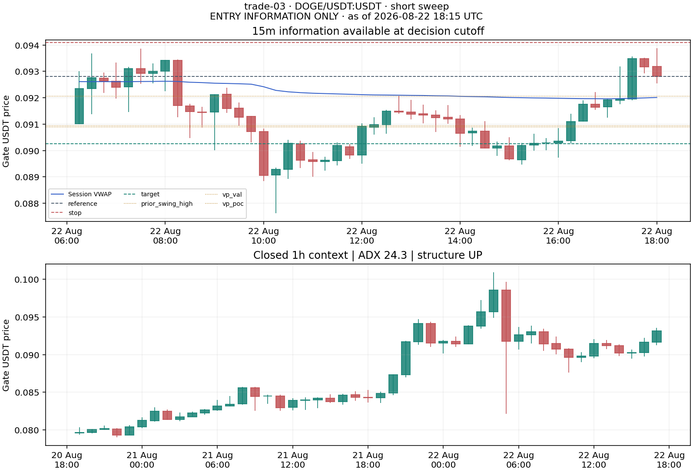

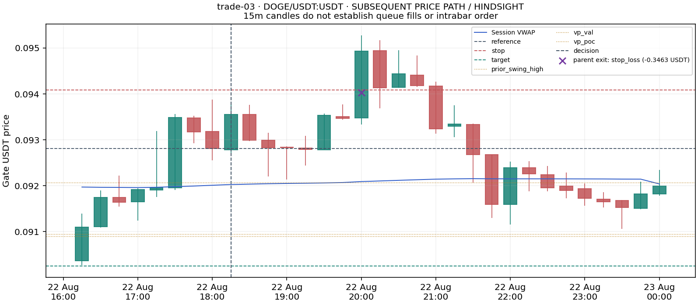

## trade-04: SOL/USDT:USDT | 2026-08-23T01:00:00+00:00 UTC | short sweep | NATIVE_FILLED

Winning short reversal against hourly UP structure. A countertrend label alone does not invalidate reversal logic. Parent and router geometry differ slightly.

Entry reference 96.32; stop 97.368888; target 94.222224; hourly ADX 18.52, structure UP. Router net +0.397135; matched parent net +0.405140 USDT; router exit roi.

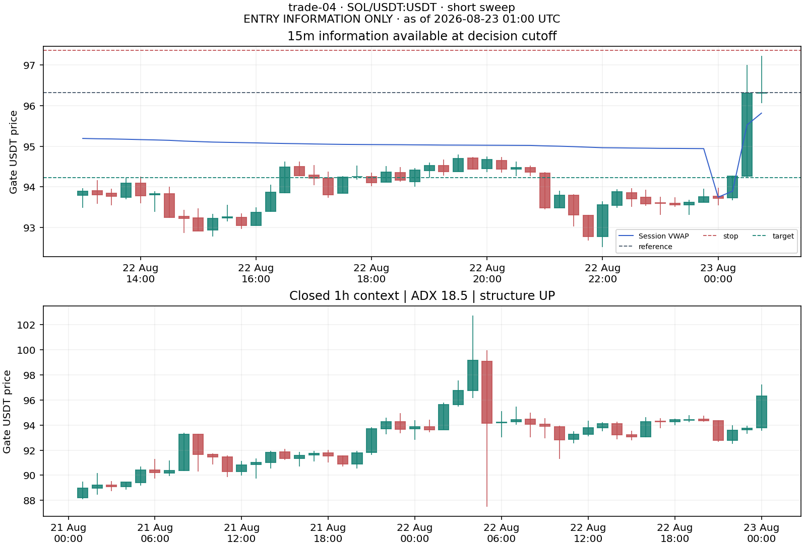

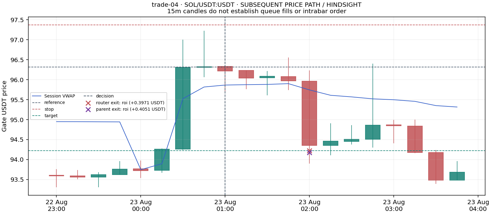

## trade-05: SOL/USDT:USDT | 2026-08-25T01:00:00+00:00 UTC | short sweep | NATIVE_FILLED

Negative example for the proposed repair: the original early thesis exit preserved more profit than the parent/new hold. Removing the rule harms this one trade, even though it helps the aggregate.

Entry reference 101.71; stop 102.94811; target 99.233784; hourly ADX 24.41, structure UP. Router net +0.231743; matched parent net +0.059640 USDT; router exit closed_hour_thesis_invalidated.

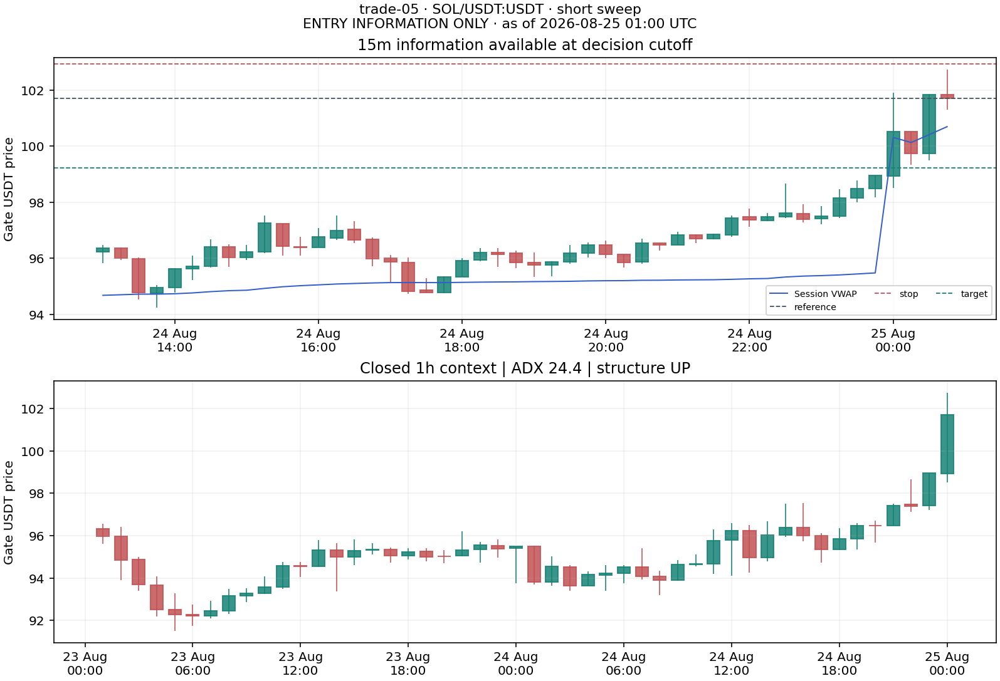

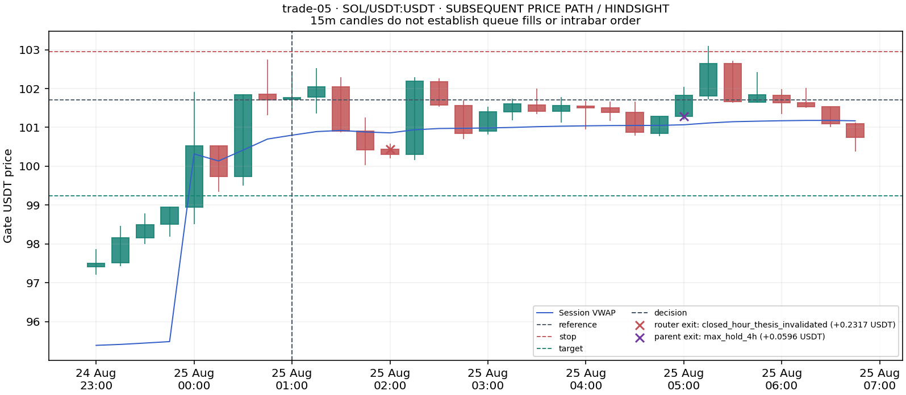

## trade-06: XRP/USDT:USDT | 2026-08-25T14:00:00+00:00 UTC | long sweep | NATIVE_FILLED

Winning reversal long against hourly DOWN structure. The old partial reduces its winner, and its M1 funding lies outside source bounds. Neither the partial policy nor hourly alignment can be declared superior.

Entry reference 1.4568; stop 1.4404543; target 1.4894914; hourly ADX 14.83, structure DOWN. Router net +0.287639; matched parent net +0.287639 USDT; router exit max_hold_4h.

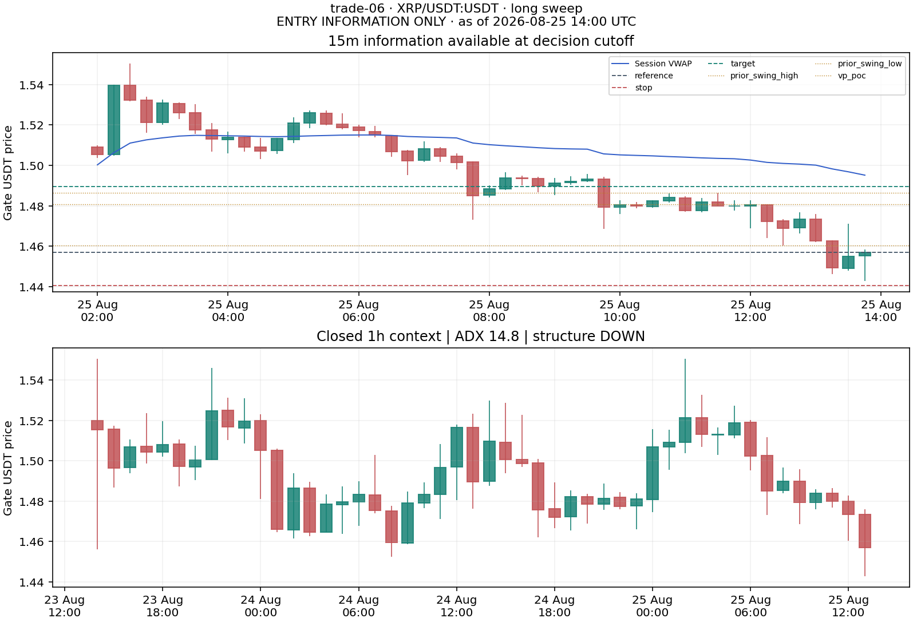

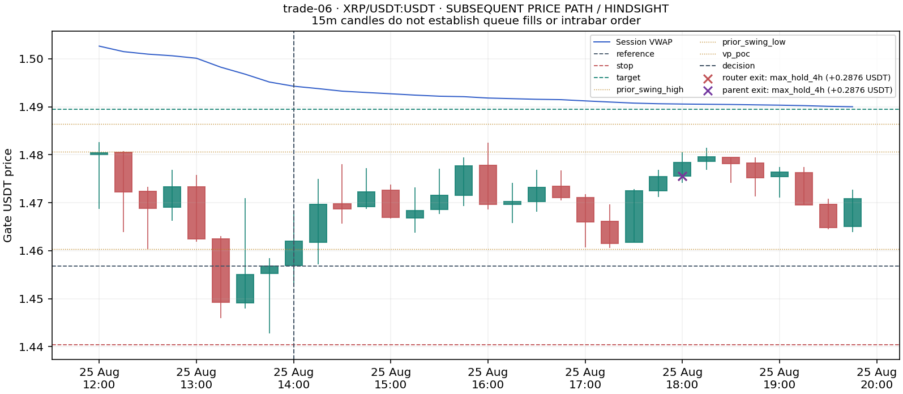

## trade-07: ETH/USDT:USDT | 2026-09-11T14:15:00+00:00 UTC | short sweep | NATIVE_FILLED

Premature-exit example: entry already opposes hourly UP structure with ADX below 25. Strengthening ADX can trigger an exit without breaching the frozen signal-bar risk level. Native exit ablation recovers the later parent result.

Entry reference 2611.4; stop 2671.6322; target 2490.9356; hourly ADX 22.33, structure UP. Router net +0.014753; matched parent net +0.632856 USDT; router exit closed_hour_thesis_invalidated.

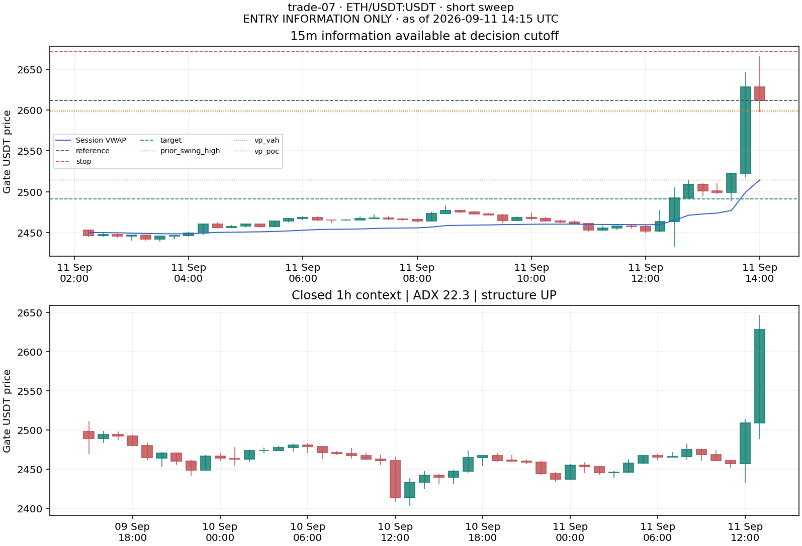

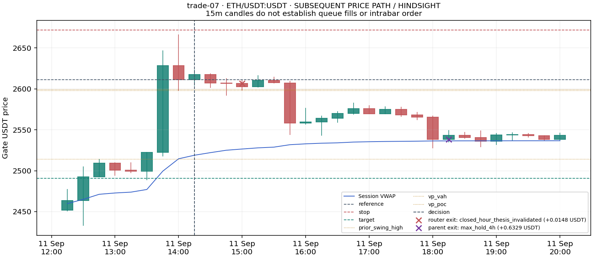

## trade-08: XRP/USDT:USDT | 2026-09-15T15:00:00+00:00 UTC | long sweep | NATIVE_FILLED

Meaningful losing reversal: complete pre-exit bars show about 2.088% favorable excursion before basic M0 stops. The old M1 saves profit here and dominates the entire M1 advantage. Exact intrabar/queue execution remains unknown.

Entry reference 1.3841; stop 1.3692893; target 1.4137214; hourly ADX 20.93, structure DOWN. Router net -0.297863; matched parent net -0.285270 USDT; router exit stop_loss.

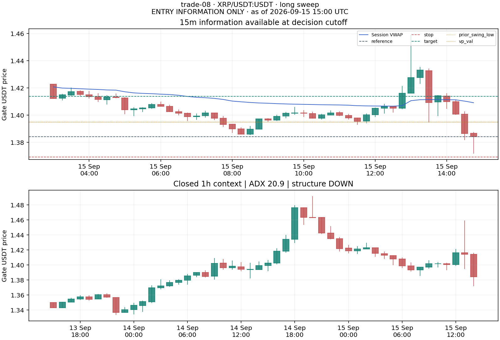

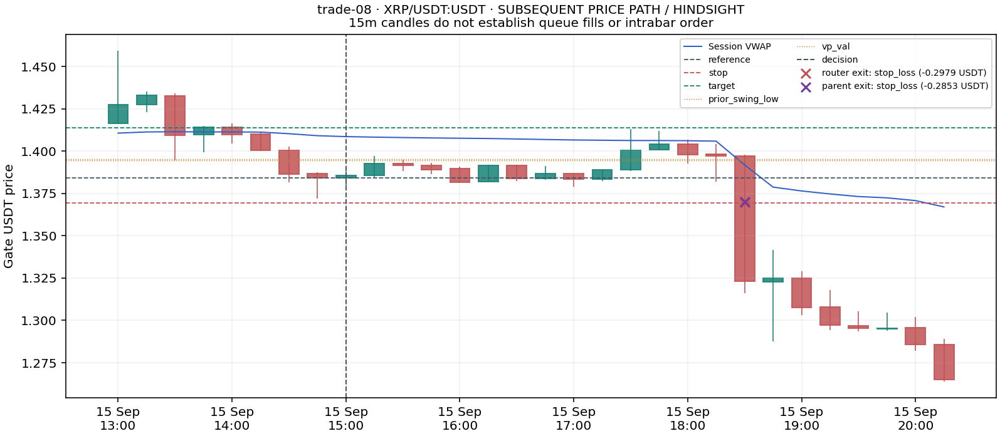

## trade-09: XRP/USDT:USDT | 2026-09-22T08:45:00+00:00 UTC | long vwap | NATIVE_FILLED

Strong winning VWAP long with a known prior-day high before 2R. An indiscriminate obstacle veto discards this winner, illustrating the cost of the conservative target experiment.

Entry reference 1.5358; stop 1.5118653; target 1.5836695; hourly ADX 40.90, structure UP. Router net +0.736453; matched parent net +0.766835 USDT; router exit roi.

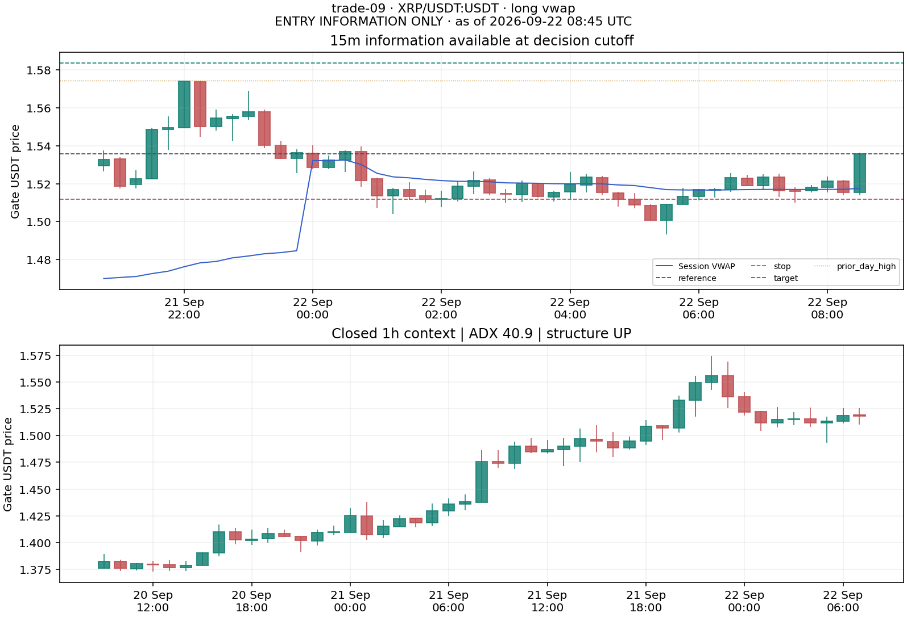

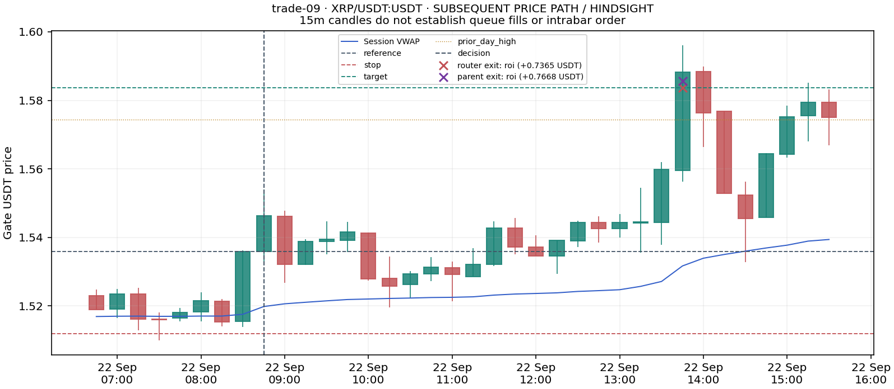

## trade-10: XRP/USDT:USDT | 2026-10-02T12:45:00+00:00 UTC | short sweep | NATIVE_FILLED

Short reversal near the ADX routing boundary. The router exits at a small loss while the identical parent entry later profits. The new exit only removes this regime condition; it does not predict the future path.

Entry reference 1.537; stop 1.5565724; target 1.4978553; hourly ADX 24.90, structure UP. Router net -0.109558; matched parent net +0.510822 USDT; router exit closed_hour_thesis_invalidated.

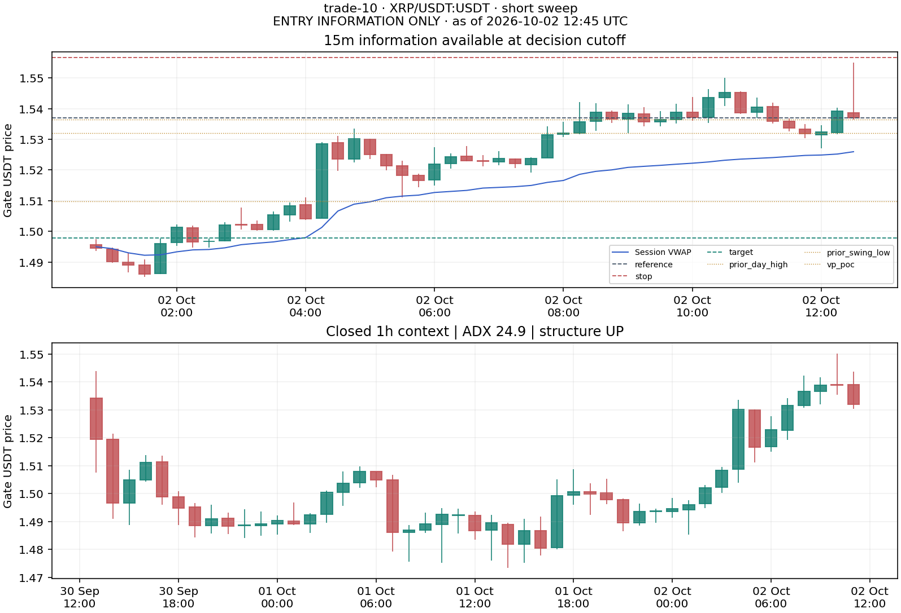

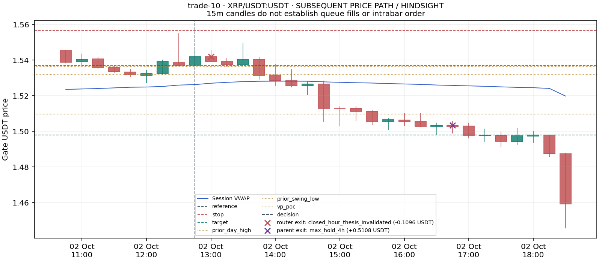

## rejected-01: XRP/USDT:USDT | 2026-08-11T15:45:00+00:00 | CHEAP_SCREEN_OR_RANK

Actual rejected short vwap opportunity. Frozen-parent same-clock net -0.224024 USDT. Positive controls illustrate missed opportunities; negative controls illustrate avoided losses. This is parent management, not a hypothetical router fill.

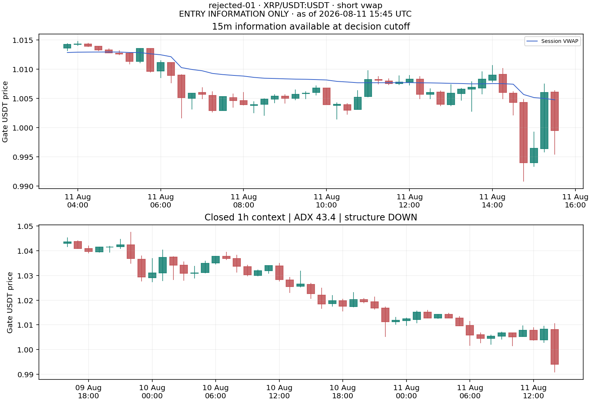

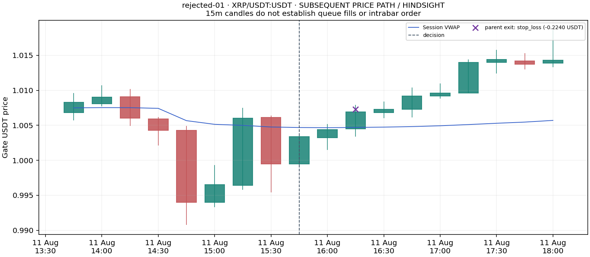

## rejected-02: XRP/USDT:USDT | 2026-08-30T18:45:00+00:00 | CHEAP_SCREEN_OR_RANK

Actual rejected short sweep opportunity. Frozen-parent same-clock net +0.295821 USDT. Positive controls illustrate missed opportunities; negative controls illustrate avoided losses. This is parent management, not a hypothetical router fill.

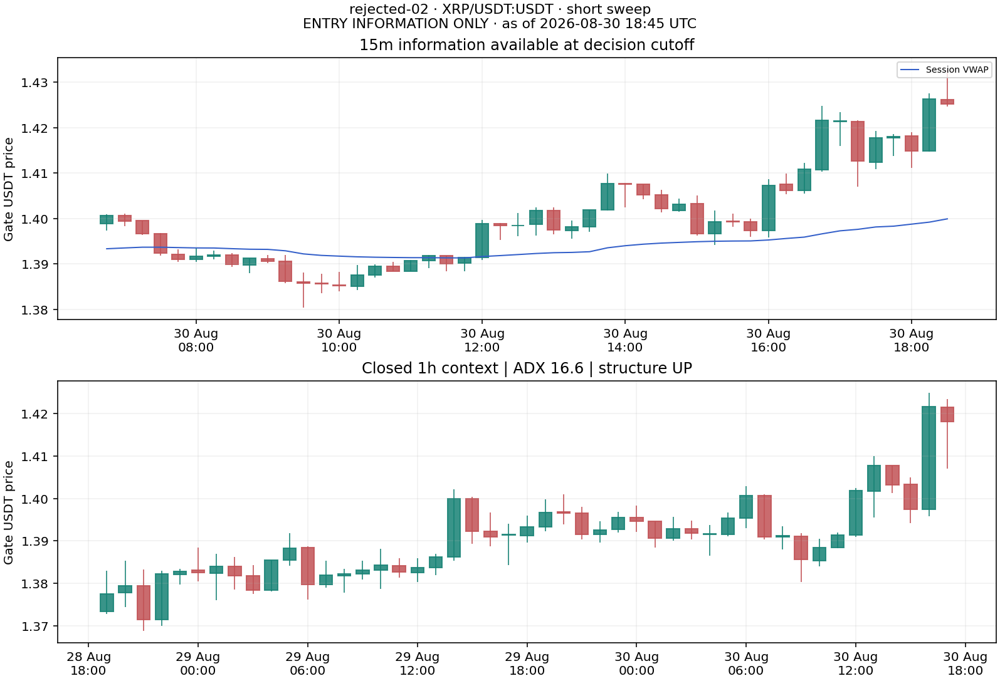

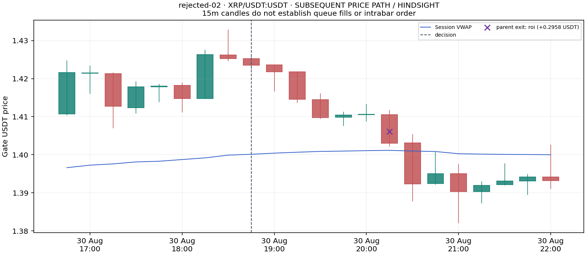

## rejected-03: SOL/USDT:USDT | 2026-08-08T04:15:00+00:00 | TARGET_ROOM_OR_COST

Actual rejected short sweep opportunity. Frozen-parent same-clock net -0.054988 USDT. Positive controls illustrate missed opportunities; negative controls illustrate avoided losses. This is parent management, not a hypothetical router fill.

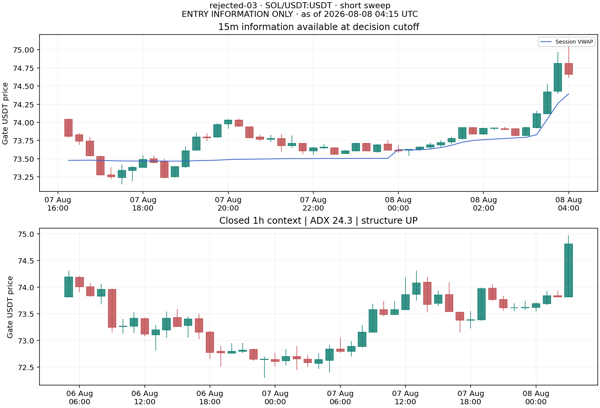

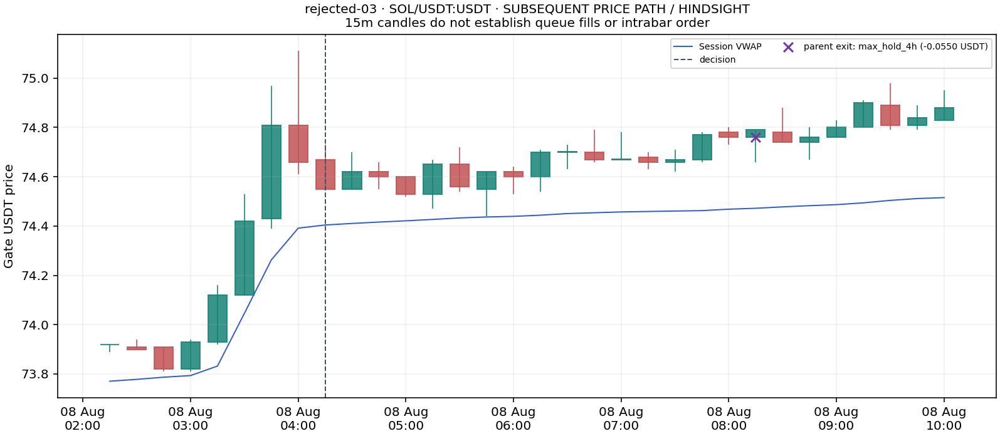

## rejected-04: ETH/USDT:USDT | 2026-08-07T12:45:00+00:00 | TARGET_ROOM_OR_COST

Actual rejected short sweep opportunity. Frozen-parent same-clock net +0.131726 USDT. Positive controls illustrate missed opportunities; negative controls illustrate avoided losses. This is parent management, not a hypothetical router fill.

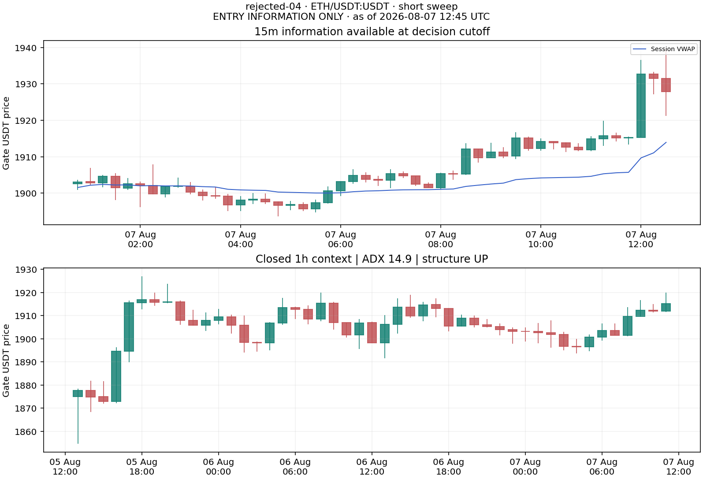

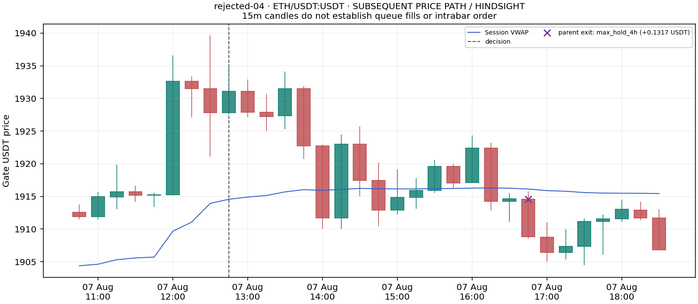
