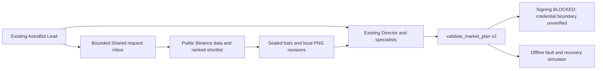

# Five-agent add-on workflow v2 — NO MERGE / DEMO ONLY

This extends the recovered current-market integration. The historical recovery protocol,
Freqtrade strategy results, original six profiles and installed skills stay independent.
The new tools do not edit OpenBot databases, change models/access, or invoke synthetic C06 plans.



## Owner operation

Use the dedicated checkout, with Docker and the existing Matplotlib cache. Run:

```bash
bash scripts/lab-five-agent.sh ../research-run-UNIQUE \
  "$HOME/OpenBot-Trading-Lab-local-recovery/user_data/data/local_recovery/mpl" \
  /mnt/c/Users/OWNER/OpenBot/Shared
```

Replace `OWNER` with the discovered Windows account directory. This is a public
research operation: no credentials, signed account reads, orders or setting changes.
The launcher fails on errors and never substitutes fixtures. Raw HTTPS responses,
source hashes, clock checks, complete/rejected symbol ledger, four sealed legacy packets, eight legacy PNGs, and sixteen clean default
PNGs stay in the chosen run directory. `index.json` identifies the exact packets.
The 24-symbol context screen first filters all exchange-listed instruments by status,
spread, liquidity and the 25 USDT cap. Ranking considers structural location, six-hour
regime, participation and upcoming funding, with reasons and component values.
Four packets are candidates for review, not four qualified trades. The inherited
strategy's NO_OPPORTUNITY is not a veto on an evidence-backed alternative from the team.

The public research venue is production **market data only**. Demo quotes, filters,
account and fills are separate. No research packet establishes Demo readiness.
All times are UTC. Closed data at a cutoff and the later HTTP receipt time are both
retained. News is NOT_FETCHED; taker-buy kline ratios are a participation proxy,
not trade-print CVD, footprint or volume profile. Extra 1h history supports 4h/daily
context and requested 150-candle views; 5m and 15m use the latest 72 hours.

## Chart requests and native handoff

The existing candle primitives are reused. A revision has one readable price panel,
optional aligned base-volume panel, UTC ticks, source identity and exact visible count.
Four uncluttered default views per candidate show 4h/120, 1h/150, 15m/144 and 5m/72 completed candles with aligned volume. They live outside the original sealed packet. The original renderer/output remains available. A request example:

```json
{
  "request_id": "vision-context", "candidate_id": "COPY_FROM_INDEX",
  "symbol": "XRPUSDT", "venue": "BINANCE_PUBLIC_USDM", "cutoff_ms": 0,
  "timeframe": "1h", "visible_candles": 150, "overlays": [],
  "volume": true, "purpose": "Identify structural invalidation and conflicting timeframes",
  "revision": 1
}
```

Copy the **actual** cutoff and candidate from the sealed packet. Render in the same
offline runtime with `python -m trading_lab.workflow chart PACKET REQUEST_JSON REVISION_DIRECTORY`.
The native Chart-Vision Analyst can request 4h, 1h, 15m, 5m and captured 1m bars;
uncaptured 1m returns CHART_FEED_NOT_CAPTURED. Each chart shows 20–200 candles.
Overlays are `vwap`, `ema20`, `ema50`, `confirmed_swings`, maximum three.
`start_ms`/`end_ms` bound a UTC range; `focus_zone: [low, high]` explicitly records
candle cropping. No paths, URLs, arbitrary indicator code or future cutoff are accepted.
Revision numbers must be consecutive, up to four per request and twelve rendered charts / 24 MiB per candidate. Changed content under
an existing revision ID is rejected. Indicators use prior bars for warm-up; UTC-day
VWAP is rejected when the requested display includes a truncated session.
Confirmed pivots need two later completed bars and record when each became knowable.

Use the **existing Lead conversation** and native send/transfer tools for the five-agent
review. Attach actual PNGs, retain native image/attachment and message IDs, and request
two meaningfully different Vision revisions with concise changed observations. Preserve
Researcher thesis, Risk objections, rebuttal and Director reconciliation verbatim locally.
File replies and process status are not native message receipts or evidence of pixel access.
Absent native transport is `PENDING_OPENBOT_OWNER_RUN`, never substituted agents.

## Bounded Shared worker

`python -m trading_lab.workflow serve OPENBOT_SHARED/TradingLab-Workflow-v2 --max-seconds 300`
is the explicit foreground start command. `bash scripts/lab-shared-worker.sh EXISTING_MATPLOTLIB_CACHE OPENBOT_SHARED 300` provides the bounded Docker wrapper. The runtime needs pandas and the existing
Matplotlib cache. Run it as an unsigned public-data process, with no credentials mounted.
The worker stops after the time budget, Ctrl+C, or the presence of `control/STOP`.
For a deliberate restart remove only that STOP file and run the start command again.
No boot service is installed. Native automation requires the owner to enable a supported
OpenBot Local scripts listener; this add-on does not change that setting.

Write request JSON to a temporary filename and atomically rename it to
`requests/REQUEST_ID.json`. Its exact envelope is:

```json
{"schema":"openbot.shared.request.v2","request_id":"unique-request","kind":"READINESS",
 "created_at_ms":0,"expires_at_ms":1,"payload":{}}
```

Use current UTC milliseconds, TTL at most ten minutes. Max file size 64 KiB.
Allowed operations: SCAN (`universe` 24–40, `shortlist` 3–6), CHART
(`run_id`, `candidate_id`, `chart` request), GATE (`run_id`, `candidate_id`, optional
`proposal` and `native_receipts`), READINESS (empty payload). No shell or signed API.
The worker serializes writers, preserves interrupted captures, deduplicates exact
request bytes across restart, and rejects ID reuse. Results appear atomically in
`replies/REQUEST_ID.json`. Missing replies are a transport failure, not agent consent.
The worker can fetch public data; chart revisions operate offline on sealed bars.

On Windows, use native Python to run `scripts/lab-shared-worker-windows.py --checkout-wsl CHECKOUT_WSL --cache-wsl CACHE_WSL --shared WINDOWS_SHARED --max-seconds 300`. It converts the Shared path through wslpath and passes argument arrays without changing PowerShell policies.

## Deterministic gate

`python -m trading_lab.workflow gate PACKET [--proposal FILE] [--account FILE] [--receipts FILE]`
uses explicit MARKET/LIMIT/CONDITIONAL/NO_OPPORTUNITY decisions. No proposal returns
SKIPPED_NO_PROPOSAL. A trade needs packet hash, symbol/side, decimal entry/stop/tp1/tp2,
quantity, 10–25x leverage, expiry, ISOLATED margin, BOTH position side, MARK_PRICE stop,
DEMO_READ_ONLY engine, max 15-hour hold, structural invalidation source hash/time/reason,
an `anchor_price` independently matched to the cited closed bar low/high, and sized close-only exits. A conditional trigger must name a completed 5m price check,
expiry and `order_after_confirmation: true`; resting orders before confirmation are invalid.

`--account` accepts **research inputs only** from an independently verified isolated
executor: fresh authenticated Demo state, equivalent filters, quote/mark, configured
mode/leverage, matching bracket, fees/funding stress, reserved funds, existing exposures,
daily/correlated risk budgets, equity and native receipts. Missing evidence remains
UNKNOWN. Decimal math checks ticks, steps, min/max sizes, 25 USDT notional, two slots,
cost-adjusted reward/risk, liquidation clearance and wallet risk. Metrics report USDT
loss/P&L and return on both notional and margin. A numerical PASS never authorizes an order.
JSON fields are not proof of authentication or OS isolation; no execution consumer trusts
them. The agent inbox deliberately cannot supply account state.

## Signing, recovery and remaining execution work

`python -m trading_lab.workflow readiness` always reports
EXECUTION_BLOCKED_CREDENTIAL_BOUNDARY. The inherited owner-terminal signed reader is
also blocked. A separate terminal and chmod 600 on the same WSL user are insufficient.
No command/flag/JSON file here arms live Demo signing. Do not move credentials into Shared.
No leverage, margin, production, deposit or withdrawal API is provided.

Current authoritative references, checked for this implementation:

- [Binance USD-M general info and Demo host](https://developers.binance.com/en/docs/products/derivatives-trading-usds-futures/general-info)
- [USD-M trade API, conditional algo create/query and open algo orders](https://developers.binance.com/en/docs/catalog/core-trading-derivatives-trading-usd-s-m-futures/api/rest-api/trade)
- [Official modular Python connector](https://github.com/binance/binance-connector-python/tree/master/clients/derivatives_trading_usds_futures)

The maintained modular SDK exposes new_algo_order; the old futures connector is deprecated.
It must be configured and independently verified within the future isolated service;
its default production host must never be used for signing. Conditional TP/SL uses
`/fapi/v1/algoOrder`, queried separately from ordinary orders, not `/papi/` routes.
Documentation support does not prove authenticated Demo route availability.

`OfflineManager` is a **simulator-only** persistent SQLite recovery harness. It records
submit intent before a simulated call, reconciles ambiguous acknowledgments without
repeating entry, confirms queried stop fields, protects partial fills, cancels pending
exposure, and uses an explicitly preapproved close-only emergency policy. The stop-new
control permits protective/close-only management. IDs begin SIMULATED and cannot be
reported as Binance IDs. Tests cover restart, stop rejection/disappearance/mismatch,
partial fill, unknown submit/close, expiry, no reply and kill switch.

Still required before a real Demo lifecycle: OS/service credential isolation (including
Windows access to WSL), official SDK integration and account verification, separately
approved concrete order/settings, authenticated algo protection/query, on-exchange TP,
fill-aware fees/funding, user stream/REST monitor, staleness alerts and crash-safe close
reconciliation against the exchange. The offline harness does not establish these.

## Rollback and review

Stop the foreground worker. Archive only the new TradingLab-Workflow-v2 add-on directory
and retain the dedicated checkout/evidence. No original app/profile/skill restore is
needed for these additive files. Private backups may only be restored to scratch for
verification; do not restore into running OpenBot. Do not merge, auto-start signing or
activate a persistent service as part of this draft PR.
